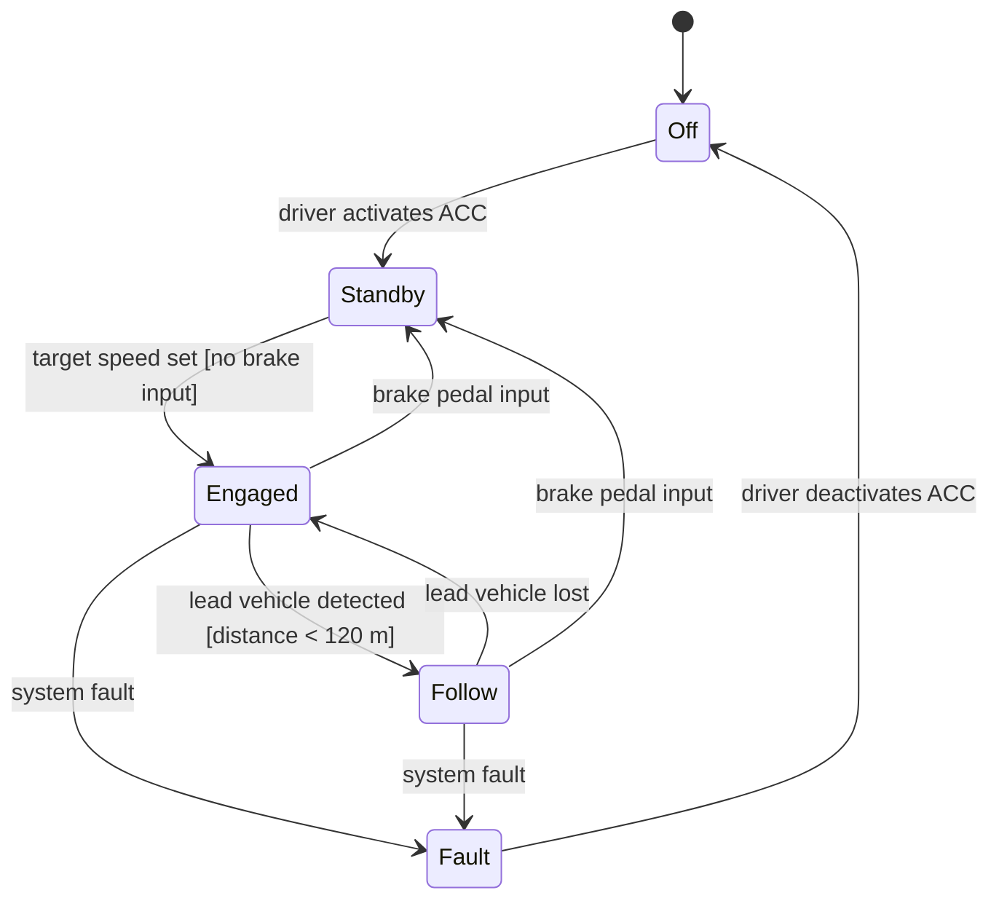

# Examples — Requirements Translation

> **Provenance:** Examples 1–2 condense worked examples from the AI4RE Prompt Guide
> `[AI4RE]`. Examples 3–5 are new, following the same method `[AI4RE-adapted]`. New model
> examples use Mermaid/PlantUML textual notation, per this repository's preference for
> markdown-renderable, importable model code `[Supplementary: Mermaid, PlantUML]`.

## 1. Insurance — requirements → UML sequence diagram `[AI4RE]`

**Use case:** Generate Model From Text.
**Input:** functional requirements document for an *Insurance Broker Portal* (registration/
MFA, customer portfolio, quotation, policy lifecycle, commissions, notifications,
documents, reporting, support, integrations, security/GDPR).

**Configuration:** modeling language UML · diagram type sequence diagram.

**Output shape (abridged):**
- *Grouping of requirements:* 12 candidate interaction scopes (G1 Registration/Login/MFA …
  G12 Security & Compliance), each with a one-sentence rationale; user asked which group to
  start with; recommendation given (G4 Quotation to Offer or G1 as foundational flow).
- After the user picks **G1**: *Diagram elements* table (Broker actor, Broker Portal UI
  boundary, Auth/RBAC/MFA controls, User Directory database, Email/SMS gateway, Audit
  Trail — each with UML type, purpose, mapped requirement).
- *Model Representation:* importable PlantUML sequence diagram (`@startuml … @enduml`)
  covering registration with optional verification, login with alt/opt fragments for
  invalid credentials and MFA on/off, and password reset — with guards like `[MFA enabled]`.
- *Validation Note:* assumptions listed (MFA policy optional per user, email verification
  added as common safeguard, single directory vs. external IdP, lockout rules unspecified);
  *Recommendation:* three policy decisions to validate with stakeholders before regenerating.

**Why it is good:** interactive group selection before modeling; element table maps every
lifeline to a requirement (traceability); cross-cutting concerns (audit, encryption)
modeled as notes instead of invented flows; assumptions flagged inline and at the end.

## 2. Aviation — interview transcript → persona `[AI4RE]`

**Use case:** Generate Persona.
**Input:** interview transcript with an Aeronautical Information Services (AIS) Officer.
**Configuration:** role = AIS Officer · image = yes.

**Output (abridged):** *Daniel Weber, 38, AIS Officer* — main goals (timely, accurate
aeronautical information; aviation safety), day-to-day challenges (high-pressure
priorities, conflicting/incomplete information, error consequences, coordination),
technology affinity (digital task management, simulation training, open to AI), values
(teamwork, continuous learning, confidentiality), expectations towards the system
(reliable communication channels, prioritization support, error-prevention tools, current
regulatory information). Closing note: *"Hypotheses are not included, as all points are
directly supported by the interview transcript."* Plus a portrait description of the
persona in a modern control-room environment.

**Why it is good:** exactly one persona, under 200 words, all eight structure fields; every
trait grounded in the transcript; the hypothesis-labeling rule is applied visibly (here:
none needed) — the reader knows nothing was invented.

## 3. Automotive / embedded — requirements → Mermaid state diagram `[AI4RE-adapted]`

**Use case:** Generate Model From Text. Notation: Mermaid `[Supplementary: Mermaid]` —
renders directly in markdown toolchains, no modeling tool required.

**Input (excerpt):** "When the driver activates adaptive cruise control (ACC), the system
shall enter Standby. From Standby, ACC shall engage when the driver sets a target speed and
no brake input is present. While engaged, ACC shall switch to Follow mode when a lead
vehicle is detected within 120 m. ACC shall disengage immediately on brake pedal input or
system fault."

**Output (abridged):**
- *Grouping:* one group — all statements describe the mode logic of a single controller.
- *Diagram elements* table: states Off, Standby, Engaged, Follow, Fault; transitions with
  guards (`brake input`, `lead vehicle < 120 m`), each mapped to its source sentence.
- *Model Representation:*

- *Validation Note:* `Assumption:` Follow→Engaged on lead-vehicle loss is inferred (source
  is silent on leaving Follow). `Gap:` behavior on fault recovery and on ACC deactivation
  from Standby is unspecified. Safety review (ISO 26262 context) recommended.

**Why it is good:** guards carried verbatim; the one transition the text does not state is
marked as an assumption instead of silently modeled.

## 4. Medical device — spec → plain language for nursing staff `[AI4RE-adapted]`

**Use case:** Explain Requirements in Simple Language (translate variant).
**Input (excerpt):** "REQ-17: The infusion pump shall trigger a high-priority alarm per
IEC 60601-1-8 within 2 s of occlusion detection. REQ-23: Bolus administration shall require
re-authentication of a user holding the 'clinician' role."

**Stakeholder group:** nursing staff (end users).

**Output (abridged):**
- The pump raises a loud, high-priority alarm within 2 seconds if the line is blocked
  (occlusion). *What this means for you:* you are alerted almost immediately when the
  medication stops flowing, so you can act before the patient is affected.
- Giving an extra dose (bolus) **requires** logging in again with a clinician account —
  this is mandatory, not optional. *What this means for you:* you must re-enter your
  credentials for every bolus; staff without the clinician role cannot administer one.

**Self-review:** "occlusion" and "bolus" explained, not deleted; "shall … require" kept as
a hard obligation (not "you can log in again"); the IEC 60601-1-8 alarm-priority nuance
kept as "high-priority"; no reassuring fluff softening a safety requirement.

## 5. Cloud / microservices — source code → requirements `[AI4RE-adapted]`

**Use case:** Generate Requirements From Source Code.
**Input:** a payment microservice — REST controller, retry/timeout configuration, and an
outbox-pattern publisher (no other services provided).

**Output (abridged):**
- *Introduction:* scope = payment service only; callers, downstream ledger service and
  deployment topology not visible — inferences limited accordingly.
- *Functional Requirements:* FR-1 The system shall authorize a payment for a given order
  and amount and reject amounts ≤ 0 (validation branch). FR-2 The system shall persist
  every payment event and publish it exactly once to the event bus (outbox table + relay).
  FR-3 The system shall expose payment status per order ID.
- *Non-Functional Requirements (ISO/IEC 25010:2023):* Reliability · Fault tolerance —
  calls to the card gateway retry up to 3 times with exponential backoff and a 2 s timeout
  (resilience config). Security · Authenticity — endpoints require a bearer token
  (`@PreAuthorize`); `Assumption:` token issuance handled by an external IdP. Performance
  Efficiency · Time behaviour — no evidence in code; **gap stated, not invented**.
- *Glossary:* outbox pattern, authorization vs. capture.
- *Traceability Note:* FR-1 ← `PaymentController.authorize()` + `PaymentValidator`;
  FR-2 ← `OutboxRelay`; NFR-Reliability ← `resilience4j` config.

**Why it is good:** helper classes (mappers, DTO converters) were not promoted to
requirements; every requirement cites its code source; missing NFR evidence is reported as
a gap; scope limits of the single-service view are stated up front.
