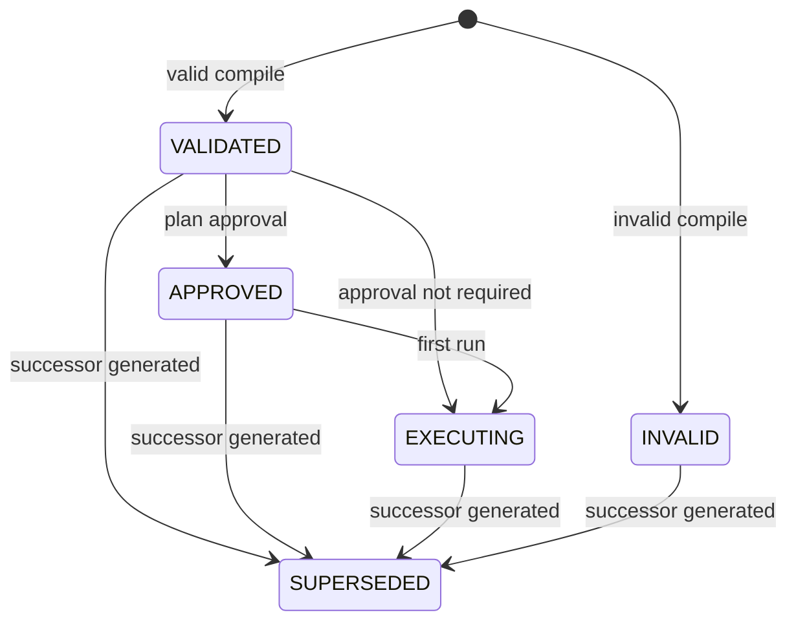

# ADR 0005: Regenerate plans as versioned successor snapshots

- Status: **Accepted**
- Date: 2026-09-11
- Scope: execution-plan lifecycle, approval safety, and historical runs

## Context

An ADLC Blueprint can change after a plan has been validated, approved, or used to create a run. Replacing that plan
in place would destroy the evidence describing what a user reviewed and what a historical run executed. Leaving every
old plan runnable would create a different risk: a caller could start new work from an accepted but stale snapshot.

The current implementation is process-local, but its public lifecycle must be stable before plan persistence moves to
a database.

## Decision

1. Plans form an owner-scoped, workflow-scoped, monotonically versioned lineage.
2. Generating a plan when a prior latest plan exists creates a new snapshot. It never rewrites the prior plan's tasks,
   resolved node specs, digests, approval provenance, or source workflow snapshot.
3. The successor stores `supersedes_plan_id`; the predecessor changes lifecycle status to `SUPERSEDED`.
4. A successor starts as the compiler's `VALIDATED` or `INVALID` result. Approval is never copied from its predecessor.
5. A superseded plan remains readable but cannot be revalidated, approved, or used to create a new run.
6. Runs already created from a predecessor remain usable. Replaying the same plan-to-run idempotency key returns the
   existing run; a new key is rejected after supersession.
7. Explicit regeneration accepts an idempotency key. Repeating the same owner, predecessor, and key returns the same
   successor. A different request against that now-stale predecessor returns `PLAN_STATE_CONFLICT`.
8. A structural parse failure creates no successor and leaves the predecessor current. A successfully parsed plan
   that compiles as `INVALID` is still a new version and supersedes its predecessor, preventing execution of a stale
   accepted plan after the saved Blueprint changed.

The lifecycle projection is therefore:

`SUPERSEDED` describes whether a plan may start future runs; it does not cancel or alter a `WorkflowRun` already
created from that plan.

## Consequences

### Benefits

- Every run retains an exact link to the plan version that created it.
- Editing a Blueprint cannot silently change an approved snapshot.
- Approval applies to one exact version and cannot leak into regenerated work.
- Request retries do not create duplicate successor plans.
- The same lifecycle can be moved behind a database repository without changing the API or scheduler.

### Costs

- Plan history grows append-only and needs a retention policy later.
- Only one plan is current for an owner and workflow; stale clients must refresh after a conflict.
- Status is a lifecycle projection that changes even though semantic plan contents remain immutable.
- The process-local implementation loses plans and idempotency records on restart and is not safe across workers.

## Alternatives considered

### Update the accepted plan in place

Rejected because historical runs would no longer have reproducible planning evidence.

### Keep old plans accepted and runnable

Rejected because it makes accidental execution of stale approved configuration too easy.

### Copy approval to the successor

Rejected because any changed stage, binding, package, or policy requires a new human decision.

### Cancel historical runs when their plan is superseded

Rejected because plan authoring lifecycle and runtime lifecycle are separate state machines.

## Future persistence constraints

A database-backed implementation must:

- assign `(owner_id, workflow_definition_id, plan_version)` uniquely;
- keep at most one non-superseded latest plan per owner and workflow;
- store the predecessor relationship and immutable semantic snapshot;
- enforce `(owner_id, supersedes_plan_id, idempotency_key)` uniqueness;
- lock or compare-and-swap the current lineage head while regenerating; and
- retain run-to-plan foreign keys without cascading deletion from plan history.

The compiler, scheduler, run state machine, and frontend contract must not depend on which repository supplies these
operations.

## Related decisions

- [ADR 0002](./0002-compile-blueprints-to-execution-plans.md)
- [ADR 0004](./0004-snapshot-resolution-and-legacy-compatibility.md)

