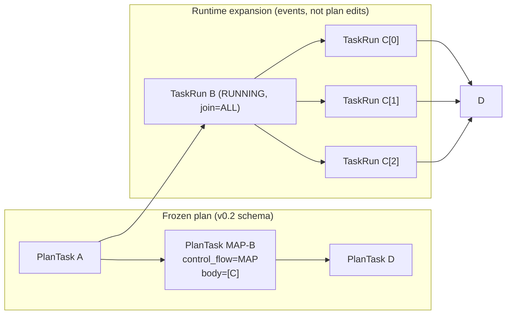
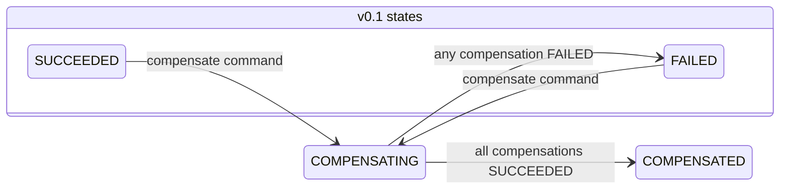

# ADR 0016: Extend the ADLC contract to v0.2 for dynamic fan-out, iteration, sub-workflows, compensation, and durable events

- Status: **Proposed**
- Date: 2026-10-08
- Scope: workflow/execution contract versioning, control-flow task semantics, compensation (saga) actions, and durable event storage
- Unlocks: roadmap items "dynamic fan-out / loop / sub-workflow" and "DLQ compensation/rollback"

## Context

Contract v0.1 is frozen and serves the product well for static DAGs: every run replays a frozen plan, the task
machine is closed, and executors receive immutable v0.1 payloads. Two limitations now block the highest-value
remaining roadmap items:

1. **Static DAGs only.** A plan enumerates every task at compile time. There is no way to express "run this body
   once per item of a collection", "repeat until a condition", or "execute a nested workflow and bind its result".
2. **Failure is terminal, not reversible.** A run that partially completed leaves downstream side effects applied
   with no contract-level way to undo them. The dead-letter view (slice 9) is read-only; the only revival path is
   manual retry of one task.

Additionally, slices 7–9 exposed a durability asymmetry: run *snapshots* are durable, but the ordered `RunEvent`
timeline lives only inside the snapshot JSON. Dynamic expansion and compensation need queryable, append-only
per-transition event rows to be auditable and multi-replica safe.

The contract must remain backward compatible: v0.1 payloads, v0.1 plans, and every existing run must keep working
unchanged.

## Decision

Contract v0.2 is **additive and coexistent**. v0.1 files are never edited. Producers stamp
`schema_version: "0.2"` and `contract_version` on run aggregates that opt in; consumers validate against
`adlc-contracts/v0.2/`. A run records the contract version it was created with, and all v0.2 features are
rejected on v0.1 runs.

### 1. Control flow as data, not as task types

`PlanTask` (and its runtime mirror `AdlcTaskDefinition`) gains one optional, closed object — `control_flow`:

| Shape | Fields | Semantics |
|---|---|---|
| `MAP` | `collection_source`, `item_alias`, `max_fanout` (default 100), `join: ALL \| ANY \| QUORUM(n)`, `failure_policy: FAIL_FAST \| COMPLETE_THEN_FAIL \| SKIP_FAILURES`, `body: [plan_task_id]` | One plan task expands at dispatch into N child `TaskRun`s — one per resolved collection item. |
| `WHILE` | `condition` (strict template expression), `body: [plan_task_id]`, `max_iterations` (default 100) | Each iteration dispatches the body as one child attempt; the loop ends when the condition is false or the budget is spent. |
| `SUBWORKFLOW` | `workflow_ref {workflow_id, version_pin \| LATEST}`, `input_mapping`, `output_binding`, `failure_propagation: PROPAGATE \| CONTINUE` | Dispatch starts a nested `WorkflowRun` as a child; the parent task mirrors the child's terminal state. |

Normative rules:

1. The plan stays **frozen and static**: it contains the control-flow *specification*, never the expanded
   children. Expansion is a runtime fact, recorded as events.
2. Expansion creates ordinary `TaskRun`s wearing three new optional v0.2 fields — `parent_task_run_id`,
   `map_index`, `map_key` — so the **scheduler needs no changes**: children are plain tasks competing for READY
   dispatch, inheriting the parent's executor and constraints. Depth is capped at one level in v0.2
   (no nested control flow inside a body); the validator rejects deeper nesting.
3. The parent MAP/WHILE task remains `RUNNING` while children are open and resolves by the join rule:
   `ALL` → succeeded iff every child succeeded; `ANY` → first terminal child wins; `QUORUM(n)` → n successes.
   `FAIL_FAST` cancels pending children on first child failure; `COMPLETE_THEN_FAIL` lets in-flight children
   finish; `SKIP_FAILURES` resolves the parent `SUCCEEDED` with failed children recorded as events.
4. Child results are addressable to downstream templates and input bindings as
   `{{task.<key>.items.<map_key>...}}` and as an aggregate `{{task.<key>.output.items}}`.
5. `SUBWORKFLOW` dispatch creates a child run owned by the same owner with a
   `subworkflow_of_run_id` back-reference; the parent task maps the child's terminal status
   (`SUCCEEDED` → `SUCCEEDED`, anything else → `FAILED` unless `CONTINUE`).

### 2. Compensation as first-class saga steps

Any task may declare an optional, closed `compensation` object: `{task_type, executor, input_template,
timeout_ms, max_attempts: 1}` — a normal executor dispatch that *undoes* the task's effects.

Normative rules:

1. Compensation executes **only** via the explicit run-level command
   `POST /adlc/runs/{run_id}/compensate` (idempotent, actor-recorded). There is no automatic compensation.
2. Allowed from run states `SUCCEEDED` and `FAILED` only. The run transitions through one new state:
   `SUCCEEDED/FAILED → COMPENSATING → COMPENSATED | FAILED`.
3. `COMPENSATING` dispatches compensation tasks in **reverse topological order** for every task currently
   `SUCCEEDED` that declares a compensation. Each compensation is one child `TaskRun` with
   `purpose: COMPENSATION` and `compensates_task_run_id` (new v0.2 fields).
4. Compensation failure stops the saga: the run terminalizes `FAILED` with a
   `workflow_run.compensation_failed` event naming the failing compensation. No partial reordering.
5. New task states `COMPENSATING` and `COMPENSATED` are added to the task machine; a compensated task is
   terminal for the run's lifetime (retry of a compensated run is forbidden — start a fresh run).
6. Dead letters (slice 9) gain the `compensate` action as a thin wrapper over the run command; `retry`
   stays as-is. `discard` remains out of scope.

### 3. Durable event rows join the persistence boundary

1. v0.2 runs persist **one append-only `adlc_run_event` row per `RunEvent`** in the same database transaction
   as the snapshot write (the slice-7 boundary gains a second write, not a new boundary).
2. The table is keyed by `(run_id, sequence)` unique, ordered, immutable; the run payload keeps embedding the
   timeline for backward-compatible reads. Dynamic expansions, join outcomes, and compensation steps are
   therefore queryable and auditable without replaying snapshots.
3. This is also the prerequisite for multi-replica coordination: the event log becomes the input for the
   Harness attempt-ledger migration already tracked in the architecture "Targeted next" list.

### 4. Versioning and compatibility mechanics

1. `adlc-contracts/v0.2/` ships: `state-machines.json` (superset of v0.1 with `COMPENSATING`/`COMPENSATED`),
   `execution-plan.schema.json` (PlanTask + `control_flow`), and the extended execution-contract bundle
   (`TaskRun`, `ApprovalRequest`, `RunEvent`; new `MapExpansionRecord`,
   `CompensationRecord` payloads).
2. Every v0.2 payload carries `schema_version: "0.2"`; embedded value objects inherit the enclosing version.
3. Compilers, validators, and the run coordinator accept both versions and stamp
   `contract_version` onto `WorkflowRun`. v0.2 control-flow or compensation fields on a v0.1 run are a
   validation error, never a silent downgrade.
4. Unknown fields continue to be rejected — v0.2 extension data goes in `metadata`, as in v0.1.

## Consequences

### Benefits

- Fan-out, iteration, sub-workflows, and rollback become **contract-level concepts** instead of per-product
  hacks, and the scheduler stays unchanged because expansion produces ordinary tasks.
- The saga model gives the dead-letter view a real remediation action while keeping compensation explicit,
  auditable, and human-initiated.
- Append-only event rows close the durability asymmetry and unblock multi-replica work.

### Costs and limitations

- Two contract versions coexist: every consumer must branch on `contract_version` until v0.1 is retired.
- Expansion depth capped at one level in v0.2; nested control flow needs a later version.
- Compensation tasks are declared per task definition; there is no automatic inverse derivation.
- `SUBWORKFLOW` runs count against the same run and approval budgets; deep nesting can multiply trigger-loop
  risk, so `SUBWORKFLOW` is forbidden inside trigger-snapshot definitions in v0.2.

### Rejected alternatives

1. **Dynamic plan mutation** (rewrite the plan at runtime to add children) — destroys the frozen-snapshot
   guarantee that ADR 0005 built approval safety on.
2. **A separate workflow engine for control flow** — splits the source of truth and duplicates the scheduler,
   retries, persistence, and observability seams this project already owns.
3. **Compensation as ordinary plan tasks with `ON_FAILURE` edges** — cannot express reverse order, cannot run
   after `SUCCEEDED`, and conflates business failure handling with rollback.

## Implementation plan (sequenced, each step shippable)

1. Ship `adlc-contracts/v0.2/` schemas + state machine superset + contract tests (no runtime change).
2. MAP/WHILE expansion + join in the run service; scheduler untouched; events for expansion and join outcomes.
3. `SUBWORKFLOW` dispatch + run back-reference.
4. Compensation states + run command + reverse-order saga + dead-letter `compensate` action.
5. `adlc_run_event` durable rows inside the existing persistence boundary; retire snapshot-only event reads.
