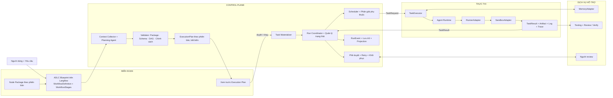

# Kiến trúc hệ thống ADLC

Trạng thái: **KIẾN TRÚC MỤC TIÊU HIỆN TẠI**

Cập nhật lần cuối: 2026-10-17

## Trách nhiệm hệ thống

ADLC tách biệt rõ bốn phần — biên soạn (authoring), lập kế hoạch (planning), điều phối (orchestration) và thực thi (execution) — để người dùng mô tả quy trình phát triển phần mềm ở mức cao trong khi nền tảng phân giải và chạy công việc một cách an toàn, tái lập được.



## Các tầng kiến trúc

| Tầng | Nguồn chân lý | Trách nhiệm |
|---|---|---|
| Biên soạn | `WorkflowDefinition` và tham chiếu package chính xác | Stage vòng đời, mục tiêu, đầu ra kỳ vọng, chính sách mức cao, phụ thuộc. |
| Lập kế hoạch | Phiên bản `ExecutionPlan` bất biến | Phân giải package, sinh nhiệm vụ cụ thể, xác thực DAG / capability / binding, ghi nhận giả định. |
| Điều phối runtime | `WorkflowRun`, `TaskRun`, `ApprovalRequest`, `RunEvent` | Chuyển trạng thái, lịch chạy, retry, phê duyệt, hủy, lưu trữ, projection. |
| Thực thi | `TaskRequest`, hợp đồng lệnh, `TaskResult` | Công việc của agent, lệnh, phiên Sandbox, log, sinh artifact, lỗi có cấu trúc. |
| Dịch vụ hỗ trợ | Bộ nhớ và báo cáo theo adapter | Context từ Memory, bằng chứng Testing/Review, quyết định của con người. |

## Ranh quyền sở hữu

- Người dùng biên soạn blueprint; người dùng **không** tự tay nối các component nội bộ để tạo DAG thực thi.
- Registry sở hữu các phiên bản package bất biến và digest nội dung.
- Planner/compiler sở hữu phân giải package và xác thực `ExecutionPlan`.
- Coordinator sở hữu trạng thái workflow/task/phê duyệt và mutation sự kiện có thứ tự.
- Scheduler sở hữu độ sẵn sàng, phụ thuộc, điều phối song song, điều kiện retry và tính toán kết thúc run.
- `TaskExecutor` là cổng thực thi duy nhất mà scheduler nhìn thấy.
- Runner sở hữu trạng thái thực thi lệnh; lệnh `SUCCESS` không trực tiếp chuyển task sang `SUCCEEDED`.
- Adapter chỉ trả dữ liệu và callback; không tự mutate trạng thái coordinator.
- UI chỉ render trạng thái đã lưu và gọi lệnh; không phải nguồn chân lý runtime.

## Đường đi từ biên soạn đến runtime

```text
Yêu cầu + ngữ cảnh repository
  -> WorkflowDefinition / Blueprint
  -> phân giải package
  -> ExecutionPlan (sinh hoặc biên dịch)
  -> xác thực tất định
  -> phê duyệt kế hoạch (tùy chọn)
  -> materialize nhiệm vụ
  -> WorkflowRun / TaskRun
  -> scheduler điều phối qua TaskExecutor
  -> TaskResult / Artifact / RunEvent
```

## Chiến lược tương thích

ADLC **mở rộng** Langflow thay vì thay thế:

- Tái dùng ReactFlow, lưu trữ flow, xác thực, dịch vụ cơ sở dữ liệu và hạ tầng sự kiện của Langflow.
- Graph component thuần Langflow vẫn chạy qua API thực thi bình thường của Langflow.
- Chế độ ADLC Blueprint dùng marker tường minh ở mức flow và bộ API lập kế hoạch riêng.
- Runtime mock trên saved-flow vẫn là đường tương thích legacy.
- Component Langflow mức thấp có thể cài đặt bên trong một package, nhưng không hiển thị dưới dạng cạnh trên canvas blueprint.

## Bản đồ hợp đồng

| Ranh giới | Tài liệu / hợp đồng |
|---|---|
| Kiến trúc node package | [Kiến trúc node package](./node-package-architecture.md) |
| Vòng đời workflow, task, lệnh | [State machine](./state-machine.md) |
| Hợp đồng thực thi v0.1/v0.2 | `adlc-contracts/README.md` |
| Phiên Harness và giao kết ngoài | `adlc-contracts/harness/v0.1/README.md` |
| Task loop | `adlc-contracts/task-loop/` |
| Hợp đồng tài liệu / thực thi tài liệu | `adlc-contracts/documents/` |
| Quyết định kiến trúc | [ADR](./adr/README.md) |

## Ranh giới triển khai hiện tại

Đã triển khai:

- Hợp đồng trạng thái và wire contract (v0.1 đóng băng; v0.2 bổ sung `control_flow` MAP/WHILE/SUBWORKFLOW, compensation và event payload).
- Bộ lập kế hoạch: parse blueprint, phân giải package, xác thực DAG/slot, biên dịch `ExecutionPlan` tất định, tái sinh kế hoạch theo phiên bản (regeneration/supersession).
- Điều phối runtime: DAG, chạy song song, retry tự động với backoff, phê duyệt 3 loại gate, hủy/tạm dừng, deadline mỗi lần thử, khôi phục sau crash, snapshot SQL.
- Trigger (cron/interval/webhook), metrics cửa sổ trượt + cảnh báo ngưỡng, thông báo vận hành, dead-letter.
- Biểu thức mẫu `{{task...}}` / `{{run...}}` với fail-fast.
- Task loop: spec khóa commit Git, kiểm thử bảo vệ (protected tests), verifier, khôi phục phiên.
- Coding Agent: OpenCode (headless server, worktree Git dùng một lần cho mỗi lần thử) và DeepSeek Harness (plugin hub, callback HMAC, outbox bền vững).
- Hợp đồng (Contract): soạn bởi tool, phê duyệt, thực thi theo chính sách, xác minh chính xác, khôi phục.
- Evidence Plane (kho bằng chứng: patch, log, kết quả kiểm thử, screenshot, metrics) và Resource Manager (cấp phát agent theo capability, least-privilege).
- Adapter thực: PytestTestingAdapter, SQLiteMemoryAdapter, DockerSandboxAdapter, DSH agent/memory adapter.

Chưa có / cần làm tiếp:

- Lưu trữ bền vững cho từng event row và ghi đa-aggregate trong một transaction.
- Lưu trữ telemetry vượt quá cửa sổ metrics trong tiến trình.
- Ranh giới Sandbox container/remote cho thực thi không tin cậy và đa tenant.
- Lưu trữ bền vững diff/artifact của OpenCode độc lập với thời gian giữ của provider.
- Bridge phê duyệt ADLC cho các hành động plugin nhạy cảm.

Mặc định vẫn là mock-only. OpenCode và DeepSeek Harness chỉ khả dụng khi bật tường minh qua biến môi trường. Provider cài đặt sau các cổng ổn định (stable ports), không được nối cứng vào scheduler hay graph blueprint. DeepSeek Harness sở hữu phiên thực thi và plugin; ADLC tiếp tục sở hữu kế hoạch, trạng thái workflow/task, chính sách phê duyệt, retry và việc chấp nhận kết quả cuối.
