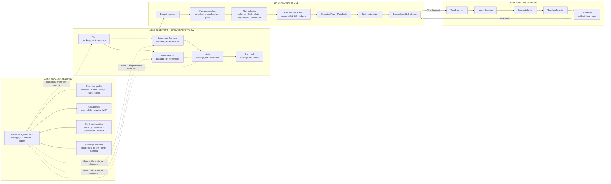
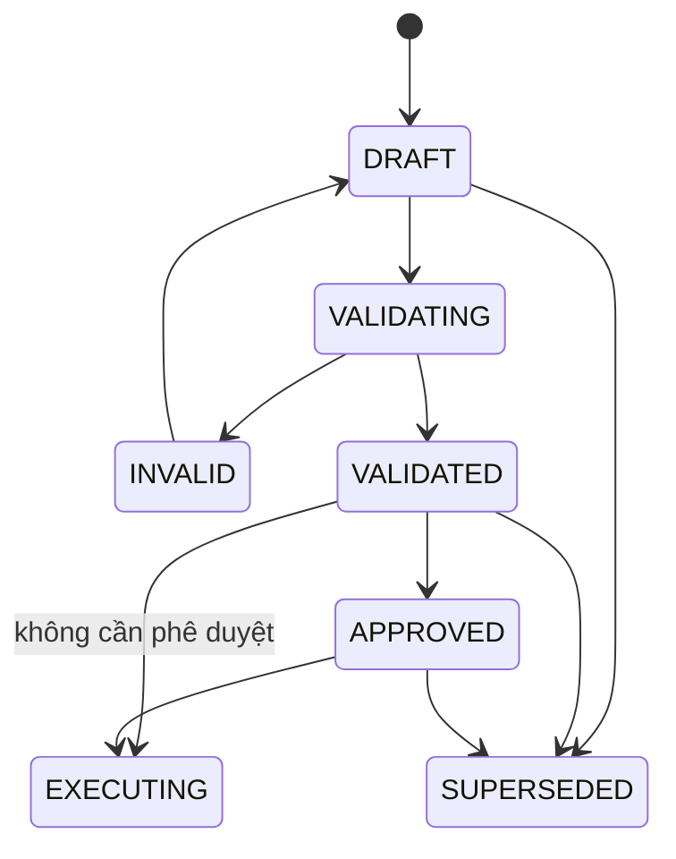

# Kiến trúc node package theo phiên bản của ADLC

Trạng thái: **ĐÃ TRIỂN KHAI** (slice 2 → 10, harness H2–H5D)

Cập nhật lần cuối: 2026-10-17

## Mục đích

Workflow ADLC phải được biên soạn như một graph nhỏ gồm các stage vòng đời có ý nghĩa, không đòi hỏi người dùng tự nối model, system prompt, rules, hooks, tools, skills, plugins, Memory và Sandbox vào từng agent node.

Kiến trúc này đưa một `NodePackageDefinition` theo phiên bản đứng sau mỗi `WorkflowStage` cấp cao. Canvas chỉ chứa các thể hiện stage và cạnh phụ thuộc. Orchestrator phân giải package, xác thực blueprint, tạo ra một `ExecutionPlan` bất biến, rồi materialize kế hoạch đó vào runtime `WorkflowRun` và `TaskRun` hiện có.

Thiết kế giữ Langflow làm canvas và nền tảng component, đồng thời tách blueprint ADLC khỏi graph thực thi từng component của Langflow.

Tài liệu liên quan:

- [ADR 0001: Dùng node package bất biến theo phiên bản](./adr/0001-versioned-node-packages.md)
- [ADR 0002: Biên dịch blueprint thành execution plan](./adr/0002-compile-blueprints-to-execution-plans.md)
- [ADR 0003: Dùng giao diện stage chuẩn](./adr/0003-standard-stage-interface.md)
- [ADR 0004: Snapshot resolution và giữ tương thích Langflow thuần](./adr/0004-snapshot-resolution-and-legacy-compatibility.md)

## Vấn đề

Mô hình biên soạn Langflow thuần khiến mỗi nhiệm vụ ADLC phải lặp lại hình dạng "Agent nối riêng với model, prompt builder, toolkit, hook, chat input, chat output". Điều này gây ra:

- Canvas bị chi phối bởi "đường ống" thực thi thay vì ý đồ vòng đời.
- Muốn tái dùng agent phải copy node và cạnh.
- Các bản copy cấu hình trôi dạt độc lập theo thời gian.
- Lỗi tương thích chỉ phát hiện khi chạy, không phải khi biên soạn.
- Secret và thông tin provider có nguy cơ nằm trong JSON flow đã lưu.
- Orchestrator không thể nhận diện một cách tin cậy ranh giới logic của một nhiệm vụ.

## Nguyên tắc kiến trúc

1. **Một node trên canvas đại diện cho một stage workflow, không phải đường ống thực thi.**
2. **Một stage tham chiếu đúng một phiên bản package đã xuất bản.** Không sao chép thân package.
3. **Package khai báo cấu hình và capability.** Không sở hữu trạng thái workflow hay lịch chạy.
4. **Cạnh nối các giao diện stage chuẩn.** Không bao giờ nối handle nội bộ của model, prompt, tool hay hook qua các stage.
5. **Blueprint được biên dịch trước khi chạy.** Blueprint không hợp lệ hoặc không phân giải được không thể tạo `WorkflowRun`.
6. **Thực thi phải tái lập được.** Kế hoạch được chấp nhận lưu snapshot package đã phân giải cùng digest nội dung.
7. **Secret luôn là tham chiếu.** Giá trị secret đã phân giải không bao giờ xuất hiện trong package, blueprint, plan, event hay log.
8. **Hành vi Langflow thuần vẫn khả dụng.** Flow component hiện có và `/api/v2/workflows` không bị tái diễn giải thành blueprint ADLC.

## Tổng quan hệ thống



## Mô hình miền

### `NodePackageDefinition`

Định nghĩa có thể tái dùng và xuất bản của một loại node. Nó khai báo:

- định danh package ổn định và phiên bản semantic chính xác;
- loại package, ví dụ `AGENT`, `TESTING`, `REVIEW`, `APPROVAL`, `ROUTER` hoặc `JOIN`;
- các input/output slot có tên;
- config schema, giá trị mặc định và danh sách override được phép tường minh;
- tham chiếu triển khai và capability;
- giá trị mặc định chính sách Memory, Sandbox, permission, retry, timeout và tài nguyên;
- các phiên bản contract và engine ADLC được hỗ trợ; và
- digest nội dung chính tắc (canonical) tính tại thời điểm xuất bản phiên bản.

Một cặp `(package_id, version)` đã xuất bản là bất biến. Thay đổi tạo ra phiên bản mới.

### `WorkflowStage`

Stage là thể hiện node được lưu trong `WorkflowDefinition`. Nó chứa ý đồ vòng đời chứ không phải graph component:

- ID thể hiện và thông tin hiển thị;
- mục tiêu và đầu ra kỳ vọng;
- `package_ref` chính xác;
- các override cấu hình được package cho phép;
- override chính sách ở mức stage; và
- dữ liệu trình bày trên canvas.

Secret chỉ được biểu diễn bằng `secret_refs`. Vị trí và kích thước trên canvas là dữ liệu trình bày, không ảnh hưởng đến phân giải package hay digest kế hoạch.

### `WorkflowEdge`

Một cạnh có hai trách nhiệm:

1. khai báo rằng stage đích phụ thuộc vào việc hoàn thành thành công của stage nguồn; và
2. tùy chọn, gắn các output slot có tên của nguồn vào input slot có tên của đích.

Với v0.1, mọi cạnh là phụ thuộc `ON_SUCCESS` phi chu trình. Retry và làm lại là chính sách của scheduler chứ không phải chu trình trong graph. Phê duyệt được mô hình hóa như một stage điều khiển tường minh.

### `ExecutionPlan` và `ResolvedNodeSpec`

Compiler phân giải từng stage và tạo một `ResolvedNodeSpec` cho mỗi stage trong kế hoạch. Spec chứa cấu hình hiệu lực chính xác cùng digest SHA-256 của nó. Một `PlanTask` tham chiếu stage nguồn và resolved spec của nó.

Một `ExecutionPlan` được chấp nhận là bất biến. Tái sinh (regeneration) tạo phiên bản kế hoạch mới và giữ lại kế hoạch cũ để kiểm toán.

### Mô hình runtime

Hợp đồng thực thi hiện có giữ nguyên:

- `PlanTask` được materialize thành `TaskRun` và `TaskRequest`.
- Phía thực thi trả về `TaskResult`, `Artifact` và `ServiceError`.
- Runner dùng `CommandExecutionRequest` / `CommandExecutionResponse` ở nội bộ.
- Coordinator vẫn là chủ sở hữu duy nhất của mutation `WorkflowRun`, `TaskRun`, `ApprovalRequest` và `RunEvent` có thứ tự.

## Phân giải package

Phân giải là tất định và theo thứ tự ưu tiên:

```text
mặc định của package đã xuất bản
  < chính sách mặc định của workflow
  < override của stage nằm trong allow-list của package
  < tham số run được đánh dấu runtime-overridable
```

Resolver phải:

1. nạp đúng `package_id` và `version`;
2. xác minh digest nội dung đã xuất bản;
3. xác thực mọi override với `configuration_schema`;
4. từ chối đường override không nằm trong `override_allowlist`;
5. xác thực tham chiếu capability, Memory, Sandbox và provider với các registry;
6. giữ tham chiếu secret mà không phân giải giá trị;
7. sinh JSON chính tắc cho cấu hình hiệu lực của package;
8. tính digest SHA-256 đã phân giải; và
9. trả về `ResolvedNodeSpec` bất biến.

Phân giải package không gọi mạng và không khởi động agent hay sandbox.

## Giao diện stage chuẩn

Canvas hiển thị một handle phụ thuộc vào và một handle phụ thuộc ra cho stage thực thi được. Dữ liệu riêng của package nằm trong các logic slot có tên:

```text
StageInput
  requirement_ref
  context_refs
  upstream_result_refs
  named_inputs

StageResult
  status
  named_outputs
  artifact_refs
  log_ref
  trace_ref
  error
```

Package khai báo từng logic slot và schema của nó. Gắn kết (binding) nối tên slot, không phải mã hóa handle ReactFlow hay output của component nội bộ. Slot cùng tên tương thích có thể được gợi ý tự động, nhưng mọi binding được lưu phải là tường minh.

Tại thời điểm materialize, các giá trị cấp biên soạn này được chuyển thành `TaskRequest.input`, `TaskRequest.context`, `TaskResult.output` và các trường artifact hiện có.

## Vòng đời biên soạn và runtime



Vòng lifecycle trên thuộc về một `ExecutionPlan`; nó không thay thế các state machine workflow-run và task-run đã đóng băng.

## Giao diện biên soạn trên UI

Chế độ Blueprint tái dùng ReactFlow nhưng trình bày catalogue và node renderer riêng của ADLC:

- Catalogue liệt kê package stage vòng đời thay vì mọi component Langflow mức thấp.
- Thẻ node hiển thị tên stage, package/phiên bản, tóm tắt provider, số capability và các chính sách quan trọng.
- Panel bên chỉnh các mục General, Package, Agent, Capabilities, Runtime, Policies và Input/Output.
- Package quyết định giá trị nào hiển thị và giá trị nào được override.
- Cạnh hiển thị tóm tắt phụ thuộc và binding.
- Lỗi xác thực được gắn vào stage hoặc cạnh bị ảnh hưởng.

Một view phát triển package nâng cao có thể lộ graph component Langflow nội bộ sau MVP; không thuộc luồng biên soạn blueprint thông thường.

## Ranh giới API

API mục tiêu tách biệt khỏi thực thi workflow thuần Langflow:

| Method | Route | Trách nhiệm |
|---|---|---|
| `GET` | `/api/v1/adlc/node-packages` | Liệt kê các phiên bản package hiển thị với trạng thái bất biến và vòng đời. |
| `GET` | `/api/v1/adlc/node-packages/{package_id}/versions/{version}` | Đọc một định nghĩa package bất biến; phiên bản ẩn trả 404. |
| `POST` | `/api/v1/adlc/workflow-definitions/{workflow_id}/plans` | Parse blueprint đã lưu và sinh một phiên bản kế hoạch. |
| `GET` | `/api/v1/adlc/execution-plans/{plan_id}` | Đọc nhiệm vụ đã phân giải, cảnh báo và kết quả xác thực. |
| `POST` | `/api/v1/adlc/execution-plans/{plan_id}/regenerate` | Biên dịch kế hoạch kế nhiệm idempotent và supersede kế hoạch hiện tại. |
| `POST` | `/api/v1/adlc/execution-plans/{plan_id}/validate` | Xác thực lại mà không thực thi. |
| `POST` | `/api/v1/adlc/execution-plans/{plan_id}/approve` | Ghi nhận phê duyệt kế hoạch khi bắt buộc. |
| `POST` | `/api/v1/adlc/execution-plans/{plan_id}/runs` | Materialize một kế hoạch đã chấp nhận thành run. |

Endpoint legacy `POST /api/v1/adlc/runs` (theo flow-ID) vẫn khả dụng cho graph ADLC cũ không đánh dấu. Nó từ chối blueprint được đánh dấu tường minh vì graph đó phải đi qua API lập kế hoạch trước.

Projection đọc package giữ `status` bất biến của định nghĩa và phơi deprecation hiệu lực bên ngoài qua `lifecycle_status`, để digest nội dung quảng bá luôn mô tả chính xác các byte của package.

## Mô hình lưu trữ

Registry đầu tiên dựa trên repository:

```text
adlc_components/
└── packages/
    └── coding-agent/
        └── 0.1.0/
            ├── package.json
            └── README.md
```

Package trong repository giúp review, nạp fixture và kiểm thử tất định trở nên đơn giản. Package tùy chỉnh trên cơ sở dữ liệu có thể bổ sung sau, đằng sau cùng một giao diện registry.

Registry hiện có các nhóm package (mỗi nhóm một hoặc nhiều phiên bản bất biến):

| Package | Vai trò |
|---|---|
| `approval` | Stage điều khiển phê duyệt. |
| `coding-agent` | Agent code mock/ cơ sở. |
| `coding-agent-opencode` | Coding Agent qua OpenCode headless server. |
| `coding-agent-deepseek-harness` | Coding Agent qua DeepSeek Harness (plugin hub). |
| `coding-agent-contract-harness` | Coding Agent thực thi hợp đồng qua Harness. |
| `skilltree-authoring-deepseek-harness` | Soạn Skilltree qua Harness. |
| `task-loop` | Vòng lặp nhiệm vụ có kiểm (mock). |
| `task-loop-opencode` | Vòng lặp nhiệm vụ qua OpenCode. |

Workflow definition vẫn được lưu trong từ điển `Flow.data` của Langflow, mang marker ADLC cấp flow và metadata stage. Execution plan, snapshot đã phân giải và các aggregate runtime thuộc về persistence do ADLC sở hữu, không nằm trong graph executor thuần của Langflow.

## Bảo mật và quản trị

- Triển khai package và tham chiếu capability phải tồn tại trong registry tin cậy.
- Model lập kế hoạch chỉ được chọn package và capability đã đăng ký và hiển thị cho caller.
- Quyền hiển thị package và permission capability được kiểm tra khi biên dịch và kiểm tra lại từ snapshot đã chấp nhận trước khi tạo run mới.
- Đăng ký trong registry không tự cấp quyền cho caller; tham chiếu đã đăng ký nhưng bị từ chối thất bại với một lỗi ổn định riêng biệt.
- Cấu hình package không được chứa thông tin xác thực đã phân giải.
- `secret_refs` chỉ được phân giải tại thời điểm điều phối và chỉ cho lần thử nhiệm vụ được chọn.
- Override không được mở rộng capability hay permission trừ khi package đánh dấu tường minh đường đó là được override.
- Phiên bản package đã xuất bản là bất biến và kiểm toán được qua digest.
- Deprecation là metadata vòng đời bên ngoài, không thể viết lại một package hay một kế hoạch đã chấp nhận.
- Log, event và preview kế hoạch redact giá trị secret và cấu hình provider được bảo vệ.
- Runtime từ chối kế hoạch khi phiên bản package hoặc digest được tham chiếu không khớp snapshot đã chấp nhận.

## Khả quan sát và truy vết

Mọi nhiệm vụ runtime phải giữ chuỗi truy vết:

```text
WorkflowRun
  -> phiên bản ExecutionPlan
  -> PlanTask
  -> WorkflowStage nguồn
  -> phiên bản NodePackageDefinition
  -> digest ResolvedNodeSpec
```

Giao diện chi tiết run/nhiệm vụ hiển thị định danh package và digest đã phân giải. Hoạt động tool và lệnh nội bộ vẫn quan sát được qua log, artifact và tham chiếu trace dù các component nội bộ bị ẩn khỏi canvas blueprint.

## Tương thích và di chuyển

Ba chế độ cùng tồn tại trong quá trình di chuyển:

| Chế độ | Nhận diện | Hành vi |
|---|---|---|
| Langflow thuần | Không có marker blueprint ADLC | Thực thi graph Langflow hiện có giữ nguyên. |
| ADLC mock cũ | Endpoint run theo flow-ID hiện có | Mọi node canvas đủ điều kiện được chuẩn hóa thành một nhiệm vụ mock. |
| ADLC Blueprint v0.1 | Marker blueprint cấp flow + package ref của stage | Biên dịch, xác thực, xem trước, phê duyệt, rồi materialize. |

Bộ chuẩn hóa legacy không được đoán rằng một flow Langflow thuần bất kỳ là blueprint. Việc di chuyển graph orchestrator cũ bắt đầu bằng package `coding-agent@0.1.0` viết tay; việc đóng gói tự động mọi subgraph bị lùi lại có chủ đích.

## Phi mục tiêu

- Thay thế ReactFlow hoặc registry component của Langflow.
- Thay đổi hành vi `/api/v2/workflows` thuần.
- Biến package thành scheduler hay chủ sở hữu trạng thái.
- Lưu secret thô trong JSON workflow.
- Hỗ trợ cạnh chu trình trong v0.1.
- Tự động chuyển mọi graph component legacy.
- Xây dựng trình soạn package trực quan đầy đủ trong slice dọc đầu tiên.

## Tiêu chí nghiệm thu slice dọc đầu tiên

Kiến trúc được chứng minh khi:

1. `coding-agent@0.1.0` và `approval@0.1.0` nạp được từ registry repository.
2. Người dùng biên soạn hai stage ADLC trở lên với cạnh chuẩn, không nhìn thấy dây nối model/prompt/tool.
3. Phân giải package từ chối phiên bản không tồn tại, override bị cấm, capability thiếu, hoặc binding slot không tương thích.
4. Blueprint hợp lệ sinh ra một `ExecutionPlan` tất định chứa tham chiếu stage nguồn, snapshot đã phân giải và digest.
5. Kế hoạch được materialize vào đường scheduler `WorkflowRun`/`TaskRun` mock hiện có.
6. Phê duyệt, retry, sự kiện, log và artifact tiếp tục hoạt động.
7. Thay đổi package tạo phiên bản mới và không đổi kế hoạch hay run cũ đã chấp nhận.
8. Flow Langflow thuần và kiểm thử ADLC legacy giữ nguyên hành vi.
