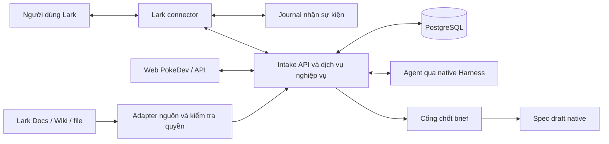

# Kế hoạch tích hợp LarkSuite vào giai đoạn nhận yêu cầu

Ngày lập: 25/11/2026; cập nhật: 26/11/2026. Trạng thái: **LI-01 đã triển khai; luồng DM của LI-02 đã qua kiểm tra tự động, PostgreSQL, desktop và thử liên kết/tạo hồ sơ trên tenant thật; LI-00 đã kiểm tra offline và DM hai chiều thật, còn chờ mention/callback/tài liệu/phục hồi**. LI-03 trở đi chưa nối vào luồng live. Xem [kết quả và cách chạy](../lark-intake-implementation.md).

Source access và requirement readiness từ `Phuc/specification` đã được tích hợp làm nền cho các slice sau, với feature flag readiness tắt mặc định. Chưa có binding từ intake tới readiness hoặc kênh Lark. Xem [phạm vi tích hợp và kiểm tra](../operations/branch-integration-20261125.md).

Mục tiêu là để người dùng giao việc bằng hội thoại, tài liệu hoặc file; agent tự tìm phần đã có căn cứ, hỏi những điểm còn thiếu, ghi nhận câu trả lời và cùng người dùng chốt phạm vi trước khi tạo Spec. Lark là một kênh giao tiếp của PokeDev. Trạng thái yêu cầu, quyền quyết định và điều phối agent thuộc control plane vAIPlatform.

Đề xuất làm LI-00 đến LI-05 trước để có vòng hỏi–đáp thật. LI-06 đến LI-08 hoàn thiện đầu vào và bàn giao sang Spec. LI-09 và LI-10 bổ sung nhắc việc, vận hành và nghiệm thu pilot. Các adapter Slack, GitHub Issue và Lark Base có slice riêng sau đó.

## 1. Điểm xuất phát trong repository

| Phần đã có | Căn cứ trong source | Cách sử dụng cho đợt này |
|---|---|---|
| Nhận mô tả và đề xuất kế hoạch | [`orchestrator_intake.py`](../../adlc-flow/langflow/adlc/orchestrator_intake.py) phân loại bằng quy tắc, tạo proposal; cache idempotency nằm trong tiến trình | Tham khảo hợp đồng proposal. Cần hồ sơ intake bền vững và bước làm rõ trước khi lập kế hoạch |
| Agent hỏi người dùng | [`human_inputs.py`](../../adlc-flow/langflow/adlc/human_inputs.py) có store bền vững, câu hỏi/lựa chọn, trả lời và theo dõi sự kiện Harness | Tách phần hợp đồng/validation có thể dùng chung; binding hiện tại theo run/node/session chưa đáp ứng intake trước khi có run |
| Tương tác native Harness | [`harness_models.py`](../../adlc-flow/langflow/adlc/harness_models.py) có interaction record/response/receipt; [`SDK Python`](../../sdk/dsh_web_sdk/client.py) có session và xác thực | Xây `IntakeAgentPort` cho hội thoại trước Spec. Không tạo WorkflowRun giả chỉ để có nơi treo câu hỏi |
| Intake tài liệu và approval theo digest | [`document_intake.py`](../../adlc-flow/langflow/adlc/document_intake.py) có revision, nguồn, quyết định và chống lặp lệnh | Tái sử dụng ý tưởng snapshot/digest; module còn import Workloop và mang trường Slack nên cần adapter mới cho đường native |
| Quyền và quyết định của con người | [`collaboration.py`](../../adlc-flow/langflow/adlc/collaboration.py), [`collaboration_models.py`](../../adlc-flow/langflow/adlc/collaboration_models.py) có command ID, revision, digest và policy revision | Dùng cùng nguyên tắc kiểm tra quyền ở server, ghi audit cùng transaction |
| Notification và outbox | [`slack_notifications.py`](../../adlc-flow/langflow/adlc/slack_notifications.py) | Tham khảo retry/receipt; phần lõi mới phải độc lập với Slack và Workloop |

Tại thời điểm lập kế hoạch chưa có adapter Lark trong các đường intake đã rà. LI-02 hiện bổ sung adapter DM tùy chọn; chưa coi Spec agent native hoặc adapter GitHub nghiệp vụ là phần đã hoàn tất.

## 2. Luồng người dùng cần đạt

1. Người dùng nhắn bot hoặc @bot trong nhóm: “Cần xuất báo cáo doanh thu”, có thể kèm tài liệu/file.
2. Bot xác nhận đã nhận, tạo một hồ sơ và trả link mở hồ sơ trong PokeDev.
3. Agent đọc nguồn được phép dùng. Nếu tài liệu đã quy định định dạng CSV, agent ghi nhận căn cứ đó và tập trung hỏi quyền xuất báo cáo, kỳ dữ liệu hoặc điểm còn mâu thuẫn.
4. Người dùng trả lời từng phần bằng tin nhắn, card hoặc trên web. Hồ sơ giữ những câu đã trả lời; agent chỉ hỏi tiếp phần còn thiếu.
5. Khi cần quyết định của người khác, bot gửi câu hỏi tới người có trách nhiệm theo chính sách project, trong phạm vi thông báo đã cho phép.
6. Bot trình bày brief gồm phạm vi, ngoài phạm vi, tiêu chí nghiệm thu, giả định và nguồn. Người có quyền chốt đúng revision đang xem.
7. PokeDev bàn giao snapshot đã chốt sang bước tạo Spec draft bằng Harness. Việc duyệt Spec, duyệt kế hoạch và bắt đầu thực thi giữ các cổng quyết định riêng.

Một lần bấm trả lời câu hỏi không đồng nghĩa duyệt brief. Duyệt brief không cấp quyền chạy code, tạo PR hoặc triển khai.

## 3. Kiến trúc và hợp đồng cần giữ



- Chỉ bổ sung một connector Lark tùy chọn. Dùng database và control plane hiện có; không thêm một hệ điều phối riêng hay phụ thuộc Workloop mới. Connector giữ credential Lark; model không được tự gọi API gửi tin hoặc tự cấp quyền.
- Ưu tiên Custom App có Bot capability, một tenant LarkSuite quốc tế và một project pilot. Cấu hình domain Lark rõ ràng; không dùng mặc định Feishu của SDK. Đây là giả định cho kế hoạch, cần xác nhận ở LI-00.
- Ưu tiên đánh giá `lark-channel-sdk` cho hội thoại, kết hợp `lark-oapi` cho OpenAPI cần thiết. Khóa phiên bản sau thử nghiệm. Channel SDK có cơ chế dedup, nhưng tài liệu nêu giới hạn chống lặp xuyên process; database nghiệp vụ vẫn cần unique key và transaction. [Channel SDK](https://github.com/larksuite/channel-sdk-python), [dedup architecture](https://github.com/larksuite/channel-sdk-python/blob/main/docs/dedup-architecture.md).
- Nhận sự kiện, xác nhận giao thức và xử lý agent là ba bước riêng. Phải có bản ghi bền vững trước ACK thành công. Nếu cần journal cục bộ ở connector, dùng volume riêng rồi chuyển idempotently vào backend. LI-00 phải kiểm chứng điểm SDK đánh dấu đã nhận; không chỉ đặt callback sau SDK rồi giả định không mất sự kiện.
- Domain và SDK là lựa chọn cần thử trên tenant thật. Mẫu SDK Python có đăng ký `card.action.trigger` trên WS, nhưng source WS cũng có nhánh xử lý CARD riêng. Vì vậy callback card phải được thử với đúng phiên bản SDK, loại card và tenant; có phương án HTTPS callback hoặc web khi chưa đạt. [Mẫu WS chính thức](https://github.com/larksuite/oapi-sdk-python/blob/v2_main/samples/ws/sample.py), [WS client chính thức](https://github.com/larksuite/oapi-sdk-python/blob/v2_main/lark_oapi/ws/client.py).

### Trạng thái và dữ liệu nghiệp vụ

Luồng chính dự kiến:

```text
NEW → ANALYZING → WAITING_FOR_USER → ANALYZING → READY_FOR_REVIEW
    → ACCEPTED → HANDOFF_PENDING → HANDED_OFF
```

`BLOCKED` biểu thị thiếu quyền, cấu hình hoặc ngân sách; `CANCELLED` dừng hồ sơ. Nếu người dùng sửa yêu cầu sau khi chốt, tạo revision mới; snapshot đã bàn giao giữ nguyên.

Các record chính, chưa bắt buộc tương ứng một-một với bảng SQL:

| Record | Thông tin cần giữ |
|---|---|
| `IntakeRequest` | ID, project, người yêu cầu, revision, trạng thái, digest của brief |
| `IntakeSource` | Loại nguồn, URL/message/file ID, phiên bản hoặc content hash, locator trích dẫn, quyền sử dụng |
| `ExternalIdentity` | Provider, tenant, app, external user ID, user PokeDev đã xác minh |
| `ConversationBinding` | Provider/tenant/app/chat, root/thread/message IDs, intake liên quan, phạm vi người tham gia |
| `ClarificationQuestion` / `IntakeAnswer` | ID câu hỏi, revision, người/vai trò cần trả lời, lựa chọn/schema, câu trả lời và nguồn |
| `AnalysisAttempt` | Revision đầu vào, snapshot ngữ cảnh, session Harness, giới hạn lượt/token và trạng thái |
| `InboundEvent` / `OutboundDelivery` | Chống lặp, lease, retry, biên nhận và trạng thái chưa xác nhận |
| `IntakeDecision` / `HandoffReceipt` | Actor, policy revision, digest đã chốt, command ID và kết quả bàn giao |

Session Harness giúp giữ mạch hội thoại. Hồ sơ, quyết định và nguồn đã lưu mới là căn cứ khôi phục khi session hoặc process mất.

`READY_FOR_REVIEW` do validator ở backend kiểm tra: có mục tiêu, đối tượng/hành vi chính, phạm vi và ngoài phạm vi, dữ liệu/ràng buộc liên quan, tiêu chí nghiệm thu kiểm tra được và nguồn cho các kết luận. Các câu hỏi chặn phải có câu trả lời hợp lệ hoặc giả định được người có quyền chấp nhận rõ ràng. “Chưa biết” vẫn là thông tin chưa chốt, không tự chuyển thành đồng ý. Không dùng điểm tự tin của model làm điều kiện duyệt.

### Các ranh giới áp dụng ngay từ đầu

1. Danh tính Lark phải được liên kết đã xác minh. Email hiển thị, tên trong nhóm hoặc payload card không tự cấp quyền PokeDev. Auto-login local không được biến mọi người dùng Lark thành một chủ project chung.
2. Dedupe tách theo provider/tenant/app và event/message/command ID. Mỗi câu trả lời gắn với question ID và revision. Hai câu trả lời đồng thời phải có một kết quả xác định, không ghi đè âm thầm.
3. Một chat có thể có nhiều hồ sơ. Giữ riêng các ID native của Lark; DM dùng focus/câu hỏi đang chờ có xác nhận. Nếu có nhiều đích hợp lệ, bot yêu cầu chọn hồ sơ.
4. Reply trong thread đã theo dõi chỉ dùng được nếu app thực sự nhận được sự kiện đó. Quyền @mention và việc lọc thread ở backend không tự bảo đảm nhận mọi reply không @mention.
5. Bot đọc được tài liệu chưa đủ để đưa nội dung vào một nhóm. Phải kiểm tra nguồn được phép dùng và người nhận được phép xem; khi chưa xác định được audience, chuyển nội dung riêng tư qua DM/web phù hợp.
6. Model đề xuất câu hỏi, brief và thay đổi; backend kiểm tra schema, quyền và revision trước mọi tác động. Nội dung từ chat/tài liệu được xử lý như dữ liệu, không trở thành lệnh cấp quyền hoặc thực thi tool.

## 4. Bản đồ slice

Mỗi slice là một thay đổi có thể demo và rollback bằng feature flag. Các kiểm tra độ bền và quyền được làm trong slice tạo ra hành vi đó; LI-10 kiểm tra tổng hợp, không phải nơi bắt đầu thêm chúng.

| Slice | Đầu ra có thể demo | Phụ thuộc |
|---|---|---|
| LI-00 | Xác nhận SDK, transport, permission và callback trên tenant thật | Không |
| LI-01 | Tạo và xem hồ sơ yêu cầu bền vững trên web/API | Không; chốt contract cùng LI-00 |
| LI-02 | DM Lark → liên kết danh tính → tạo hồ sơ → phản hồi đã nhận | LI-00, LI-01 |
| LI-03 | Nhóm/thread và định tuyến reply về đúng hồ sơ | LI-02 |
| LI-04 | Agent hỏi lại, nhận trả lời từng phần và tiếp tục | LI-01, LI-02; dùng nhóm khi LI-03 đạt |
| LI-05 | Trả lời qua card/form và cập nhật trạng thái tương tác | LI-00, LI-04 |
| LI-06 | Đọc, tìm tài liệu liên quan trong phạm vi project và dẫn nguồn | LI-04; LI-00 xác nhận quyền tài liệu |
| LI-07 | Nhận file, rich text và form; hợp nhất đầu vào vào cùng hồ sơ | LI-01, LI-04, LI-06 |
| LI-08 | Chốt brief theo revision và bàn giao sang Spec draft native | LI-04, LI-05, LI-06 |
| LI-09 | Nhắc câu hỏi, nhờ đúng người và xử lý thay đổi chủ động | LI-04, LI-06, LI-08 |
| LI-10 | Pilot hoàn chỉnh, phục hồi lỗi và bộ vận hành local | LI-02 đến LI-09 |

## 5. Nội dung và nghiệm thu từng slice

### LI-00 — Kiểm chứng Lark trước khi chốt transport

Trạng thái: có [probe nhận sự kiện và biên bản offline](../../services/lark-connector/README.md), khóa SDK và 6 kiểm tra đã đạt. Bot PokeDev 0.1.0 đã phát hành cho một thành viên pilot với đúng ba quyền tenant. Đã xác minh WebSocket Connected, một DM vào journal và một biên nhận thử trong đúng cuộc trò chuyện. Mention, callback, tài liệu và phục hồi còn chờ; xem [biên bản pilot](../operations/lark-pilot-20261125.md).

Tạo app thử hoặc dùng app được phép thử; ghi lại tenant, app type, domain, phiên bản SDK và capability matrix. Ưu tiên thử outbound WebSocket để phù hợp môi trường local/VPN. Không tự mở tunnel hoặc đổi routing VPN.

Nghiệm thu:

- Nhận DM, @mention, reply trong nhóm, gửi tin/reply, bấm card và gửi form thử; ghi rõ mục nào đạt với quyền nào. Các quyền DM/gửi bot/@mention có trong [hướng dẫn bot chính thức](https://open.larksuite.com/document/uAjLw4CM/ukTMukTMukTM/mcp_integration/develop-mcp-intelligent-assistant-bot), nhưng không sao chép toàn bộ scope của demo.
- Chứng minh việc persist trước ACK bằng cách dừng process tại các điểm trước/sau journal và trước/sau SDK dedup. Ghi rõ hành vi redelivery, reconnect và callback timeout của phiên bản đã chọn.
- Thử đọc một Lark Doc/Wiki được cấp quyền và một tài liệu bị từ chối; xác định khi nào cần user authorization, redirect URL và scope tương ứng.
- Chốt WS cho event và transport cho card riêng. Nếu card qua WS chưa đạt, dùng callback HTTPS được cho phép hoặc web; chưa hiển thị nút bấm như một chức năng đã hoạt động.

Đầu ra: ADR ngắn, ma trận quyền/capability, fixture đã loại token/nội dung riêng tư và biên bản chạy. Slice này chưa gọi agent để thực hiện công việc nghiệp vụ.

### LI-01 — Hồ sơ yêu cầu trước Spec

Trạng thái: đã triển khai model, migration, API và trang desktop `/intake`; đã kiểm tra SQLite, PostgreSQL, API đồng thời và thao tác lưu/sửa/tải lại trên giao diện. Hồ sơ hiện thuộc riêng người tạo; chia sẻ và câu trả lời qua Lark thuộc các slice sau.

Thêm model, migration, service và API intake mới dưới namespace ổn định `/api/v1/adlc/...`; thêm màn hình desktop nhập yêu cầu và xem hồ sơ. Project context dùng catalog/quyền native đã cấu hình, không cần tạo Gitea repo hoặc Workloop để nhận một yêu cầu. Tách mô tả ban đầu, thông tin đã xác nhận, giả định và tiêu chí nghiệm thu.

Nghiệm thu:

- Tạo yêu cầu từ web/API, nhận lại cùng một hồ sơ khi lặp command ID; khởi động lại backend vẫn đọc đủ lịch sử.
- Hai lần sửa cùng revision được phát hiện xung đột; actor ngoài project không đọc/sửa được hồ sơ.
- Tạo hồ sơ chưa tạo WorkflowRun, TaskRun, approval thực thi hoặc lệnh shell.

### LI-02 — DM Lark có danh tính và biên nhận

Trạng thái ngày 26/11/2026: đã triển khai và qua 295 kiểm tra backend, 22 kiểm tra connector/probe, 7 kiểm tra UI, PostgreSQL và build production. Người dùng đã thực hiện liên kết thật và gửi DM: backend tạo đúng một hồ sơ riêng, lưu nguồn và gửi biên nhận có link đúng hồ sơ; cả hai outbox liên kết/tạo hồ sơ đều DELIVERED và đã đối soát với connector. Tải lại desktop mở được nội dung và phiên bản 1. Luồng DM LI-02 đã nghiệm thu trong pilot một tài khoản chưa gắn project. Xem [kế hoạch thực hiện](li02-implementation.md), [runbook](../operations/lark-li02.md) và [ADR 0023](../adr/0023-verified-lark-dm-intake-and-delivery-receipts.md). Chưa có số đo để công bố mục tiêu biên nhận 2 giây đã đạt.

Thêm connector Lark nhẹ, cấu hình credential riêng, liên kết external identity với user PokeDev qua quy trình đã xác minh. Nhận DM vào durable journal/inbox, chuyển vào LI-01 và gửi biên nhận/link hồ sơ qua outbox. Chưa liên kết thì chỉ hướng dẫn liên kết, không liệt kê project hoặc đưa ngữ cảnh riêng tư ra chat.

Nghiệm thu:

- Người đã liên kết gửi DM và nhận một intake ID; gửi lại cùng event không tạo hồ sơ thứ hai.
- Backend tạm ngắt kết nối không làm mất sự kiện đã ACK; sau phục hồi, hồ sơ và biên nhận được đối soát.
- Lỗi/timeout khi gửi tin có trạng thái rõ. Khi chưa biết provider đã nhận hay chưa, ghi `UNCONFIRMED` và đối soát trước khi gửi lại.
- Mục tiêu UX đề xuất: biên nhận thường xuất hiện trong 2 giây khi không bị rate limit; ACK/callback tuân thủ deadline đã xác nhận ở LI-00 và không đợi LLM.

### LI-03 — Hội thoại trong nhóm và thread

Mở @mention trong nhóm đã được cấu hình, giữ `message_id`, root/parent/thread identifiers theo payload thật. Gắn reply vào đúng hồ sơ và có cách chọn project/hồ sơ khi mơ hồ. Link một hồ sơ sang web hoặc kênh khác phải qua kiểm tra quyền và thao tác liên kết rõ ràng.

Nghiệm thu:

- Hai thread hoặc hai yêu cầu trong cùng chat giữ ngữ cảnh riêng; DM có nhiều câu hỏi đang mở không được lấy “hồ sơ mới nhất” làm câu trả lời mặc định.
- Reply không @mention chỉ được công bố hỗ trợ sau khi app nhận được event thật và backend lọc đúng thread đang theo dõi. Nếu chưa có quyền đó, giao diện nêu rõ cách @bot, dùng card hoặc trả lời trên web.
- Tin ngoài các cuộc hội thoại được theo dõi, tin của bot và event lặp không kích hoạt agent; không tự thêm mọi thành viên nhóm vào project.

### LI-04 — Agent chủ động hỏi và tiếp tục cùng yêu cầu

Xây adapter từ hồ sơ intake tới `ReadinessService`/`DshAgentRunner` native đã tích hợp trong `requirement_readiness`, cùng HumanBridge cho Lark/web. Mỗi lượt nhận snapshot có version và trả kết quả có cấu trúc: câu hỏi, đề xuất brief, mâu thuẫn cần người quyết hoặc không cần hành động. Service lưu câu hỏi trước khi gửi. Agent không trực tiếp quyết định đích gửi hoặc tự đánh dấu người dùng đã phê duyệt.

Nghiệm thu:

- Agent hỏi 1–3 điểm đang chặn quyết định mỗi lượt, nêu lý do, hỗ trợ lựa chọn, câu trả lời tự do và “Chưa biết”. Những thông tin có căn cứ sẵn không bị hỏi lại.
- Trả lời từng phần được lưu ngay. Agent tóm tắt điều đã hiểu, chỉ hỏi phần còn thiếu; câu trả lời suy diễn hoặc mơ hồ cần người dùng xác nhận trước khi thành quyết định.
- Không giữ một lời gọi model đang chạy trong lúc chờ con người. Tin nhắn hợp lệ đánh thức lượt phân tích mới với ngân sách lượt/token/thời gian cấu hình được.
- Khi Harness/session mất, khôi phục từ hồ sơ, câu hỏi và nguồn đã lưu; không coi session ID là nguồn bộ nhớ duy nhất. Có kiểm tra reply trễ, event lặp và hai người trả lời đồng thời.

### LI-05 — Card và form cho vòng hỏi–đáp

Render câu hỏi bằng card có lựa chọn, ô trả lời nếu capability đã được kiểm chứng, link hồ sơ và hành động nhờ người khác. Nội dung chính gồm tóm tắt yêu cầu, câu hỏi đang mở và nguồn; chi tiết model/tool có nơi xem riêng trong PokeDev.

Nghiệm thu:

- Bấm/submit trả lời cùng question ID và revision như trả lời trên web. Backend xác minh actor, binding và action nonce; không tin quyền hoặc trạng thái gửi lên từ card.
- Card cũ, câu hỏi đã được trả lời hoặc người không có quyền nhận phản hồi phù hợp, không làm thay đổi hồ sơ. Callback được phản hồi đúng hạn, xử lý dài đi qua hàng chờ.
- Web/card/chat phản ánh cùng một kết quả. Khi card không dùng được, vẫn có đường trả lời bằng text hoặc web đã kiểm chứng; không cần phụ thuộc UI mobile.

### LI-06 — Tài liệu có quyền, phiên bản và trích dẫn

Nối `SourceGateway` và các reader GitHub/Lark trong `source_access` vào hồ sơ intake, danh mục nguồn và quyền project. Bắt đầu bằng đọc link trực tiếp; sau đó tìm tài liệu liên quan trong thư viện đã được project cho phép. Khi API cần danh tính user, phải có ủy quyền đúng người. Trích dẫn giữ URL, phiên bản/hash, block/đoạn và phần nội dung làm căn cứ.

Nghiệm thu:

- Agent dẫn được tài liệu liên quan và chỉ ra phần dùng để kết luận. Không tìm được nguồn thì ghi rõ khoảng trống và hỏi lại, không tạo link hoặc căn cứ giả.
- Tài liệu bị từ chối, xóa hoặc chưa chia sẻ được phân biệt với lỗi mạng. Credential không đi vào prompt/chat. Nội dung lấy bằng quyền app không tự được phát cho mọi thành viên nhóm.
- Hai nguồn mâu thuẫn tạo câu hỏi có đủ căn cứ. Nguồn đổi phiên bản làm phát sinh kiểm tra lại các kết luận bị ảnh hưởng; approval cũ không chốt được snapshot mới.
- Confluence và nguồn khác đi qua cùng interface khi có adapter native/MCP được cho phép. Không nối Lark intake mới qua `DocumentIntake` phụ thuộc Workloop để đọc tài liệu.

### LI-07 — File, rich text và form thành một hồ sơ

Chuẩn hóa text, rich text có link/mention, file Lark và upload/form web vào `IntakeSource`. Đợt đầu hỗ trợ TXT/Markdown, PDF có text và DOCX; giới hạn kích thước, loại file và thời gian xử lý. Trích xuất file là job riêng sau khi đã ghi nhận sự kiện.

Nghiệm thu:

- Cùng hồ sơ có mô tả trong chat, một file và phần bổ sung trên web, giữ được nguồn của từng thông tin.
- File trùng có hash/receipt; file quá lớn, sai loại hoặc PDF scan không đọc được có phản hồi cụ thể. Người dùng vẫn bổ sung text được.
- URL nguồn được kiểm tra, không tải tùy ý địa chỉ nội bộ hoặc chạy nội dung file. OCR, voice và transcript họp để ở phạm vi sau, chưa gắn nhãn đã hỗ trợ.

### LI-08 — Chốt brief và bàn giao sang Spec bằng vAIPlatform

Tạo brief có version/digest, phạm vi trong/ngoài, tiêu chí nghiệm thu kiểm tra được, giả định đã được chấp nhận, câu hỏi đã giải quyết và nguồn. Nút chốt/yêu cầu sửa dùng quyền của project và actor đã liên kết. Chỉ gọi `SpecDraftPort` native sau khi brief được chốt hợp lệ.

Nghiệm thu:

- Người tạo yêu cầu/người được chính sách project cho quyền mới chốt được đúng revision. Vai trò hoặc tên hiển thị trong Lark không tự thay thế capability của project.
- Sau thay đổi brief/nguồn/policy liên quan, card và quyết định cũ không được dùng để chốt bản mới. Mỗi quyết định có audit và receipt bền vững.
- Bàn giao cùng một snapshot nhiều lần chỉ tạo một công việc Spec. LI-08 phải hoàn thiện adapter/profile tạo Spec draft qua native Harness; nếu chưa sẵn sàng, hồ sơ ở `HANDOFF_PENDING`, không fallback Workloop.
- Spec agent có thể yêu cầu làm rõ qua cùng cơ chế câu hỏi. Thay đổi phạm vi đã chốt mở revision mới; không sửa ngầm snapshot hoặc kế hoạch đang thực thi.
- Duyệt Spec, duyệt kế hoạch và chạy workflow giữ các cổng hiện có; bài kiểm tra xác nhận chốt brief không khởi chạy coding/PR/deploy.

### LI-09 — Hỏi đúng người và nhắc theo trạng thái

Thêm bộ lập lịch cho câu hỏi đến hạn, yêu cầu quyết định của người phụ trách, nguồn thay đổi và hồ sơ bị chặn. Agent được đánh thức từ các sự kiện đã lưu; không chạy vòng lặp LLM để chờ tin nhắn. Đích gửi, quiet hours, số lần nhắc và điều kiện escalation do project cấu hình.

Nghiệm thu:

- Nhắc đúng câu hỏi còn mở, có lý do và đường trả lời. Câu hỏi đã trả lời, đã hủy hoặc đã hết hiệu lực không tiếp tục nhắc.
- Nhờ Tech Lead/Approver chỉ trong phạm vi danh tính và quyền đã xác minh. Khi không đủ dữ kiện chọn người, ghi trạng thái cần phân công.
- Hai câu trả lời xung đột giữ nguyên lịch sử và yêu cầu người có thẩm quyền quyết định; không lấy câu mới nhất làm chân lý.
- Scheduler chạy lặp hoặc khởi động lại không nhân đôi thông báo. Có giới hạn tần suất, hủy nhắc và cơ chế chuyển lỗi chưa xử lý tới người vận hành.

### LI-10 — Pilot và vận hành có thể phục hồi

Thêm profile Docker tùy chọn cho connector, health/readiness, cấu hình mẫu không có secret và runbook tạo app/cấp quyền/phát hành. Giữ credential/runtime riêng của PokeDev. Cấu hình URL web mà người dùng pilot truy cập được và cơ chế đăng nhập thật trước khi mở cho nhiều người.

Nghiệm thu:

- Demo trên tenant thật: DM và group/thread → agent hỏi → trả lời từng phần qua hai phương thức → tài liệu có trích dẫn → chốt brief → một Spec draft native.
- Dừng process giữa persist/ACK/send/response, reconnect, token hết hạn, rate limit và quyền bị thu hồi; hệ thống không mất câu trả lời hoặc thực thi lặp thao tác nghiệp vụ.
- Có số đo thời gian nhận/ACK/biên nhận, số câu hỏi chờ, lỗi nguồn, outbox chưa xác nhận, số lượt model và chi phí. Log loại secret và có chính sách giữ/xóa nội dung phù hợp project.
- Tắt feature flag dừng nhận việc mới an toàn, giữ hồ sơ và có thể xử lý phần đang chờ trên web. CI cho Lark intake chạy được khi Workloop/Gitea đều không có mặt.

## 6. Các adapter sau pilot

| Slice tiếp theo | Đầu ra | Điều kiện nghiệm thu chính |
|---|---|---|
| LI-11 — Slack native | Nhận Slack DM/mention/reply qua cùng core intake, thay dần đường Workloop cũ | Identity và thread namespace riêng; một hồ sơ nối Lark/Slack chỉ qua liên kết có quyền; không nhân đôi câu trả lời/handoff |
| LI-12 — GitHub Issue intake | Issue body/comment/attachment link thành nguồn yêu cầu, webhook có xác thực và receipt | Chọn repo/issue được phép; sự kiện create/edit/replay đúng revision. Đây là intake Issue, không đồng nghĩa đã có toàn bộ adapter repo/branch/PR |
| LI-13 — Lark Base/form | Record được gửi từ form thành intake có trường cấu trúc và link nguồn | Map trường có version; update cùng record tạo revision theo chính sách; không coi người tạo record là approver mặc định |

OCR, voice và nội dung cuộc họp là các đợt sau khi có nhu cầu cụ thể, kiểm chứng quyền và xác định chất lượng trích xuất. Không gộp chúng vào cam kết pilot chat.

## 7. Cách bàn giao và cổng chấp nhận

| Mốc | Slice | Kết quả |
|---|---|---|
| Demo vòng hỏi–đáp nội bộ | LI-00 → LI-05 | Bot và người trao đổi thật; cùng hồ sơ tồn tại qua restart; card không phải đường trả lời duy nhất |
| Intake đầy đủ cho một project | Thêm LI-06 → LI-08 | Có tài liệu/file, căn cứ, brief được chốt và một bàn giao native sang Spec draft |
| Mở pilot có kiểm soát | Thêm LI-09 → LI-10 | Có nhắc việc, phân công, theo dõi lỗi và bằng chứng phục hồi/kiểm tra quyền trên tenant thật |

Mỗi slice cần một demo theo hành vi người dùng, test hợp đồng và trường hợp lỗi ngay tại ranh giới thay đổi, cấu hình/feature flag, migration nếu có và ghi rõ phần chưa hỗ trợ. Mặc định kiểm tra giao diện desktop.

Các quyết định cần chốt trong LI-00: tenant/app thực tế; SDK và transport card; quyền nhận reply không @mention; project/người pilot; tập tài liệu được phép; URL đăng nhập/ủy quyền mà người dùng có thể truy cập; provider/model native cho intake và Spec. Những điểm này chưa cản việc lập kế hoạch, nhưng là điều kiện trước khi tuyên bố tích hợp đã chạy thật.
