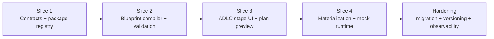

# Lộ trình sản phẩm và giao diện ADLC

Tài liệu này tổng hợp 9 kế hoạch gốc thành một bản kể lại duy nhất về lộ trình sản phẩm ADLC (Poke Dev). Chín nguồn hợp thành **ba lớp kế hoạch**, mỗi lớp xây trên lớp trước: **(1) Nền móng orchestrator/adapter** — tách Orchestrator khỏi Langflow component thành plugin interface, dựng Evidence Plane + Resource Manager, thay MOCK adapters bằng implementation thật (Giai đoạn 1, Giai đoạn 2 – Mục 4); **(2) Thư viện node package** — khung mở rộng trên Langflow, giai đoạn (stage) cấp cao thành node package version bất biến, biên dịch blueprint thành ExecutionPlan, thư viện stage trên canvas (ADLC Extension Plan, node-package implementation plan, stage library và package roadmap); **(3) Trải nghiệm UI workspace** — tầm nhìn blueprint → kế hoạch → lần chạy, rồi các đợt thiết kế lại UI: redesign plan, capability map, workspace đã giao (UI_Extension_Plan, adlc-ui-redesign-plan, adlc-ui-capability-map, adlc-ui-implementation).

Vòng đời sản phẩm xuyên suốt: **Request → Requirements and planning → Implementation → Verification → Review → Release → Feedback**. Hành trình thực thi hiện có: **Workflow → Plan review → Run → Result review**.

> Thuật ngữ: *stage* → "giai đoạn", *task* → "nhiệm vụ", *run* → "lần chạy", *plan* → "kế hoạch", *approval* → "phê duyệt", *flow* và *feature flag* giữ nguyên. Blueprint, node package, workspace, capability, widget, sidebar, dark mode… giữ tiếng Anh; mọi định danh code/JSON không dịch.

---

## Giai đoạn 1: External Orchestrator — kế hoạch và kết quả

**Nguồn:** `docs/stage-1-external-orchestrator-plan.md` · **Trạng thái:** ✅ HOÀN THÀNH (commit `d125b8d`)

**Mục tiêu:** biến Orchestrator từ Langflow component tích hợp chặt thành **plugin interface** cắm được các agent runtime khác nhau (hiện tại: OpenCode; tương lai: DeepSeek Harness). Nguyên tắc: 100% backward compatible với existing flows; thứ tự Evidence Plane → Resource Manager → External Orchestrator; unit + integration test đầy đủ.

### Tổng kết

| Phase | Trạng thái | Unit tests | Integration tests | Tổng |
|---|:---:|:---:|:---:|:---:|
| 1. Evidence Plane | ✅ Done | 33 | 7 | 40 |
| 2. Resource Manager | ✅ Done | 29 | 8 | 37 |
| 3. External Orchestrator | ✅ Done | 30 | 10 | 40 |
| **Tổng** | | **92** | **25** | **117** |

Thời gian thực tế ~1 phiên làm việc (thay vì 6–10 ngày ước tính) nhờ scope rõ và test-driven approach.

### Phase 1: Evidence Plane ✅

Module tập trung lưu trữ, validate, truy vấn mọi bằng chứng thực thi. Files trong `adlc-flow/langflow/adlc/evidence_plane/`: `__init__.py` (public API), `models.py` (Evidence, EvidenceQuery, EvidenceReceipt, EvidenceSummary), `store.py` (EvidenceStore Protocol + InMemory + SQLite), `validators.py` (PatchFormat, TestResult, LogSecret, PayloadSchema), `service.py` (EvidencePlaneService facade).

| Tính năng | Mô tả |
|---|---|
| **Evidence schema** | `EvidenceType` (patch/log/test_result/screenshot/callback/metric), `ValidationStatus`, `RetentionPolicy` |
| **Storage** | `InMemoryEvidenceStore` (thread-safe) + `SQLEvidenceStore` (durable, indexed) |
| **Validators** | 4 built-in: patch format, test result outcome, log secret detection, payload schema |
| **Service API** | `submit_evidence()`, `query_evidence()`, `get_validated_evidence()`, `evidence_summary()`, `revalidate()` |
| **Backward compat** | `Evidence.to_artifact()` project sang `Artifact` cũ |

Thiết kế theo slide: ✅ **Evidence-First** (mọi kết quả qua Evidence Plane trước khi qua Gate) · ✅ **3 Plane architecture** (Evidence Plane là module độc lập, không trộn Execution) · ✅ **Contract-First** (schema validation tự động, stable error codes).

### Phase 2: Resource Manager ✅

Chọn Agent theo bảng năng lực (capability) + cấp quyền tối thiểu (Least Privilege). Files trong `adlc-flow/langflow/adlc/resource_manager/`: `capabilities.py` (AgentCapability, AgentProfile, CapabilityRequirement, AllocationDecision, InMemoryCapabilityRegistry), `policies.py` (LeastCostPolicy, HighestTrustPolicy, BalancedPolicy, RoundRobinPolicy), `privileges.py` (PrivilegeGrant, PrivilegeCalculator least-privilege), `manager.py` (ResourceManager facade).

| Tính năng | Mô tả |
|---|---|
| **Capability schema** | 8 capabilities: code_generation, code_review, test_runner, security_scan, content_writing, planning, reflection, orchestration |
| **Cost tiers** | cheap / medium / expensive |
| **4 allocation policies** | LeastCost, HighestTrust, Balanced (weighted), RoundRobin |
| **Least-privilege grants** | `PrivilegeGrant` với TTL, revoke, extend |
| **Registry / Manager** | `InMemoryCapabilityRegistry` (thread-safe); `allocate()`, `revoke()`, `get_grant()`, `active_grant_count()` |

Thiết kế theo slide: ✅ **Policy-Based Allocation + Least Privilege** · ✅ **Single Responsibility** (mỗi capability một nhiệm vụ rõ) · ✅ **Contract-First** (`CapabilityRequirement` là contract khai báo input/output).

### Phase 3: External Orchestrator as Plugin ✅

Tách Orchestrator thành plugin interface — hiện có `MonarchPlugin` (OpenCode backend), tương lai `DeepSeekHarnessPlugin`. Files trong `adlc-flow/langflow/adlc/orchestrator_plugin/`: `interface.py` (OrchestratorPlugin Protocol + Intent/Plan/Result models), `host.py` (OrchestratorHost registry + dispatcher), `plugins/monarch.py` (MonarchPlugin, plan-only mode cho testing), `plugins/deepseek_harness.py` (DeepSeekHarnessPlugin stub, document integration points, disabled by default).

| Tính năng | Mô tả |
|---|---|
| **OrchestratorPlugin Protocol** | Interface thống nhất: `plan()`, `execute()`, `reflect()` |
| **OrchestratorHost** | Registry + dispatcher, auto-select theo capability |
| **Intent/Plan/Result models** | Schema chuẩn cho mọi plugin |
| **Backward compat** | Existing Monarch component vẫn hoạt động |

Thiết kế theo slide: ✅ **External Orchestrator** (OrchestratorHost đứng ngoài, dispatch qua plugin interface) · ✅ **Pluggable** (DeepSeek Harness plug vào không sửa control plane) · ✅ **Contract-First** (Protocol là contract giữa control plane và agent runtime) · ✅ **Single Responsibility** (plugin lo plan/execute/reflect; control plane lo scheduling/retry/approval).

Cách sử dụng điển hình:

```python
from langflow.adlc.evidence_plane import EvidencePlaneService, Evidence, EvidenceType
from langflow.adlc.resource_manager import ResourceManager, AgentProfile, AgentCapability, CostTier, CapabilityRequirement, LeastCostPolicy
from langflow.adlc.orchestrator_plugin import OrchestratorHost, MonarchPlugin, DeepSeekHarnessPlugin, Intent, IntentType

service = EvidencePlaneService()
receipt = service.submit_evidence(Evidence(evidence_type=EvidenceType.PATCH,
    payload={"files": [{"file": "a.py", "patch": "@@"}]}, producer="my-agent",
    submitted_at=datetime.now(timezone.utc)))  # receipt.validation_status.value

manager = ResourceManager(policy=LeastCostPolicy())
manager.register_agent(AgentProfile(agent_id="code-gen", display_name="Code Generator",
    capabilities=frozenset({AgentCapability.CODE_GENERATION}), cost_tier=CostTier.CHEAP, trust_score=0.8))
decision = manager.allocate(CapabilityRequirement(
    required_capabilities=frozenset({AgentCapability.CODE_GENERATION})))  # decision.agent_id, decision.score

host = OrchestratorHost()
host.register(MonarchPlugin()); host.register(DeepSeekHarnessPlugin())
plan = await host.dispatch_plan(Intent(intent_type=IntentType.CODE_GENERATION,
    description="Implement feature X",
    required_capabilities=frozenset({AgentCapability.CODE_GENERATION})))
result = await host.dispatch_execute(plan)   # result.status
report = await host.dispatch_reflect(result) # plan.plugin_id
```

### Hướng dẫn plug DeepSeek Harness (tương lai)

1. Implement `DeepSeekHarnessClient` trong `harness_client.py`; wire client vào `DeepSeekHarnessPlugin.__init__()`.
2. Implement logic thật trong `execute()` (hiện là stub); enable plugin: `plugin._metadata.enabled = True`.
3. Register với host: `host.register(DeepSeekHarnessPlugin(client))`.

Control plane không cần thay đổi — plugin interface đã chuẩn hóa.

### Backward compatibility

`test_adapters.py` 10/10 ✅; `test_artifact_payload_store.py` ✅; `test_package_authorization.py` ✅. Existing flows (`adlc_components/flow/*.json`) chạy không đổi; API endpoints giữ nguyên signature; functionality mới là additive, không breaking.

### Bước tiếp theo (Giai đoạn 2)

| # | Công việc | Độ khó | Thời gian | Giá trị |
|---|---|:---:|:---:|:---:|
| 4 | Thay MOCK adapters (Sandbox/Memory/Testing) | ⭐⭐⭐⭐ | 7–10 ngày | ⭐⭐⭐⭐⭐ |
| 5 | Agent Trust Score | ⭐⭐ | 1–2 ngày | ⭐⭐⭐ |
| 6 | Model/Vendor routing | ⭐⭐⭐ | 2–3 ngày | ⭐⭐⭐ |
| 7 | Multi-tenant support | ⭐⭐⭐⭐⭐ | 5–7 ngày | ⭐⭐⭐⭐ |

---

## Giai đoạn 2, Mục 4: Real Adapters — kế hoạch và kết quả

**Nguồn:** `docs/stage-2-item-4-real-adapters-plan.md` · **Trạng thái:** ✅ HOÀN THÀNH (commits `e9be808`, `80cb62a`, `e77ecf8`, `e5938be`, DSH adapters)

**Mục tiêu:** thay MOCK adapters bằng implementation thật, sẵn sàng production. Phạm vi: (1) Testing Adapter — real pytest; (2) Memory Adapter — SQLite persistent; (3) Sandbox Adapter — Docker isolation; (4) DSH Agent + Memory — remote DSH server qua SDK. Nguyên tắc: 100% backward compatible (Mock vẫn là default); real adapters opt-in qua env var/config; mỗi adapter có unit + integration test; DSH dùng SDK gọi từ xa, không tải plugin về máy.

### Tổng kết

| Phase | Trạng thái | Unit tests | Integration tests | Tổng |
|---|:---:|:---:|:---:|:---:|
| 4.1 Real Testing | ✅ Done | 24 | 6 | 30 |
| 4.2 Real Memory | ✅ Done | 19 | 7 | 26 |
| 4.3 Docker Sandbox | ✅ Done | 13 | 0 | 13 |
| 4.4 DSH Agent + Memory | ✅ Done | 25 | 0 | 25 |
| **Tổng** | | **81** | **13** | **94** |

### Phase 4.1: Real Testing Adapter ✅ (commit `e9be808`)

Chạy pytest thật trên code agent generate, trả về kết quả PASSED/FAILED/SKIPPED + coverage. Files: `adlc-flow/langflow/adlc/adapters/real_testing.py` (PytestTestingAdapter); tests: `adlc-flow/tests/unit/adlc/test_real_testing_adapter.py`, `adlc-flow/tests/integration/test_real_testing_integration.py`.

| Tính năng | Mô tả |
|---|---|
| **Subprocess execution** | Chạy pytest qua `asyncio.create_subprocess_exec` |
| **JSON report parsing** | Hỗ trợ `pytest-json-report` nếu có; stdout fallback parse summary line từ stdout/stderr |
| **Coverage / Timeout** | Parse `coverage.json` nếu có; `asyncio.wait_for` với timeout configurable |
| **Failure messages** | Extract từ JSON report |
| **Evidence Plane** | Submit `test_result` evidence |
| **Backward compat** | `MockTestingAdapter` vẫn là default |

Cấu hình: `PytestTestingAdapter(config=PytestConfig(timeout_seconds=300, coverage_enabled=True, python_executable=sys.executable))`; kết quả đọc tại `result.metadata["testing"]["outcome"]` — "PASSED" | "FAILED" | "ERROR".

### Phase 4.2: Real Memory Adapter ✅ (commit `80cb62a`)

Lưu task context + results vào SQLite, retrieval theo run_id/task_id. Files: `adlc-flow/langflow/adlc/adapters/real_memory.py` (SQLiteMemoryAdapter); tests: `test_real_memory_adapter.py`, `test_real_memory_integration.py`.

| Tính năng | Mô tả |
|---|---|
| **Persistent storage** | SQLite file (hoặc temp file nếu không config); schema `memory_records` table với indexes |
| **Query by memory_refs** | Load context từ attempt IDs; fallback to workflow_run (record mới nhất) nếu không có memory_refs |
| **Variable merging** | Request variables override stored |
| **TTL cleanup / Max records** | Auto-delete expired records; FIFO eviction khi vượt limit |
| **Thread-safe** | SQLite locking + `threading.Lock` |
| **Evidence Plane** | Submit `memory_record` evidence |
| **Backward compat** | `MockMemoryAdapter` vẫn là default |

Cấu hình: `SQLiteMemoryAdapter(config=SQLiteMemoryConfig(db_path=Path("./memory.db"), ttl_seconds=86400, max_records=10000))`; API: `await adapter.record_result(request, result)` và `context = await adapter.load_context(new_request)` (merged variables từ các attempt trước).

### Phase 4.3: Docker Sandbox Adapter ✅ (commit `e77ecf8`)

Container isolation thay vì chỉ Git worktree. Files: `adlc-flow/langflow/adlc/adapters/docker_sandbox.py` (DockerSandboxAdapter); test: `test_docker_sandbox_adapter.py`.

| Tính năng | Mô tả |
|---|---|
| **Container isolation** | Mỗi attempt chạy trong container riêng |
| **Resource limits** | CPU (`--cpus`), memory (`--memory`) |
| **Network policy** | `none` / `bridge` / `host` |
| **Volume mounts / Auto cleanup** | Mount workspace vào container; `--rm` flag hoặc explicit `docker rm` |
| **exec_in_container** | Chạy command trong container; graceful fallback khi detect Docker availability |
| **Backward compat** | `MockSandboxAdapter` và `LocalWorktreeSandboxAdapter` vẫn là defaults |

Cấu hình: `DockerSandboxAdapter(config=DockerSandboxConfig(image="python:3.11-slim", cpu_limit=1.0, memory_limit="512m", network_mode="none", workspace_mount=Path("./workspaces")))`; vòng đời: `open_session(request)` → `exec_in_container(session, "python -m pytest")` → `close_session(request, session)` (finally).

### Phase 4.4: DSH Agent + Memory Adapters ✅

Cho phép ADLC workflows dùng các DSH plugins (vai-sandbox, vai-testforce, vai_agentmemory) như agents trong workflow, giống coding agent — gọi từ xa qua SDK, không tải plugin về máy. Files: `adlc-flow/langflow/adlc/adapters/dsh_agent.py` (DSHAgentAdapter, AgentAdapter protocol), `adlc-flow/langflow/adlc/adapters/dsh_memory.py` (DSHMemoryAdapter, MemoryAdapter protocol); tests: `test_dsh_agent_adapter.py` (12 tests), `test_dsh_memory_adapter.py` (13 tests).

**`DSHAgentAdapter` (`agent-provider:dsh`)** — ủy quyền thực thi nhiệm vụ cho một DSH session từ xa:

```
ADLC scheduler → DSHAgentAdapter.execute()
    → DshHarnessClient.create_session(prompt=task_objective)
    → DSH LLM agent invokes vai-sandbox / vai-testforce / vai_agentmemory
    → DSH session finalizes with structured result
    → DSHAgentAdapter projects result into v0.1 TaskResult
```

| Tính năng | Mô tả |
|---|---|
| **Remote execution** | Tạo DSH session trên server từ xa, không cần plugin local |
| **Plugin orchestration** | Prompt hướng dẫn LLM dùng vai-sandbox, vai-testforce, vai_agentmemory |
| **Result projection** | Project DSH session result → ADLC v0.1 `TaskResult` |
| **Timeout handling** | Poll session, default 600s configurable |
| **Error propagation** | DSH errors → ADLC `ServiceError` với category/retryable mapping |
| **Context building** | Inject cwd + memory_refs vào DSH session context |

Opt-in: `export ADLC_AGENT_ADAPTER=dsh`, `export ADLC_HARNESS_BASE_URL=http://10.0.10.195:3080`, `export ADLC_HARNESS_API_TOKEN=<token>`.

**`DSHMemoryAdapter` (`memory:dsh+cognee`)** — primary backend vai_agentmemory (DSH SDK), fallback Cognee HTTP API, last resort local cache. Cả `load_context(request)` lẫn `record_result(request, result)` đi theo thứ tự: vai_agentmemory (via DSH SDK `http_get`/`http_post`) nếu khả dụng → else Cognee HTTP API `http://10.0.10.195:8002/v1` → else local cache.

| Tính năng | Mô tả |
|---|---|
| **vai_agentmemory primary** | Dùng DSH SDK để gọi plugin |
| **Cognee fallback / Local cache** | HTTP API tới `http://10.0.10.195:8002/v1`; local cache khi cả 2 backend unavailable |
| **Evidence Plane** | Submit `memory_record` evidence cho mỗi store |
| **Configurable** | `prefer_dsh`, `cognee_base_url`, `cognee_api_key`, `namespace` |

Opt-in: `export ADLC_MEMORY_ADAPTER=dsh`. Wiring trong `opencode_runtime.py`:

```python
# Khi ADLC_AGENT_ADAPTER=dsh
routes[DSHAgentAdapter.service_name] = dsh_executor

# Khi ADLC_MEMORY_ADAPTER=dsh
memory_adapter = DSHMemoryAdapter(config=DSHMemoryConfig(dsh_client=dsh_client))
```

### Tổng kết Mục 4

Test: Phase 4.1 — 30 passed (24 unit + 6 integration); 4.2 — 26 passed (19 + 7); 4.3 — 13 passed (13 unit, Docker integration). Tổng **69 passed**. Backward compat: cả 4 mock/local adapters (`MockSandboxAdapter`, `MockMemoryAdapter`, `MockTestingAdapter`, `LocalWorktreeSandboxAdapter`) vẫn hoạt động; existing flows không đổi; real adapters opt-in qua config. Bộ adapters hoàn chỉnh trong `adlc-flow/langflow/adlc/adapters/`: `__init__.py`, `real_testing.py`, `real_memory.py`, `docker_sandbox.py`, `dsh_agent.py`, `dsh_memory.py`. Sau Mục 4, các MOCK adapters đã có implementation thật; các bước kế tiếp: Agent Trust Score (1–2 ngày), Model/Vendor routing (2–3 ngày), Multi-tenant support (5–7 ngày), Orchestrator as DSH plugin (3–5 ngày).

---

## ADLC Extension Plan — khung mở rộng trên Langflow

**Nguồn:** `docs/adlc-extension-plan.md`

Định ranh giới giữa những gì ADLC **tái sử dụng** từ Langflow và những gì ADLC **thêm vào** — khung tham chiếu cho cả lớp node package lẫn lớp UI.

**Langflow capabilities tái sử dụng:** ReactFlow canvas; flow/component definitions; component registry; graph construction; existing SSE/event pipeline; database + service infrastructure; authentication.

**ADLC capabilities thêm vào:** WorkflowRun, TaskRun, TaskAttempt; Scheduler, Retry, Approval Gate; artifact metadata; ADLC event timeline; Sandbox, Memory, Testing adapters; versioned node-package registry; abstract WorkflowDefinition + WorkflowStage authoring model; blueprint compiler, package resolver, ExecutionPlan validator.

Protocol boundary ban đầu + mock implementations: `docs/adapter-interfaces.md`. Kiến trúc node package cấp cao: `docs/node-package-architecture.md` + implementation plan (mục dưới).

### Extension points

| ADLC requirement | Langflow extension point |
|---|---|
| Run button | Workflow editor toolbar |
| ADLC API | New `/api/v1/adlc` router |
| Persistence | New database models/migrations |
| Scheduler | New ADLC orchestration service |
| Monitoring | Existing SSE pipeline or ADLC event endpoint |
| Components | Versioned ADLC node-package registry backed initially by `adlc_components/packages/` |
| Blueprint | ADLC-specific stage nodes stored in Langflow `Flow.data` with an explicit blueprint marker |
| Planning | ADLC parser, package resolver, validator and ExecutionPlan service |
| UI | ADLC Blueprint mode, Plan Preview and run-detail pages |

### Core areas không được sửa

Existing `/api/v2/workflows` behavior; base component identifiers; Langflow graph payload format; LFX execution primitives (trừ khi bắt buộc); native component-by-component authoring and execution.

### Quyết định đã chốt

Blueprint nodes represent high-level `WorkflowStage` instances (không phải atomic Langflow execution components); a stage references an exact immutable `NodePackageDefinition` version và chỉ áp dụng allow-listed overrides; stage edges thể hiện acyclic dependencies + named logical-slot bindings (không phải internal component handles); blueprint phải compile thành validated `ExecutionPlan` trước runtime materialization; accepted plans lưu resolved package snapshots + digests; native Langflow, legacy ADLC mock, ADLC Blueprint modes tách biệt tường minh trong migration. Lý do và hệ quả chi tiết: `docs/adr/README.md`.

### Quyết định chưa chốt

Existing SSE versus separate ADLC event stream; artifact storage implementation; approval resume behavior; database-backed custom package lifecycle after the repository registry; advanced visual package/subflow editor scope after MVP.

---

## Node-package implementation plan — từ blueprint đến runtime

**Nguồn:** `docs/node-package-implementation-plan.md` · **Trạng thái:** ⏸ IN PROGRESS — Slice 1–4, 5A, 5B hoàn thành, đang chờ review (last updated 2026-09-11)

**Kết quả mục tiêu:** một slice blueprint-to-runtime hoàn chỉnh — user nối các giai đoạn cấp cao, mỗi giai đoạn resolve một versioned node package tái sử dụng. Slice phải tái sử dụng scheduler, task/run state machines, mock adapters, retry, approval, event timeline, Run Detail page. Implementation thay đổi authoring + planning **trước khi** đổi execution providers; OpenCode, Sandbox, Memory, Testing thật vẫn thay thế độc lập sau adapter boundaries.

**Baseline sẵn có:** ReactFlow/Langflow canvas + persisted `{nodes, edges, viewport}`; saved-flow ADLC endpoint coi mọi node đủ điều kiện là mock task; DAG validation + dependency unlocking; `WorkflowRun`, `TaskRun`, retry, approval, ordered events; `TaskExecutor` với mock Agent/Sandbox/Memory/Testing adapters; frozen task + command execution contracts v0.1. Current saved-flow parser giữ làm legacy path; blueprint mới không được âm thầm diễn giải lại native Langflow flows.

### Chiến lược — 5 vertical slices



### Slice 1 — Authoring schemas và package registry ✅ (2026-09-08)

Implement authoring objects của Node-package authoring contract v0.1; load immutable package versions từ repository; resolve exact package reference không thực thi.

Files: `adlc-contracts/workflow/v0.1/` (`node-package.schema.json`, `workflow-definition.schema.json`, `execution-plan.schema.json`, `examples/`); `adlc_components/packages/` (`coding-agent/0.1.0/package.json`, `approval/0.1.0/package.json`); `adlc-flow/langflow/adlc/blueprints/` (`models.py`, `errors.py`, `canonicalization.py`); `adlc-flow/langflow/adlc/packages/` (`registry.py`, `resolver.py`).

Công việc: closed Pydantic models + JSON Schema tương ứng; canonical JSON + SHA-256 digest test vectors; `NodePackageRegistry` protocol; repository-backed registry load lúc startup/first access; từ chối duplicate package versions + digest mismatch; exact-version lookup + caller-visible listing; override validation không resolve secrets; hai package đầu (Coding Agent, Approval).

Exit criteria đạt: package examples validate với JSON Schema + runtime models; cùng package cho cùng digest trên Windows và Linux; unknown versions + forbidden overrides trả stable validation errors; không đổi scheduler/API behavior. Bằng chứng: 3 schemas Draft 2020-12 generate từ closed Pydantic models; Coding Agent + Approval versions load với canonical digests; resolver áp precedence workflow → stage → runtime qua allow-lists riêng; trusted references kiểm tra không resolve secret values; published in-process versions không đổi digest khi registry refresh; coverage contract/registry/resolver pass không đổi scheduler, run APIs, frontend.

### Slice 2 — Blueprint compiler và validator ✅ (2026-09-08, pending architecture review)

Chỉ parse flows được đánh dấu explicit là ADLC blueprint; resolve package references, compile stage nodes thành versioned `ExecutionPlan`; plan generation read-only với runtime state.

Files: `adlc-flow/langflow/adlc/planning/` (`parser.py`, `compiler.py`, `validator.py`, `service.py`); tests trong `adlc-flow/tests/unit/adlc/planning/` (`test_blueprint_parser.py`, `test_package_resolution.py`, `test_edge_bindings.py`, `test_plan_compiler.py`).

Công việc chính — flow-level marker (đặt trong `Flow.data`, chỉ áp dụng cho flows đánh dấu explicit):

```json
{"adlc": {"document_type": "WORKFLOW_DEFINITION", "schema_version": "0.1", "workflow_definition_id": "...", "version": 1}}
```

Stage metadata với exact `package_ref` + allowed overrides; parse ReactFlow nodes/edges thành authoring-domain objects; resolve mọi package thành một `ResolvedNodeSpec` mỗi stage; validate unique IDs, dependencies tồn tại, roots, cycles, package visibility, configuration, capabilities, required slots, binding compatibility; deterministic `PlanTask` IDs từ plan/stage identity; persist plan versions, resolved snapshots, warnings, errors, provenance; chặn materialization của invalid/rejected/unresolved plans.

API thêm: `GET /api/v1/adlc/node-packages`; `GET /api/v1/adlc/node-packages/{packageId}/versions/{version}`; `POST /api/v1/adlc/workflow-definitions/{workflowId}/plans`; `GET /api/v1/adlc/execution-plans/{planId}`; `POST /api/v1/adlc/execution-plans/{planId}/validate`. (Approval/regeneration ban đầu là service methods, thêm HTTP cùng Plan Preview.)

Bằng chứng: parser chỉ nhận marker `WORKFLOW_DEFINITION` v0.1, bỏ qua Langflow flows không đánh dấu; ReactFlow stage nodes + dependency edges normalize vào closed `WorkflowDefinition`; exact package resolution, required inputs, named slots, multiplicity, schema equality, roots, missing dependencies, cycles được validate trước khi plan đạt `VALIDATED`; canonical semantic + resolution digests cho deterministic plan/spec/task identities; authenticated package + owner-scoped plan APIs (create, read, read-only revalidation); marked blueprints bị legacy direct-run endpoint từ chối (chặn bypass compilation); plans dùng in-process immutable snapshot store — durable database persistence là follow-up tường minh trước production/multi-worker. Review record: `docs/blueprint-planning.md`.

### Slice 3 — ADLC Blueprint UI và Plan Preview (complete for review)

Chi tiết tương tác, file map, manual test procedure, approval checklist: `docs/blueprint-ui-slice-3.md`.

Mục tiêu: author stage-level workflows không cần low-level component wiring; hiểu package + validation state mà không lộ secrets/internal data.

Frontend areas: `adlc-flow/frontend/src/` — `CustomNodes/AdlcStageNode/`, `components/adlc/StageConfigurationPanel/`, `components/adlc/PackagePicker/`, `pages/ExecutionPlanPage/`, `controllers/API/queries/adlc/packages/`, `controllers/API/queries/adlc/plans/`, `types/adlc/`.

Công việc: Blueprint mode không đổi catalogue Langflow thông thường; ADLC package catalogue grouped by stage kind; `AdlcStageNode` với 1 dependency input + 1 dependency output handle; hiển thị name, package/version, provider summary, capability count, timeout, retry, approval summary; side panel các mục General, Package, Agent, Capabilities, Runtime, Policies, Input/Output; chỉ hiện fields theo package configuration schema + override allow-list; edge binding configuration dùng declared logical slot names; render compiler errors trên node/edge bị ảnh hưởng; Plan Preview cho resolved tasks, package versions, dependencies, assumptions, warnings, validation errors; ẩn internal package components trong MVP Blueprint mode.

Exit criteria: user tạo `Implementation -> Approval` không cần wiring model, prompt, tool, hook, Memory, Sandbox nodes; save/reopen giữ stage package refs + presentation data; Plan Preview cho effective configuration + digest nhưng không bao giờ resolved secrets; existing normal Langflow flows render/save không đổi.

### Slice 4 — Plan materialization và mock execution (implemented for review)

Chi tiết runtime mapping, API behavior, trace fields, test coverage, manual acceptance: `docs/plan-materialization-slice-4.md`.

Mục tiêu: chuyển accepted plan thành existing runtime aggregates; giữ scheduler + adapter ownership boundaries.

Backend areas: `adlc-flow/langflow/adlc/planning/materializer.py`, `adlc-flow/langflow/adlc/run_service.py`, `adlc-flow/langflow/api/v1/adlc.py`; tests: `adlc-flow/tests/unit/adlc/planning/test_plan_materialization.py`, `adlc-flow/tests/unit/api/v1/test_adlc_plans.py`.

Công việc: plan validation/approval commands; `POST /api/v1/adlc/execution-plans/{planId}/runs`; một `TaskRun` mỗi materialized `PlanTask`; map named inputs, context refs, package implementation, environment, dependencies vào `TaskRequest`; lưu `execution_plan_id`, `plan_task_id`, source stage ID, package ref, resolved digest làm runtime traceability fields; dispatch qua existing `TaskExecutor` port; mock adapters giữ làm default provider composition; coordinator là sole writer của runtime state + events; giữ retry, approval, dependency unlocking, logs, artifacts, Run Detail behavior.

Exit criteria: mock workflow chạy từ accepted plan (không phải direct canvas-node normalization); parallel branches + Approval behave đúng như vertical slice cũ; task results trace ngược về plan task, stage, package version, digest; không adapter nào tự mutate workflow/task state.

### Slice 5 — Migration và hardening

Slice 5A: items 1–4 + 9. Slice 5B: item 6 (plan regeneration + supersession). Slice 5C: items 5 + 7 (package lifecycle metadata + authorization). Slice 5D: item 8 (secret-safe observability). Chi tiết: `docs/execution-routing-slice-5a.md`, `docs/plan-regeneration-slice-5b.md`, `docs/package-authorization-slice-5c.md`, `docs/observability-slice-5d.md`.

Checklist (tất cả ✅): rename/wrap current parser thành explicitly legacy normalizer; route by explicit mode (không suy ra blueprint/approval semantics từ node names tùy ý); convert known orchestrator component graph thành `coding-agent@0.1.0` by hand; giữ source component flow làm package-development fixture; package deprecation metadata không mutate published versions; plan supersession + regeneration history; authorization filters cho package visibility + capability use; observability cho package resolution, validation, materialization, runtime traceability; verify package update không đổi accepted plan hay historical run.

Deferred: automatic conversion of arbitrary Langflow subgraphs into packages; database-authored packages + visual package builder; semantic-version ranges in workflow definitions; cyclic edges/general control-flow programming on the canvas; real Sandbox/Memory/Testing integration.

### Mục tiêu Tuần 3 (đã điều chỉnh)

Kiến trúc mới đẩy package standardization lên **trước** direct OpenCode coupling:

| Day | Mục tiêu chính | Kết quả demo được |
|---|---|---|
| 1 | Authoring models, schema skeletons, canonical digest rules | Package examples validate + hash deterministically |
| 2 | Repository package registry + resolver | Exact package versions load; invalid overrides fail |
| 3 | Blueprint parser + DAG/slot validator | Saved marked flow parses, không runtime mutation |
| 4 | Deterministic compiler + resolved snapshots | Blueprint cho ra reviewable `ExecutionPlan` |
| 5 | Materialize một minimal plan vào mock runtime + docs | `Implementation -> Approval` chạy end to end |

Kết quả bắt buộc của Tuần 3: đường package → plan → mock runtime hợp lệ. Nếu thiếu năng lực, Day 5 có thể dùng service-level fixture thay frontend cuối. OpenCode vẫn sau `AgentAdapter`, nối sau khi package boundary ổn định.

### Test matrix bắt buộc

- **Contract tests:** mọi example validate JSON Schema + Pydantic; unknown fields + unsupported schema versions fail; published package versions immutable; canonicalization loại presentation fields, giữ semantic configuration.
- **Registry + resolver tests:** exact version resolves; missing/duplicate/incompatible/deprecated/digest-mismatched xử lý tường minh; allowed override đúng precedence; forbidden override + raw secret value fail; missing capability/provider/policy/prompt/rule/hook fail.
- **Blueprint + compiler tests:** unique stages, valid roots, acyclic graph pass; missing stage/duplicate ID/missing root/cycle fail; required input bindings + schema equality enforced; equivalent semantic blueprints cùng resolved digest bất kể canvas position/thứ tự key; regeneration tạo plan version mới không đổi bản cũ.
- **Runtime regression tests:** fixed mock workflow cũ vẫn pass; saved-flow legacy run vẫn pass; plan-based sequential + parallel tasks pass; approval + retry pass; package resolution failure không tạo run; accepted-plan package mismatch chặn materialization; native Langflow workflow tests không đổi.

### Chuỗi pull request và definition of done

PR sequence (reviewable độc lập, không gộp schemas + frontend redesign + runtime migration + provider integration): `feat(adlc): add workflow authoring contracts and package registry` → `feat(adlc): compile blueprint stages into execution plans` → `feat(frontend): add ADLC stage nodes and package configuration` → `feat(adlc): materialize accepted plans into workflow runs` → `test(adlc): cover package versioning and legacy compatibility`.

Definition of done: architecture ADRs được chấp nhận + tham chiếu bởi code; authoring JSON Schema, examples, runtime models khớp nhau; ≥2 versioned packages load từ repository registry; marked blueprint compile thành deterministic validated plan; invalid blueprint không start run; accepted plan lưu resolved package snapshots + digests; plan materialize qua existing scheduler + mock adapters; canvas không còn expose low-level wiring cho ADLC workflow demo; historical plans/runs reproducible sau package update; native Langflow + legacy ADLC paths còn regression tests; secrets không bao giờ persist trong package, blueprint, plan, event, log, artifact metadata.

---

## ADLC stage library và package roadmap — thư viện giai đoạn

**Nguồn:** `docs/adlc-package-roadmap.md` · **Trạng thái:** ✅ application designer đã implement; các package tương lai còn WIP · 2026-10-11

### Bối cảnh

Flow creation dùng free canvas với package library, stage instances di chuyển được, dependency connections và selected-stage inspector. Designer là general workflow builder — starter flow chỉ là ví dụ, không phải chuỗi cố định. Giữ các professional controls + node editing của Langflow với theme đỏ/trung tính của Poke Dev.

Mỗi stage có identity, name, configuration, package reference riêng. Thêm cùng package hai lần tạo hai stage instances độc lập. Contract + task-loop options vẫn composable độc lập trong mỗi Coding Agent. Nối stages tạo workflow dependencies — **không** tự cấp permissions, **không** approve contract, **không** tự map artifact schemas không tương thích.

### Các entry hiện có

| Designer entry | Source | Boundary |
| --- | --- | --- |
| Requirement | Built-in authoring input | Literal workflow input, không phải published agent package |
| Coding Agent | `coding-agent@0.2.0` | Một public package cho simple, contract, loop, combined execution; availability phụ thuộc authorized references + enabled runtimes |
| Human Approval | `approval@0.1.0` | Tạm dừng chờ human decision có thẩm quyền; approval evidence + exact resource identity luôn tường minh |
| Contract Author | `skilltree-authoring-deepseek-harness@0.1.0` | Author roadmap; contract approval + execution tách riêng; runtime cần explicit setup |

Add stage catalogue shipped phải dùng authorized registry response. Package có trong repository **không** chứng minh deployment hiện tại chạy được. Giữ exact references cho old workflows mà không đưa các family Coding Agent đã thay thế trở lại default palette. Version selection + execution details thuộc inspector.

### WIP entries — 8 package đề xuất

[Planned package catalogue](../../adlc_components/package-roadmap/catalog.json) ghi 8 package đề xuất với mục đích, input/output labels dự kiến, delivery gates:

| Package | Mục đích | Lifecycle home |
| --- | --- | --- |
| Architecture Agent | Produce a versioned implementation design and technical decisions | Requirements and planning |
| Testing Agent | Run real checks against the exact candidate and retain reports | Verification |
| Code Review Agent | Produce structured findings and revision requests; no human approval authority | Review |
| Security Scan | Check source and dependencies under a pinned security policy | Verification |
| Knowledge Retrieval | Retrieve permitted project context with source and revision provenance | Context across the lifecycle |
| Pull Request | Propose an accepted candidate through an authorized repository connector | Delivery and team review |
| Release | Promote approved work under environment policy and a release gate | Release |
| Feedback Intake | Turn attributed feedback into a traceable successor requirement | Feedback and improvement |

Đây là design definitions `status: WIP`, `executable: false`, lưu **ngoài** published registry. Slot names + kinds là proposals, chưa phải execution schemas đóng băng. Không có placeholder executor, fabricated package version, provider hay successful result nào được đăng ký. Published registry từ chối non-published definitions — copy WIP `package.json` vào thư mục của nó sẽ làm registry loading break, không phải quảng bá an toàn một stage tương lai.

Expose catalogue dưới nhóm riêng **Future packages · WIP** trong design mode: user drag stage lên draft, nối dependencies, đặt tên, xem readiness gap. Lưu draft giữ nguyên từng WIP reference + planned configuration. Compilation, acceptance, dispatch unavailable cho đến khi package được published, authorized, configured, runtime-supported. Execution guard nằm ở cả server lẫn UI.

Application persist built-in Requirement + planned stages dưới dạng `ADLC_AUTHORING_BLOCK` version `0.1`, phân biệt `REQUIREMENT` và `PLANNED_PACKAGE`. Planned stage ghi proposed package ID + design metadata, không bịa executable version/digest. Server authoring validation từ chối WIP blocks trước compilation, kể cả blocks có executable fields bị spoof. Requirement blocks bind text vào explicit named literal inputs, giữ source provenance, rồi resolve qua exact-version package + planning contracts hiện có.

### Canvas interactions và validation

- Drag library entry lên canvas (hoặc nút native với keyboard/touch); drag node header để di chuyển; chọn node để sửa name + stage-specific settings.
- Nối **Next** → **Before** tạo dependency. Cho phép fan-out/fan-in; từ chối self-links, duplicate edges, circular paths. Xóa stage cũng xóa các edge liên quan; inspector hiển thị incoming dependencies với remove action accessible; hỗ trợ undo + sắp xếp draft không đổi nghĩa edges.
- Package inputs/outputs hiển thị trong details. Artifact bindings thật phải dùng declared named slots + schema compatibility; dependency wires đơn thuần không tạo artifact transforms.
- Graph positions là authoring metadata. Layout movement có thể dirty draft mà không rewrite accepted execution plan; đổi packages, dependency semantics hay execution configuration yêu cầu plan mới được review.
- Drag vùng trống pan, scroll/pinch zoom; có controls zoom tường minh, 100%, fit, overview; lưu viewport cùng draft. Đóng either side panel hoặc Focus canvas để maximize workspace; màn hẹp: palette + inspector mở thành drawers, vẫn dùng được add/connection/removal không cần drag/hover.

Conditional routing, dynamic fan-out, subworkflows, compensation là runtime work được gate riêng sau này. Nhánh trong dependency canvas chỉ minh họa parallel dependencies — không implement các execution semantics bổ sung đó.

### Ranh giới implementation

Application đã dùng existing ReactFlow canvas, flow persistence, registry query, blueprint APIs cho graph editing, drag-and-drop, dependency checks, independent Coding Agent settings, saved drafts, WIP readiness labels, responsive controls. Published graphs vào real compiler + approval path. Starter graph là editable example; WIP graphs vẫn design drafts; runtime availability + actual package permissions tiếp tục govern execution.

Đợt giao này implement replacement ADLC editor + roadmap authoring metadata. Tám WIP agents vẫn cần published contracts, implementations, configured providers, delivery gates. Legacy generic graphs giữ compatible editor. Shared team authorization + broader onboarding là backend/product work riêng. Application checks: pointer dragging, zoom/pan, independent settings + restored drafts, WIP guards, parallel arrangement, layout-only edits giữ approved plan, light/dark appearance, controls dùng được không cần drag trên màn nhỏ (kết quả test: `docs/adlc-ui-implementation.md`). Các conversation previews cũ chỉ là design references, tách khỏi production editor.

---

## ADLC Product Experience Extension Plan — tầm nhìn trải nghiệm sản phẩm

**Nguồn:** `docs/UI_Extension_Plan.md` · **Trạng thái:** Version 0.2, 31/08/2026 — kế hoạch tầm nhìn ban đầu; nhiều mục đã hiện thực qua các đợt sau, phần còn lại là mục tiêu. Architecture decision: **Abstract Workflow Blueprint → Generated Execution Plan → Runtime Execution**

### Mục tiêu

Mở rộng giao diện Langflow thành ADLC workspace nơi user: thiết kế abstract software-development workflows không cần định nghĩa từng executable task; cung cấp requirements, project context, policies, expected outcomes; để orchestrator generate concrete tasks + dependencies cho mỗi lần chạy; review/validate/regenerate/approve generated execution plan; chạy + giám sát ADLC executions end-to-end; review task outputs + artifacts; approve/từ chối human-in-the-loop gates; retry + recover failed work; quản lý projects, configuration, members, logs, traces, metrics.

Trải nghiệm chia 3 cấp: **Interface level** (thực thi, review, vận hành hằng ngày), **User journey level** (hành trình end-to-end có hướng dẫn), **Organizational level** (governance dự án, cấu hình, observability, scale).

> **Quy tắc sản phẩm lõi:** user author một abstract WorkflowDefinition; orchestrator chuyển nó thành concrete ExecutionPlan; chỉ ExecutionPlan đã validate và (khi yêu cầu) được phê duyệt mới được materialize thành WorkflowRun. **Quy tắc runtime:** Kanban board chỉ là visualization của persisted Run Coordinator state, không phải runtime source of truth; runtime drag-and-drop không bao giờ được ghi đè trạng thái thật của task đang thực thi.

### 8 nguyên tắc thiết kế sản phẩm

1. **Blueprint không phải execution plan** — user định nghĩa lifecycle stages, intent, policies, gates, expected outcomes; orchestrator generate concrete tasks, dependencies, agent assignments, tools, environments.
2. **Task generation có giới hạn** — planning agent đề xuất dựa trên requirement, repository context, project policies, available capabilities; framework validate theo schemas, permissions, dependency rules, budgets, integrations.
3. **Run Coordinator là runtime source of truth** — plan, task, attempt, approval, run state được persist bởi framework; UI render + gọi controlled commands.
4. **UI phản ánh persisted events** — runtime changes publish thành events; refresh/reconnect khôi phục cùng trạng thái từ persistence.
5. **Blueprint, plan review, runtime là 3 modes tách biệt.**
6. **Human approval là explicit system state** — không phải comment hay status change tùy tiện; mỗi decision ghi reviewer, decision, comment, thời gian, object liên quan.
7. **Mỗi generated task traceable về intent** — mỗi PlanTask tham chiếu originating workflow stage + planning rationale; đi được từ blueprint stage → plan task → runtime task → attempts → logs → tool calls → decisions → artifacts.
8. **Tính năng tổ chức không chặn MVP** — xây minimum project/role model cho pilot; defer granular enterprise governance đến khi execution loop chạy. **Progressive disclosure** — blueprint hiện lifecycle intent, plan hiện executable detail, board hiện runtime status; chi tiết kỹ thuật nằm trong task panel + observability views.

### Mô hình workflow lõi

| Biểu diễn | Tạo bởi | Granularity | Mục đích |
|---|---|---|---|
| **WorkflowDefinition** | User hoặc template | Abstract lifecycle stages | Mô tả cách công việc phát triển nên tiến hành |
| **ExecutionPlan** | Orchestrator | Concrete executable tasks | Dịch intent + project context thành DAG actionable |
| **WorkflowRun** | Framework | Materialized runtime state | Theo dõi thực thi thật: attempts, events, approvals, artifacts |

Hành trình dữ liệu: Project Requirement + Repository Context → WorkflowDefinition / Blueprint → Generated ExecutionPlan → Validation and optional approval → WorkflowRun → TaskRun → TaskAttempt.

**WorkflowDefinition chứa:** high-level lifecycle stages; stage objectives; expected deliverables; stage dependencies cấp cao; quality gates + definitions of done; allowed agent capabilities; human approval requirements; retry/timeout/budget/security/environment policies. **Không chứa** danh sách shell commands cuối cùng, files cần sửa, test cases hay các execution steps cấp thấp.

**ExecutionPlan chứa:** concrete PlanTasks; task dependencies + parallel branches; agent/human assignment; required tools, skills, integrations, environments; input context + expected artifacts; task-level quality gates; planning assumptions + rationale; estimated time/tokens/resources khi có; plan version, validation result, approval state.

Lifecycle kế hoạch:

Lifecycle kế hoạch: `DRAFT → GENERATED → VALIDATED → APPROVED → EXECUTING`, với các nhánh thất bại `INVALID` (từ GENERATED), `REJECTED` (từ VALIDATED), `SUPERSEDED` (khi plan bị thay thế). Với cấu hình không yêu cầu human plan approval, plan đã validated có thể vào thực thi ngay.

### Mức ưu tiên

**P0 — Core MVP** (bắt buộc demo ADLC workflow end-to-end, trong MVP 8 tuần) · **P1 — Pilot usability** (team nội bộ dùng lặp lại; nếu còn thời gian hoặc ngay sau MVP) · **P2 — Organizational scale** (nhiều projects, governance, enterprise; post-MVP) · **P3 — Product expansion** (advanced automation + ecosystem; future roadmap).

### Interface level

**P0 — Core MVP:** Abstract Workflow Blueprint Builder (adapt Langflow canvas: nodes là high-level ADLC stages, cấu hình objectives/outputs/gates/capabilities/policies); Execution Plan Preview (generated tasks dạng list/DAG: dependencies, assignments, expected artifacts, planning assumptions, validation errors; validate/regenerate/approve/start-run); Workflow Run Board (tasks grouped by persisted state, parallel branches, dependency awareness); Task Status Cards (name, type, status, current attempt, assignee, duration, priority); Task Detail Panel (input, output, logs, artifacts, attempts, dependencies, events, error details); Run Progress (progress tổng, elapsed, completed/failed/blocked/awaiting-approval); Approval Actions (approve/reject kèm comment); Retry Action (qua Run Coordinator, tạo TaskAttempt mới); Live State Updates (SSE/WebSocket); Clear Failure and Blocked States (phân biệt task failure, dependency blocking, infrastructure failure, cancellation, approval waiting).

**P1 — Pilot usability:** search/filter tasks theo state/type/assignee/priority; assign human/agent responsibility; assigned-review queue; so sánh attempts + outputs; task timelines + notifications giàu hơn. **P2 — Organizational scale:** bulk task actions; saved/custom board views; cross-project execution board; team workload + review-capacity views.

**Cột Run Board** ánh xạ persisted task states:

| Cột board | Persisted task states | Ý nghĩa |
|---|---|---|
| **To Do** | PENDING, READY | Chờ dependencies hoặc sẵn sàng schedule |
| **In Progress** | RUNNING | Đang thực thi |
| **Review** | WAITING_REVIEW, WAITING_APPROVAL | Chờ agent review hoặc human decision |
| **Blocked** | BLOCKED, PAUSED | Không thể tiếp tục hoặc bị pause chủ đích |
| **Failed** | FAILED | Attempt thất bại, cần retry/giải quyết/terminate |
| **Done** | SUCCEEDED | Hoàn thành |
| **Other** | CANCELLED, SKIPPED | Không hoàn thành theo thực thi bình thường |

**Ba modes:**

| Blueprint mode | Plan Review mode | Runtime mode |
|---|---|---|
| Add/remove abstract lifecycle stages | Inspect generated PlanTasks | Observe persisted TaskRun state |
| Edit high-level stage dependencies | Inspect dependencies + parallel branches | Retry a failed task |
| Configure objectives + expected outputs | Review agent/tool/environment assignments | Pause, resume, cancel a run |
| Configure quality + approval policies | Validate, regenerate, edit, approve, reject plan | Approve/reject a runtime gate |
| Save reusable workflow templates | Start a run from approved plan | Inspect attempts, logs, artifacts, events |

Catalogue component mặc định (từ Langflow) nên expose lifecycle stages: Requirement Analysis, Architecture and Design, Implementation, Unit Testing, Integration Testing, Code Review, Security Review, Release, Human Approval Gate, Quality Gate. Low-level agent tools + execution components do orchestrator generate, ẩn khỏi blueprint authoring thường; advanced editing mode có thể lộ sau MVP. Runtime actions phải gọi API command + tạo RunEvent — kéo thẳng card vào Done/Failed/In Progress không được làm giả execution record.

### User journey level

**P0:** abstract workflow authoring; requirement + project-context input; orchestrator-generated execution plan; plan validation + preview; optional plan approval trước thực thi; guided workflow execution; progress tracking; explicit approval gates; retry/recovery flow; human/AI role indicators; giải thích failure rõ + suggested next action. **P1:** workflow templates; first-run onboarding; in-app notifications; reviewer assignment; suggested recovery actions; run history + comparison. **P2:** personalized dashboard; adaptive workflow guidance theo role/context; team landing pages + queues. **P3:** prompt-to-workflow creation; mobile approval experience; automated workflow recommendations.

**Core MVP journey (17 bước):** (1) chọn Project; (2) cung cấp/chọn requirement + repository context; (3) mở/tạo/chọn abstract WorkflowDefinition; (4) cấu hình lifecycle stages, expected outputs, quality gates, policies; (5) Context Collector thu thập requirement/repository/project/capability info; (6) Planning Agent generate ExecutionPlan với concrete PlanTasks + dependencies; (7) Plan Validator kiểm tra structure, DAG validity, capabilities, permissions, policies, resource constraints; (8) UI presents plan, assumptions, warnings, validation results; (9) user regenerate/edit/approve/reject theo project policy; (10) framework materialize accepted plan thành WorkflowRun + TaskRuns; (11) scheduler dispatch ready TaskRuns tới agents/environments; (12) UI shows live execution trên Run Board; (13) mở task xem attempts, logs, outputs, artifacts; (14) task thất bại được retry → TaskAttempt mới; (15) gated task pause → ApprovalRequest; (16) authorized reviewer approve/reject; (17) workflow resume/terminate + final summary liên ngược plan và blueprint.

### Planning và orchestration layer

Lớp planning chuyển user intent thành kế hoạch an toàn, executable — implement trong ADLC framework, **không** ủy thác cho graph executor sẵn có của Langflow.

| Component | Trách nhiệm |
|---|---|
| **Context Collector** | Thu thập requirements, repository structure, project rules, prior decisions, available agents, tools, integrations, environments |
| **Planning Agent** | Đề xuất concrete tasks, dependencies, assignments, inputs, outputs, quality gates |
| **Plan Validator** | Validate schema, DAG structure, missing dependencies, cycles, capabilities, permissions, policies, resource constraints |
| **Plan Review and Approval** | Present assumptions/warnings; record regeneration, edits, approvals, rejection |
| **Task Materializer** | Chuyển accepted PlanTask thành persisted TaskRun, giữ traceability |
| **Scheduler** | Dispatch ready TaskRuns; quản lý dependencies + parallelism; điều phối pause, retry, cancel, resume |

Planning API surface: `POST /api/workflow-definitions/:workflowId/plans` (generate ExecutionPlan) · `GET /api/execution-plans/:planId` (retrieve plan, tasks, assumptions, validation state) · `POST /api/execution-plans/:planId/validate` (validate/revalidate) · `POST /api/execution-plans/:planId/regenerate` (plan version mới từ user feedback) · `POST /api/execution-plans/:planId/approve` (record approval/rejection) · `POST /api/execution-plans/:planId/runs` (materialize accepted plan thành WorkflowRun).

Quy tắc an toàn planning: planning model được đề xuất nhưng không bypass framework validation; mọi PlanTask tham chiếu originating WorkflowStage; chỉ registered capabilities/tools/skills/integrations/environments được assign; invalid plan không start run; plan cần approval không start trước approval; regeneration tạo plan version mới, giữ các bản cũ; runtime replanning phải giữ completed work + tạo auditable plan revision. Runtime replanning là P1 trừ khi cần recovery cho MVP demo.

### Organizational level

**P0:** project model (group workflows/runs/configuration/artifacts theo project); basic project configuration (name, runtime defaults, retry policy, approval policy, adapter references); workflow logs định dạng nhất quán; basic trace timeline (plan generation/validation, state transitions, agent calls, tool calls, approvals, retries); basic metrics (cycle time, task duration, success rate, retry count, token usage, human interventions). **P1:** multiple projects; members + role presets; model/agent configuration; integration/adapter configuration; secret references không lộ raw values; project-level metrics; workflow version management. **P2:** granular RBAC; immutable audit logs; budgets + quotas; cross-project metrics; advanced trace exploration; organization policies + enforcement. **P3:** external collaboration integrations; component/tool/skill/workflow marketplace; organization-wide reusable workflow catalog.

### P0 application pages

| Route | Page | Trách nhiệm chính |
|---|---|---|
| **/projects** | Project list | Mở/tạo project |
| **/projects/:projectId** | Project workspace | Workflows, recent runs, configuration summary, metrics |
| **/projects/:projectId/workflows/:workflowId** | Blueprint builder | Author abstract ADLC stages, objectives, outputs, gates, policies |
| **/projects/:projectId/workflows/:workflowId/plans/:planId** | Plan Preview | Inspect, validate, regenerate, edit, approve, reject ExecutionPlan |
| **/runs/:runId** | Run Board | Monitor live run + controlled runtime actions |
| **/runs/:runId/tasks/:taskId** | Task detail | Inspect task, attempts, logs, artifacts, events |
| **/runs/:runId/observability** | Observability | Trace timeline + basic metrics |
| **/approvals** | Approval inbox | Approval requests của current reviewer |

Langflow canvas giữ làm visual foundation cho blueprint authoring, nhưng default nodes + validation rules phải adapt cho high-level ADLC stages — không được thực thi blueprint như thể mọi node là atomic task. Ba surface tách biệt: Blueprint Builder trả lời *"loại công việc này nên tiến hành thế nào?"*; Plan Preview trả lời *"orchestrator đã generate công việc cụ thể gì cho requirement + project này?"*; Run Board trả lời *"bây giờ thực sự đang xảy ra gì?"*.

### Nội dung Run Board P0

**Task card:** task name; task type; current state; current attempt number; agent/human assignee; priority; elapsed time/tổng duration; retry indicator; approval indicator; blocked/failure reason summary. **Task detail panel:** task definition + runtime identifiers; input payload/context reference; current + previous attempts; agent + environment; start/completion times; logs + tool calls; normalized TaskResult; generated Artifact references; error type + message; dependency + dependent tasks; approval history; RunEvent timeline; available actions theo state + permission.

### Domain objects mà trải nghiệm cần

- **WorkflowDefinition:** `id`, `project_id`, `name`, `description`, `version`, `status`, `stage_ids`, `default_policy`, `created_by`, `created_at`, `updated_at`.
- **WorkflowStage:** `id`, `workflow_definition_id`, `stage_type`, `name`, `objective`, `expected_outputs`, `dependency_stage_ids`, `allowed_capabilities`, `quality_gates`, `approval_policy`, `retry_policy`, `timeout_policy`, `resource_policy`, `configuration`.
- **ExecutionPlan:** `id`, `workflow_definition_id`, `workflow_definition_version`, `requirement_reference`, `project_context_reference`, `plan_version`, `status`, `validation_status`, `validation_errors`, `assumptions`, `warnings`, `estimated_duration`, `estimated_token_usage`, `generated_by`, `generated_at`, `approved_by`, `approved_at`, `supersedes_plan_id`.
- **PlanTask:** `id`, `execution_plan_id`, `source_workflow_stage_id`, `name`, `objective`, `task_type`, `dependency_task_ids`, `assigned_capability`, `preferred_agent_id`, `required_tools`, `required_environment`, `input_context_references`, `expected_artifacts`, `quality_gates`, `retry_policy`, `timeout_policy`, `planning_rationale`, `priority`.
- **WorkflowRun:** `id`, `project_id`, `workflow_definition_id`, `execution_plan_id`, `status`, `started_by`, `started_at`, `completed_at`, `paused_at`, `cancelled_at`.
- **TaskRun:** `id`, `workflow_run_id`, `execution_plan_id`, `plan_task_id`, `source_workflow_stage_id`, `name`, `task_type`, `status`, `priority`, `assignee_type`, `assignee_id`, `current_attempt_id`, `retry_count`, `blocked_reason`, `started_at`, `completed_at`.
- **TaskAttempt:** `id`, `task_run_id`, `attempt_number`, `status`, `agent_id`, `environment_id`, `started_at`, `completed_at`, `error_type`, `error_message`, `token_usage`, `duration_ms`.
- **ApprovalRequest:** `id`, `subject_type`, `subject_id`, `workflow_run_id`, `task_run_id`, `execution_plan_id`, `status`, `requested_by`, `required_role`, `reviewer_ids`, `decision`, `comment`, `created_at`, `decided_at`.
- **RunEvent:** `id`, `workflow_run_id`, `task_run_id`, `attempt_id`, `event_type`, `timestamp`, `payload_reference`. · **PlanEvent:** `id`, `execution_plan_id`, `plan_version`, `event_type`, `actor_id`, `timestamp`, `payload_reference`.

TaskRun được tạo bằng materialize PlanTask và phải giữ tham chiếu cả PlanTask lẫn originating WorkflowStage để UI giải thích được vì sao task đó tồn tại.

### P0 acceptance criteria

- [ ] Mở project, tạo/chọn WorkflowDefinition; blueprint nodes represent abstract ADLC stages (không phải atomic executable tasks); cấu hình stage objectives, outputs, gates, capabilities, policies.
- [ ] Cung cấp/chọn requirement + repository context; orchestrator generate ExecutionPlan với concrete PlanTasks + dependencies; mọi PlanTask tham chiếu originating WorkflowStage.
- [ ] Plan Validator phát hiện schema errors, dependency cycles, unavailable capabilities, policy violations; inspect được generated tasks, dependencies, assignments, assumptions, warnings, validation results.
- [ ] Regenerate plan mà hệ thống giữ plan versions; plan generation, validation, regeneration, approval decisions tạo PlanEvents.
- [ ] Invalid plan không tạo WorkflowRun; plan cần approval không tạo WorkflowRun trước approval; accepted ExecutionPlan materialize thành WorkflowRun + TaskRuns.
- [ ] Run Board render từ persisted TaskRun data, hiển thị đúng parallel tasks; task state changes live không cần full refresh; failed và blocked tasks phân biệt rõ về hình ảnh + ngữ nghĩa.
- [ ] Inspect task inputs, attempts, logs, outputs, artifacts; retry task thất bại tạo TaskAttempt mới.
- [ ] Gated task pause + tạo ApprovalRequest; authorized reviewer approve/reject kèm comment; mỗi retry + approval decision tạo RunEvent.
- [ ] Run resume đúng sau approval/retry thành công; basic metrics có sau execution; refresh khôi phục cùng persisted state.
- [ ] Trace runtime result ngược qua TaskRun → PlanTask → WorkflowStage → WorkflowDefinition.

### Thứ tự implement đề xuất

(1) Models WorkflowDefinition, WorkflowStage, ExecutionPlan, PlanTask, WorkflowRun, TaskRun, TaskAttempt — P0, không dependency; (2) blueprint, planning, runtime, event API contracts — P0; (3) abstract ADLC component catalogue + Blueprint Builder — P0; (4) Context Collector + mocked Planning Agent — P0; (5) Plan Validator + plan-version persistence — P0; (6) Plan Preview với regenerate, validate, approve — P0; (7) Task Materializer, mock scheduler, runtime persistence — P0; (8) read-only Run Board + Task Detail — P0; (9) live state updates, retry, review, runtime approval — P0; (10) logs, artifacts, traceability, basic metrics — P0; (11) project management, members, role presets — P1; (12) advanced organization + governance — P2.

### Vertical-slice milestone đầu tiên

Một slice hoàn chỉnh **Blueprint → Generated Plan → Runtime Board** gồm: abstract workflow 3 stages (Implementation → Testing → Review); stage configuration cho objectives/expected outputs/quality gates/approval policy; một requirement đại diện + mocked repository context; mocked Planning Agent mở rộng 3 stages thành concrete PlanTasks; PlanTask dependencies, assignments, expected artifacts, planning rationale; plan validation có ít nhất một validation failure nhìn thấy; Plan Preview với regenerate + approve; materialization accepted plan thành WorkflowRun + TaskRuns; runtime board với parallel task visualization; Task Detail Panel liên ngược source PlanTask + WorkflowStage; simulated live event updates; một failed-task retry flow; một runtime human-approval flow; refresh-safe state restoration. Slice này chứng minh lời hứa sản phẩm cốt lõi: user định nghĩa development lifecycle mức cao, framework tạo, validate, giải thích, thực thi chi tiết.

### Ranh giới MVP 8 tuần

**Must ship:** project/requirement/repository-context selection; Langflow-based abstract ADLC Blueprint Builder; high-level stage configuration + workflow templates; ExecutionPlan + PlanTask domain models; context collection cho plan generation; ≥1 working/mocked Planning Agent; deterministic plan validation; Plan Preview, regeneration, optional approval; materialization accepted ExecutionPlan → WorkflowRun; runtime Kanban board; task detail, attempts, logs, artifacts; live status updates; retry + approval flows; basic trace + metrics; end-to-end traceability từ blueprint intent đến final artifact. **Ship nếu core loop ổn định:** search + filters; reviewer inbox improvements; members + role presets; workflow version comparison; editable generated tasks; runtime replanning; plan cost/duration estimates. **Defer:** granular RBAC; cross-project operations; budgets + quotas; advanced analytics; marketplace; prompt-to-workflow; advanced low-level workflow editing; mobile approval.

MVP thành công khi user định nghĩa abstract ADLC workflow, cung cấp software requirement, nhận generated task plan hợp lệ + dễ hiểu, approve + execute, observe + recover lần chạy, và trace kết quả cuối về original workflow intent mà không tự dựng detailed task DAG.

---

## ADLC UI redesign plan — thiết kế lại workspace

**Nguồn:** `docs/adlc-ui-redesign-plan.md` · **Trạng thái:** ✅ core workspace + dynamic canvas đã implement; team enablement còn planned · 2026-10-11

### Định hướng

Xây Poke Dev thành shared ADLC workspace mà mọi thành viên team phát triển tham gia dùng được mà không cần hiểu agent infrastructure trước. Giữ visual workflow designer + unified Coding Agent; thay inherited navigation + generic AI flow tooling bằng team-oriented language, guided entry points, contextual technical detail — để developer, QA member, reviewer, requirement owner, team lead, administrator mới đều có điểm bắt đầu hiểu được.

**Yêu cầu thiết kế thường trực:** thiết kế mọi màn hình cho cả team onboarding mượt lẫn full ADLC roadmap; mọi capability hiện tại/planned có "nhà" trong capability map; cập nhật map khi thêm feature; giữ capabilities chưa khả dụng ngoài navigation hằng ngày cho đến khi backend + permission model sẵn sàng.

Hướng đã duyệt nay đã implement cho ADLC blueprints: Workflows, Runs, Reviews, Library, Settings dùng chung focused workspace shell; workflow mới mở package designer; generic graphs cũ giữ compatible editor. Các slice còn lại phủ deeper run presentation, team onboarding, backend enablement — không mở lại thiết kế đã duyệt.

**Implemented workspace:** canvas chiếm chiều cao khả dụng với compact navigation rail; package library + inspector đóng độc lập, Focus canvas ẩn cả hai; drag vùng trống pan, wheel/pinch zoom, controls zoom in/out, 100%, fit, optional navigable overview; saved drafts khôi phục positions, connections, viewport. Thêm authorized published packages bằng drag/select; Requirement blocks cung cấp explicitly named literal input; mỗi Coding Agent giữ independent simple/contract/loop/combined configuration qua existing validated stage editor. Tám future packages lưu được thành versioned design blocks — không executable version/digest, server compilation từ chối; Library giải thích vai trò + delivery gates. Layout/selection changes giữ reviewed plan; configuration, dependency, requirement, outcome changes yêu cầu review lại; toolbar dùng thật validation, proposal, approval, run APIs với permission boundaries hiện có. Reviews hiển thị actual owner-scoped waiting-approval queue; Settings tách preferences/guidance thường khỏi advanced settings; các link account, notification, contract, run, plan hiện có giữ nguyên.

### Visual direction

Giữ interface design chuyên nghiệp của Langflow: compact application chrome, typography tiết chế, spacing chính xác, neutral surfaces, subtle borders, buttons/fields nhất quán, workflow cards, node canvas liền mạch với stage inspector. Dùng logo Poke Dev + theme tokens hiện có: red primary actions + selection, white/neutral surfaces ở light appearance, charcoal surfaces ở dark appearance; green chỉ successful verification/approval. Giữ Langflow chất lượng hình ảnh không đồng nghĩa khôi phục catalogue component, publishing screens, generic flow features. Preview sửa lại mở trên designer; proposed landing page là **Workflows**; cả Workspace + Focus layouts dùng cùng visual language.

Flow creation dùng dynamic package library + free canvas: drag/select package để thêm independent stage, reposition, nối dependency branches, rename/configure, remove connections, undo, arrange. Starter flow là ví dụ. Nhóm riêng **Future packages · WIP** hỗ trợ planning với các stages rõ ràng unavailable — xem section stage library ở trên.

### Team experience và onboarding

Tách **workspace setup** (administrator nối approved repositories/runtimes, đặt policy + resource limits, cấp project access) khỏi **joining an already configured workspace** (thành viên thường inherit approved configuration; dùng app không cần sửa env files, nhập provider keys, cấu hình sandbox).

Hành trình onboarding mục tiêu: (1) chấp nhận invitation hoặc sign in qua workspace authentication được hỗ trợ; (2) thấy accessible projects + responsibilities với giải thích granted actions — invitations, project membership, responsibility assignment cần team backend bên dưới; (3) mở assigned work, bắt đầu từ supported workflow template, hoặc xem review request — kèm short, resumable checklist; (4) hiểu requirement, repository context, expected outputs, review gates, limits trước khi bắt đầu; có labelled training example không đụng repository thật; (5) hoàn thành first meaningful action (submit request, review plan, start authorized run, inspect test results, review exact candidate) — giữ draft + context khi rời/quay lại; (6) về **My work** cho assignments, waiting decisions, blocked work, notifications khi assignment + aggregation APIs có — trước đó entry point trung thực là existing workflow/run/review views lọc theo current access.

Personas chỉ dẫn presentation, không cấp thẩm quyền — permissions thật từ server, khác nhau theo project; một member có thể kết hợp nhiều responsibilities.

| Thành viên | Điểm bắt đầu hữu ích | First successful action |
| --- | --- | --- |
| Requirement owner / product member | Request brief + project context | Mô tả outcome, review proposed requirements/plan |
| Developer | Assigned work, repository context, approved templates | Chạy/sửa scoped implementation work, inspect kết quả |
| QA / test engineer | Verification work + evidence | Inspect functional/integration/performance/security findings, request revision |
| Reviewer | Pending decisions + evidence liên quan | Approve/reject exact authorized plan, contract, candidate, release |
| Team lead | Project progress, dependencies, blockers, review workload | Assign responsibility / giải quyết blocked decision khi được phép |
| Workspace administrator | Setup, integrations, membership, policies, resource health | Chuẩn bị project dùng được, cấp đúng access; admin access không phải release-approval authority |
| Read-only member | Project/run history + permitted artifacts | Hiểu progress + decisions không có execution/mutation controls |

Dùng plain labels, visible next actions, inline explanations, templates, progressive disclosure. Guided forms + canvas edit **cùng một definition** — không thành hai sản phẩm thực thi. Approval + technical evidence dùng được trên màn nhỏ; mobile approval là capability sau. Product labels nằm trong existing localization system với một glossary; dates/deadlines/timezones tường minh; phân biệt reported usage với estimates. Accessibility, reconnect behavior, drafts mang theo cả onboarding journey lẫn main screens.

**Ranh giới team pilot thật:** run/plan/contract paths hiện chủ yếu owner-scoped. Langflow authentication + flow permissions là nền hữu ích nhưng chưa tạo shared ADLC project membership, assigned reviews, enterprise access control hoàn chỉnh. Trước khi gọi app sẵn sàng team onboarding cần: minimum workspace/project membership model, server-enforced action grants, resource ownership/sharing, invitation/provisioning path — giữ làm backend enablement track tường minh song song UI slices. **Không** mô phỏng team access bằng bỏ owner checks, coi folders hiện có là security boundaries, hay tin role chọn trong browser.

### Kết quả source audit

| Surface | Implementation hiện tại | Cách xử lý đề xuất |
| --- | --- | --- |
| Global shell | Poke Dev branding, flow menu, nút Run History isolated, notifications, account controls | Giữ brand + account controls. Thêm persistent Workflows, Runs, Reviews navigation; Settings ở đáy; workflow-specific actions trong workflow. |
| Workflow library | Flows + MCP/components tabs; folders; optional deployment tab; generic examples + empty state | Present ADLC workflows + folders; offer ADLC blank workflow + supported ADLC examples; import/export vào secondary menu. |
| Designer palette | Components, MCP, bundles, versions, agent, memories, traces | Add stage catalogue từ authorized ADLC package registry; versions dưới workflow, execution activity dưới run. |
| Designer actions | ADLC controls còn tồn cùng inherited playground, API publishing, deployment controls | Workflow action bar nhất quán: save status, validate, review plan, run approved plan; mở rộng boundary đã có trên toolbar ra shell + editor. |
| Stage editing | ADLC package selection + forms với technical references/JSON inputs | Stage inspector với plain labels + structured fields; validated JSON import dưới Advanced. |
| Run monitoring | Run list/detail riêng: pause/resume/cancel, iteration history, patches, contracts, approval | Giữ behavior; tổ chức detail quanh current work, results, next operator action; giữ history + control guards của Delivery C. |
| Contracts | Owner-scoped run/session viewers + approval APIs | Contracts cạnh stage/run liên quan; chọn exact approved revision từ owned run/session; giữ explicit reference import. |
| Settings | MCP server/client, global variables, model/database providers, shortcuts, messages, inherited store hooks | Chỉ hiện settings ảnh hưởng ADLC execution/display; API access + integrations cần thiết vào Advanced; loại inherited settings không liên quan. |

Audit anchors: `adlc-flow/frontend/src/routes.tsx`, `adlc-flow/frontend/src/components/core/appHeaderComponent/index.tsx`, `adlc-flow/frontend/src/pages/MainPage/pages/main-page.tsx`, `adlc-flow/frontend/src/pages/MainPage/components/header/index.tsx`, `adlc-flow/frontend/src/pages/FlowPage/components/flowSidebarComponent/components/sidebar-nav-items.ts`, `adlc-flow/frontend/src/components/core/flowToolbarComponent/components/flow-toolbar-options.tsx`, `adlc-flow/frontend/src/pages/SettingsPage/index.tsx`, `adlc-flow/frontend/src/controllers/API/adlc.ts`, `adlc-flow/frontend/src/controllers/API/contracts.ts`. Audit dựa trên source, không phải screenshot inventory; feature flags + runtime capabilities ảnh hưởng inherited items hiển thị.

### Cấu trúc đề xuất

Layout **Workspace**: left sidebar tiết chế, project/workspace context khi supported, page title + relevant actions, một primary working area. Phương án **Focus**: compact top navigation với cùng capabilities. Cả hai loại bỏ duplicate application/editor navigation; so sánh 2 layouts trong design preview gồm cả team onboarding + future expansion states.

| Destination | Nội dung | Main action |
| --- | --- | --- |
| Workflows — default landing page | Saved ADLC workflows, names, descriptions, folders, validation/plan state khi có | New workflow / Open workflow |
| Workflow detail | Designer, Plans, Versions; selected-stage inspector | Validate/review plan; start exact approved plan |
| Runs | Current + historical runs; status/workflow filters; retained progress | Open run |
| Run detail | Task progress, selected task, iteration history, checks, results, candidate patch, contextual feedback | Action server cho phép: pause, resume, retry, recover, cancel, review |
| Reviews | Pending run approvals với workflow/run context + link exact review | Review candidate |
| Settings | ADLC runtime readiness, relevant connections, execution limits, appearance, account | Resolve connection/configuration problem |

Giữ folders hiện có để tổ chức workflow đến khi có real project model. **Projects + team membership thuộc target design**, backend work tracked tường minh; reserve project context trong shell + resource URLs ngay, thêm picker khi có context thật. Release đầu giữ 4 core destinations trên; khi capabilities sẵn sàng mở thành 3 nhóm ổn định:

- **Work:** My work, Projects, Workflows, Runs, Reviews — My work thành member landing page khi có real assignments + queues; reviewers pin Reviews; administrators pin setup/operations.
- **Resources:** Library cho templates, agent packages, skills, tools, plugins, approved assets; project context cho knowledge + memory; selections liên quan vẫn gần workflow/task đang dùng.
- **Management:** Operations (runtime health, metrics, environments, incidents); Settings (members, policies, connections, preferences, administration) — giới hạn theo access + capabilities thực được cấp.

Không thêm permanent top-level item cho mỗi future feature. Contracts, schedules, artifacts, tests, deployments, memory nằm dưới project/workflow/run của chúng. Plans được review trong workflow; contracts trong owned run/session context. Reviews inbox đầu tiên phủ pending **run approvals**; hợp nhất mọi plan + contract approvals vào một queue là API addition sau, không phải capability ngầm của endpoints hiện có.

### Quy tắc tương tác có tính roadmap

- Mang project/workspace context, ownership, responsible member/agent, policy, version lineage qua mọi view (request, definition, plan, run, task, artifact, decision) — kể cả deep links + data-cache identity; không leak nội dung project khác khi switch context.
- Tách authoring (abstract), plan review (concrete), runtime observation; list/board/dependency views cùng một persisted state; kéo runtime card không bao giờ tự tạo status transition.
- Giữ một Coding Agent với requirement, contract, task-loop inputs composable độc lập; future agent/tool/skill selection là supported capability của stage, không phải editor phân mảnh khác.
- Hiển thị next action, lý do chờ, responsible person/agent, required evidence; approval requests, agent questions, review assignments, infrastructure failures, expired gates cần states phân biệt được.
- Giữ full path requirement → accepted code → tests → review → release → feedback; factory programs lớn group workflows + hiển thị linked successor cycles mà không ẩn task-level dependencies hay âm thầm rewrite accepted plan.
- Execution capability + permission + configuration/readiness + lifecycle state **cùng quyết định** available actions; permission response chưa resolve không enable mutation tạm thời; show unavailable features kèm setup/access guidance, omit features không liên quan.
- Ưu tiên notifications hữu ích: assignments, approval requests, expiry, failure, breached deadlines; contextual links + notification preferences, team-channel delivery sau; tránh event noise. Định nghĩa future screens trong capability map + design review; expose working features trong shipped app, không bày "coming soon" controls trơ.

### Hành vi màn hình then chốt

**Workflow designer.** Giữ visual stage-and-dependency canvas: một Add stage action + một inspector cho stage đang chọn. Stage cards nhấn name, purpose, dependencies, validation; provider names, package versions, executor identifiers là chi tiết phụ. Add stage catalogue executable dùng authorized package registry; public entries hiện tại: Coding Agent, Human Approval, opt-in Contract Author theo runtime capabilities. Requirement input là authoring element, không phải published agent package. Giữ exact-version access cho old workflows, không đưa lại replaced Coding Agent families vào main palette.

Tám future packages (Architecture Agent, Testing Agent, Code Review Agent, Security Scan, Knowledge Retrieval, Pull Request, Release, Feedback Intake) hiển thị dưới nhóm WIP riêng theo yêu cầu user cho design exploration: thêm vào design draft, nối, cấu hình cho planning được; **không** compile thành executable accepted plan hay dispatch cho đến khi published + enabled. Định nghĩa đề xuất nằm ngoài published registry trong `adlc_components/package-roadmap/catalog.json`. Không tạo placeholder executors hay trình bày WIP checks như passing.

Stage instances, positions, dependency edges, configuration thuộc shared workflow definition; tái sử dụng existing ReactFlow canvas; validate duplicate/self/circular dependencies + named artifact bindings (dependency wire không transform schema không tương thích); layout metadata tách execution semantics; đổi package/dependency/execution settings yêu cầu plan mới. Phân biệt authoring definition, reviewing compiled plan, running approved plan; save changed definition không âm thầm đổi approved plan; có unsaved-change guard + validation errors cạnh stage chịu trách nhiệm.

**Coding Agent inspector** bắt đầu bằng requirement, rồi 2 tùy chọn độc lập — **Attach approved contract** (chọn owned source run/session + exact approved revision, hiện approval state + digest; giữ validated reference import làm fallback) và **Repeat until checks pass** (pinned source revision, writable files, acceptance checks, iteration/time/usage limits). Cả hai bật đồng thời được. Summary ngắn: "Behavioral checks and contract predicates must pass before final review." Giữ phân biệt automated predicates với criteria cần human judgment; contract + loop execution chịu manual review như contract hiện tại; plain error messages khi capability unavailable. Structured loop forms phải round-trip frozen specification không drop protected checks, path scope, limits; unsupported schema fields vẫn sửa qua validated JSON, hoặc form read-only với giải thích.

**Run detail + reviews.** Hiển thị run state + available operator action đầu tiên; task list + selected-task area; giữ selected task trong URL để mở lại. Trong task: group iterations/checks, candidate changes, detailed activity; collapse raw identifiers, transport details, verbose logs dưới Details. Phân biệt approval với test pass: **Approve plan**, **Approve contract**, **Approve candidate** chỉ hiện trong review context tương ứng. Candidate review gồm exact saved patch, verification evidence, feedback field. Previous iteration là readable history — không thể thành target của final approval qua selection change. Giữ pause-at-boundary, cancel handling, stopped-loop restrictions, lost-callback recovery, partial-history notices, saved rejection feedback; read failures disable dependent controls + refresh action rõ; terminal run giữ result + feedback hiển thị. Reviews inbox đầu tái sử dụng owner-scoped paginated run list lọc `WAITING_APPROVAL`; mở item load current run + approval request + candidate evidence trước khi cho decision; **không** bulk approval hay approval chỉ dựa dữ liệu list row.

**Settings + empty states.** Tách display preferences khỏi server configuration. Read-only readiness info giải thích được agent unavailable — không ngụ ý browser sửa được env vars, provider credentials, repository paths hay restart service; chỉ thêm server configuration API khi editable runtime settings được đưa tường minh sau. Fresh administrator installation nhận setup guidance; member joining configured workspace bắt đầu bằng accessible work/templates/review request + resumable checklist. Release owner-scoped hiện tại có thể offer **Create workflow** + **Import ADLC workflow** khi team enablement chưa xong. Empty run/review pages giải thích cách work xuất hiện. Loading, offline, unauthorized, missing artifact, partial history, unavailable runtime — mỗi trạng thái có message + action riêng.

### Implementation slices

Review shell, onboarding, persona journeys, capability map trước; rồi bắt đầu UI-A. Minimal shared-project access là team-pilot release gate, không phải điều kiện tiên quyết để refine owner-scoped UI hiện tại.

| Slice | Công việc | Kết quả review được + completion check |
| --- | --- | --- |
| UI-A: shell and navigation | ADLC workspace shell + centralized route map; giữ auth, account, notifications, Poke Dev brand, current run/plan routes; core navigation + extension points cho My work, Projects, Resources, Operations | Core journey có navigation nhất quán; Langflow-specific actions + background panels biến mất; existing owned links vẫn mở; future shared context có nhà định sẵn. |
| UI-B: workflows and designer | Thay generic workflow library/empty state; guided entry + supported templates; default new workflows là ADLC blueprints; curate registry-backed stage palette; selected-stage inspector + structured Coding Agent options; consolidate plan actions | Create → save → reopen → validate → review plan chạy được; cả 4 Coding Agent combinations round-trip qua cùng stage; members dùng configured templates không cần low-level agent setup. |
| UI-C: runs and reviews | Restyle run list/detail quanh tasks, evidence, blockers, contextual actions; pending-run review inbox; tái sử dụng iteration, contract, patch, feedback components; chuẩn bị real assignments + expiry/notification presentation | Mọi execution/review states trung thực; approval binds exact current candidate; retry tôn trọng limits; reviewer hiểu request + decide mà không execute work hay configure provider. |
| UI-D: onboarding and settings | Tách administrator setup khỏi member entry; resumable first-use checklist, plain guidance, relevant readiness/preferences; chuẩn bị membership/policy surfaces cho team APIs | Owner-scoped onboarding hoạt động với existing capabilities; khi team enablement ship, invited developers/QA/reviewers hoàn thành first meaningful action bằng inherited project configuration. |
| UI-E: compatibility and verification | Audit old routes, shortcuts, welcome screens, imports, hooks, background requests; verify onboarding journeys, context switching, access failure, compatibility, responsive layouts | Existing workflows + references vẫn dùng được; new screens giữ ownership + permission boundaries; onboarding + capability map được review mỗi khi thêm feature. |

Backend enablement milestones song song cho **team pilot**:

| Milestone | Kết quả tối thiểu |
| --- | --- |
| T-1: shared scope and access | Workspace/project identities, members + role presets, resource sharing, server-enforced actions, provisioning/invitations, revocation trên ADLC resources |
| T-2: daily collaboration | Human/agent responsibility, reviewer assignment, authorized personal-work/review queries, useful notification delivery, deep links tới current evidence |
| T-3: inherited project setup | Approved runtime/repository/policy references, secret references, setup/readiness status, resumable onboarding progress; editable settings chỉ qua authorized APIs |

Đây là planned dependencies — không phải feature do tài liệu này hay existing flow permissions giao. Enterprise SSO, fine-grained organization governance, tenant isolation theo sau minimum pilot model.

Tái sử dụng React, existing UI primitives, workflow persistence, blueprint compilation, authorization, ADLC APIs, proven execution/review components; tách shared presentation khỏi legacy-page controllers khi cần — reuse component không kéo data loading/side effects dư. Backend orchestration + executor behavior nằm ngoài visual redesign. **Không** bắt đầu bằng repository-wide deletion hay frontend framework mới; retire legacy code sau khi new workspace pass compatibility checks.

### Routing và compatibility

URL khởi tạo: `/workflows`, `/workflows/:workflowId`, `/runs`, `/runs/:runId`, `/reviews`, `/settings`. Team routes mục tiêu thêm `/my-work`, `/projects`, project-scoped views như `/projects/:projectId/workflows/:workflowId`. Workspace context phải tường minh khi multi-workspace được đưa vào. Giữ `/plans/:planId`, `/runs/:runId`, `/contracts/harness/:sessionId` làm stable resource links resolve authorized context. Preserve basename/custom-navigation handling + sign-in redirects.

Map `/flows` + supported `/all/folder/:folderId` về workflow library với folder context; resolve `/flow/:id` theo saved definition's type. ADLC blueprints mở new designer; generic saved Langflow graphs nhận compatibility entry đánh dấu rõ, không silent conversion. Giữ old editor/import/export path cần thiết đến khi compatibility work verified. **Hiding navigation không phải authorization** — owner/resource checks + server capability gates vẫn authoritative. Đừng chỉ set các Langflow feature flags rải rác thành false: dùng một ADLC navigation policy, explicit legacy-route boundaries, contextual capability checks. MCP/tool integrations thật sự cần vẫn khả dụng qua execution settings khi supported.

### API dependencies cần tường minh

- Existing run list, controls, iteration inspection, patch reads, events, approval, contract, plan APIs hỗ trợ main journey — tái sử dụng.
- Rich workflow-list summaries ("latest run", "latest approved plan") cần bounded owner-scoped summary query nếu workflow response chưa có; bắt đầu bằng saved metadata, tránh fetch mọi plan/run cho từng row.
- Contracts hiện list theo owned run/session; workspace-wide searchable contract selector cần owner-scoped read endpoint mới; inspector đầu chọn source run/session hoặc import exact approved reference.
- Unified inbox cho run + plan + contract approvals cần paginated server aggregation với resource-specific review links; UI-C ban đầu chỉ gồm run approvals.
- Runtime settings hiện là deployment configuration; dedicated loop-readiness summary hay editable configuration cần backend; existing model-provider settings không được trình bày như controls cho OpenCode/Harness runtime cấu hình riêng.
- Team onboarding cần T-1→T-3: real membership, invitations/provisioning, resource sharing, responsibility/reviewer assignment, scoped aggregation, inherited configuration, onboarding-progress persistence; không dùng owner-only run filters làm bằng chứng team inbox.
- Một số roadmap foundations đã có sau APIs: schedules/webhooks, metrics, approval expiry/SLA events, notifications, dead-letter inspection — UI integration còn trong capability map; validate scope + permissions trước khi build organization-level views.
- Memory, real testing providers, remote/container sandboxing, enterprise governance, releases, factory programs có maturity khác nhau; một schema, mock adapter hay design document **không phải** running team service — track delivery conditions trong capability map.

Design preview dùng sample data + local simulations; statuses + summaries định nghĩa proposed presentation, không chứng minh aggregate query hay settings editor đã tồn tại. Role picker demo example action grants, không phải deployed authorization. Đổi project/experience reset training context; real project persistence + sharing còn là application/backend work.

### Acceptance and review checklist

1. Default workspace present software workflow design, execution, review; generic chat-flow, MCP publishing, component marketplace, voice assistant, deployment, database-provider screens không xuất hiện trong core journey.
2. Giữ logo Poke Dev + red/neutral theme với Langflow professional controls, surfaces, canvas; xác nhận **Workspace** sidebar hoặc **Focus** top navigation, Workflows landing page, target My work/project context khi team APIs có.
3. Xác nhận dynamic package library, free canvas, independent stage instances, dependency branches, selected-stage inspector, workflow-local Plans/Versions; contract + loop options composable độc lập trong mỗi Coding Agent; WIP entries labelled rõ, không vào execution.
4. Draft, compiled plan, approved plan, run, approved contract revision, final candidate có states + action labels phân biệt; editing draft không bao giờ rewrite accepted work.
5. Approval evidence load trước khi action khả dụng; stale requests, resources của owner khác, missing patches, stopped/exhausted loops không enable actions.
6. Mọi màn hình có loading, empty, unavailable, failure states; important actions + feedback hoạt động với keyboard focus + không cần hover.
7. Desktop widths: designer + inspector fit cùng nhau; màn nhỏ: inspector xuống dưới hoặc focused view, graph panning trong canvas; review actions + patch evidence vẫn accessible; verify 320px, 768px, 1440px cả 2 themes.
8. Run focused component/API tests + browser journeys: create/edit/save/reopen, plan approval, cả 4 Coding Agent combinations, execution control, exact-candidate approval/rejection, retained feedback, restart/history, compatibility links; giữ existing execution suites; chạy backend checks khi đổi read API hay execution contract.
9. Review journeys của developer, QA, reviewer, lead, administrator, read-only; normal member hoàn thành first authorized action trong configured workspace mà không sửa raw JSON, env vars, provider credentials; labelled safe training example + preserve incomplete onboarding/drafts khi quay lại.
10. Trước team-pilot release: verify server-enforced project sharing, cross-project isolation, permission revocation, reviewer assignment, stale evidence, context/cache switching; unresolved/failed permission checks không enable mutations; account cho owner-scoped boundary tường minh.
11. Mọi capability current + planned có home, implementation boundary, visibility rule trong capability map; new features mở rộng các nhà đó; first release stays uncluttered mà không đóng lifecycle rộng hơn.

### Preview verification

Preview dùng logo Poke Dev + theme red/charcoal, compact application chrome, workflow cards, drag-and-drop package library, movable + connected stage instances, selected-stage inspector. Gồm 3 registered package entries, 1 built-in Requirement input, 8 WIP package definitions. Stage editing, dependency branches, removal, undo, arranging, saved draft configuration hoạt động locally. Giữ cả 2 layouts, administrator setup vs member onboarding, project context, 7 team personas, cả 4 Coding Agent combinations, plan review, sample run, exact-candidate review với feedback. Mọi execution + approval actions là local simulations; custom + WIP graphs là design previews, training execution dùng starter flow.

**Preview verification: 202 browser assertions passed, không script errors** — 76 graph-editor checks + 126 lifecycle/review checks. Coverage: real pointer dragging, package addition, moving nodes + retaining edges, dependency fan-out/fan-in, circular/duplicate/self-link rejection, parallel arrangement, independent settings cho repeated Coding Agent instances, WIP execution guards, naming, removal/undo, restored drafts, role actions, cả 4 Coding Agent combinations, plan approval, layout changes giữ approval, execution controls, exact-candidate approval/rejection, restored feedback, context resets, future-capability navigation. Layouts kiểm ở 320, 550, 768, 1024 px cả 2 appearances, gồm 44px mobile touch targets + matching heights 2 layouts. Preview ~624 KB; tested saved graph snapshot < 3 KB; 8 roadmap definitions pass JSON, uniqueness, WIP-state, non-execution checks.

User đã đồng ý flow; bản visual revision này là input cho UI-A. **Workspace là layout khuyến nghị** — chừa nhà rõ cho full ADLC lifecycle trong khi giữ core journey compact. Review future team experience tách current owner-scoped release; T-1→T-3 vẫn team-pilot gates.

---

## ADLC UI capability map — bản đồ capability giao diện

**Nguồn:** `docs/adlc-ui-capability-map.md` · **Trạng thái:** ⏸ living design inventory · 2026-10-11 — danh mục thiết kế sống, không phải lời hứa mọi feature đã implement hay nằm trong release đầu

Tài liệu giữ UI redesign thẳng với full ADLC product + onboarding mượt cho mọi thành viên team phát triển: gán mỗi capability đã biết một vị trí trong interface. Team workspace cung cấp project context, responsibilities, approved configuration, reusable knowledge, governance quanh lifecycle.

### Navigation homes

| Area | Mục đích | Visibility |
| --- | --- | --- |
| My work | Assigned requests/tasks, requested reviews, blocked work, relevant notifications | Khi real responsibility + authorized aggregation APIs tồn tại; default member entry sau đó |
| Projects | Repository/context, work, members, policies, progress, linked releases | Khi shared-project model implement; folders đơn thuần không phải projects |
| Workflows | Templates, high-level stage design, plans, versions, schedules, authoring guidance | Core workspace; scoped theo accessible resources |
| Runs | Persisted execution state, tasks, iterations, evidence, operational actions | Core workspace; personal/project/team views theo access/query model |
| Reviews | Decisions trên plans, contracts, candidates, sensitive actions, releases | Bắt đầu bằng pending run approvals; mở rộng theo supported request type + explicit reviewer grants |
| Resources | Approved workflow templates, agent packages, tools, skills, plugins, contracts, knowledge, memory | Contextual pickers trước; Library + shared management khi registries/query APIs tồn tại |
| Operations | Runtime/environment health, queues, metrics, incidents, budgets, recovery | Operators + team leads liên quan; chỉ expose scoped, supported information |
| Settings | Workspace/project membership, policy, integrations, preferences, administration | Tách member preferences khỏi administrator configuration |

Application hiện expose **Workflows, Runs, Reviews, Library, Settings**. Library present authorized published packages + WIP roadmap riêng; shared resources + installation còn future work. Một cấu trúc navigation nhỏ phục vụ tập capability lớn qua project/workflow/run/task detail tabs.

### Capability inventory

"Current" = implementation hiện tại theo delivery documents + source, với giới hạn opt-in/mock như ghi — không ngụ ý production readiness, team authorization hay live-provider validation mới. "Foundation" = API/adapter/schema tồn tại nhưng intended UI hay full execution behavior chưa hoàn chỉnh. "Planned" = cần thêm implementation trước khi enable được.

| Capability | Current basis + hướng tương lai | UI home + điều kiện giao |
| --- | --- | --- |
| Team entry and first-use guidance | Proposed: invitations/provisioning, resumable checklist, labelled training work, inherited setup | Onboarding + My work; cần real membership, granted access, setup/readiness, progress persistence |
| Workspaces, projects, repositories | Flow folders/authentication có; shared ADLC project ownership, context, policy inheritance planned | Projects + shell context; cần identities/access APIs, migrate references không weaken owner checks |
| Members, responsibilities, collaboration | Auth/flow-permission foundations có; ADLC role presets, human/agent assignment, shared comments, mentions cần team work | Project members, task/review responsibility, contextual activity; enforce server-side, preserve attribution |
| Requirement intake and project context | Requirements feed existing stages/planning; richer request briefs, architecture context, issue import planned | Project work/request brief + guided workflow start; giữ traceable version của input |
| Roadmaps and approved contracts | Current run/session-scoped contract viewers, exact revisions/digests, approval, restricted execution | Stage context, Plans, run evidence, typed Reviews; shared discovery cần authorized query, không guess latest revision |
| Abstract workflow designer | Implemented registry-backed drag/drop canvas, independent stages, branch dependencies, undo/redo, inspector, named Requirement input bindings, zoom/pan/fit, saved viewport, versioned WIP drafts với server execution guards | Workflows / Designer; forms + canvas dùng một definition, layout metadata tách execution semantics, dependency wires cần explicit valid artifact bindings |
| Workflow templates and reuse | Registry/version foundations + supported examples; team templates + managed catalogue planned | Workflow creation + Library; giữ exact versions, defaults, required capabilities, ownership, publication policy |
| Planning assistance and prompt-to-workflow | Current deterministic compilation + bounded plan-proposal work; full prompt-to-workflow + recommendations còn expansion goals | Workflow creation / Plans; label proposal assumptions, validate, regenerate thành revision mới, require acceptance khi policy đòi |
| Plan review, versioning, lineage | Current validation, acceptance, regeneration/supersession; persistent shared lifecycle, richer comparison, generated-task editing, runtime replanning cần thêm | Workflow / Plans + Reviews; changes tạo validated revisions với predecessor, requirement, package, policy, resolution identity — không mutate accepted work |
| Unified Coding Agent | Current requirement-only, approved-contract, task-loop, combined execution qua một public package | Stage inspector; independent optional contract + repeat-verification inputs, với available runtimes + existing manual-review requirements |
| Human and agent interaction | Current run/session-scoped agent questions, typed responses, activity, manual submission; team routing + richer collaboration future | Task / Activity + My work; trả lời agent hay submit work của nó khác approving một ADLC lifecycle gate |
| Bounded task loops and iteration evidence | Current fresh sessions, budgets, candidate lineage, checks, partial history, operator controls | Run / Task / Iterations + candidate review; giữ exact evidence + stopped-loop guards |
| Other agent and lifecycle roles | Versioned package architecture hỗ trợ agent/testing/review/control kinds; WIP catalogue đề xuất Architecture, Testing, Code Review, Security, Knowledge Retrieval, Pull Request, Release, Feedback | Add stage / Future packages + Resources; WIP blocks sắp được trong design drafts nhưng không vào compilation, acceptance, execution cho đến khi package, runtime, authorization, readiness gates đạt |
| Tools, skills, plugins, MCP | Harness/plugin locks + capability/package foundations có; shared discovery, administration, marketplace planned | Stage capability details, Library, Connections; phân biệt installed, permitted, configured, available-for-execution |
| Sandbox and environment management | Local Git worktrees + mock adapters có; container/remote execution + multiple providers planned | Project environment defaults, task environment details, Operations; show actual isolation/readiness, enforce resource scope |
| Knowledge, context, memory | Mock Memory adapter + context references có; durable project/task memory + real retrieval providers planned | Project / Context + task input provenance; scope retrieval, show source/version, retention, visibility |
| Testing and quality gates | Current protected unittest checks + supported contract predicates; standalone testing adapter còn mock, real functional/integration/performance/security/self-healing providers planned | Stage policy, run/task verification evidence, QA views; show provider, candidate, report, actual results — không phải agent claims |
| Runtime list, board, dependency views | Current scheduler, parallel dependencies, task/run state, retries, pause/cancel, saved detail views; saved/custom views, priority/assignee filters, cross-project boards, team workload, controlled bulk actions cần mở rộng | Runs + Task detail; list/board/graph cùng persisted state; cross-project + bulk views cần scoped queries + per-resource action checks |
| Recovery and retained history | Current run/attempt persistence, reconciliation, saved-result recovery, patches, events với documented retention limits | Run history, task attempts, Operations / Recovery; tách adoption của original evidence khỏi một new dispatch |
| Reviews, sensitive actions, revisions | Current plan/contract/run approval boundaries + candidate review; assigned cross-resource queues, revision workflows, sensitive plugin-action bridges cần mở rộng | Reviews + contextual gates; bind decisions vào reviewer grants + immutable evidence, tạo explicit successor/revision lineage |
| Approval deadlines and run SLA | Backend expiry + SLA foundations có; broader team queue/escalation presentation planned | Reviews / Due work, run blockers, notification details; expiry dùng current server transitions, SLA breach là observation |
| Notifications and escalation | Backend notification seam + optional webhook channels có; member delivery preferences, team routing, escalation assignment cần mở rộng | Notification inbox, My work, Settings; relevant events với current-resource deep links, recipients, delivery status |
| Scheduled and event-triggered work | Current cron/interval/webhook trigger APIs, snapshot policy, overlap/missed-schedule controls | Workflow / Automation + Operations; chỉ reveal supported trigger types, giữ timezone/next-run/policy rõ, protect webhook secrets |
| Metrics, traces, cost, budgets | Current observations, in-process rolling metrics, alerts, tool/session activity, reported usage; durable analytics, team comparisons, quotas, budget enforcement cần thêm | Run / Activity + Usage; project reporting + Operations khi scoped data sẵn; tách measured values, estimates, limits, missing data |
| Dead letters and operational incidents | Backend dead-letter inspection, threshold alerts, recovery foundations có; richer incident assignment + safe remediation planned | Operations / Needs attention với linked run/task evidence; expose authorized explicit actions, không âm thầm restart uncertain work |
| Dynamic fan-out, loops, subworkflows | Contract v0.2 schema foundations có; dynamic execution/dispatch còn roadmap work, khác single-task loop đã implement | Workflow designer + grouped run detail chỉ sau khi runtime hỗ trợ; preserve expansion lineage + bounded policies |
| Compensation and rollback | Contract schema foundations có; saga/compensation execution còn planned | Failed run / Recovery plan + Operations; show authorized scope, order, consequences, proof — không bịa completed rollback |
| Larger software-factory programs | Vanguard assessment đề xuất grouped workflows, scoped parallel tasks, integration handoff, checkpoints, rework, cycles | Project / Program progress + existing plan/run/task detail; cần program identity, durable provenance, integration/evidence, restart guarantees |
| Release and production deployment | Product goal + factory design proposal; inherited Langflow API publishing là chức năng khác | Project / Releases + release review linked accepted candidate/checks; publishing/deployment cần real executor, environment, policy, approval trước side effect |
| Monitoring, issue feedback, improvement | Product/factory goals gồm issue intake, telemetry, postmortems, linked remediation, autonomy recommendations | Project feedback + linked successor proposals; deduplicate external events, preserve lineage, áp policy changes cho newly accepted work |
| Development-team integrations | Basic notification/trigger seams có; repository host, issue tracker, pull-request, CI/CD, collaboration integrations cần supported connectors | Project / Connections + contextual task/result links; show access, synchronization, provenance, disconnected states |
| Library and marketplace | Implemented Library shows authorized immutable package registry + 8 WIP delivery gates; shared templates, agent/tool/skill/workflow catalogue + marketplace planned | Library ngay, Resources sau; installation, publication, trust, permissions, execution readiness là các states tách biệt |
| Governance, secrets, organization scale | Owner-scoped ADLC authorization + flow-permission foundations có; full RBAC, SSO, immutable audit, secret references, encryption, quotas, tenant isolation còn platform work | Settings / Access, Policies, Connections; Operations / Audit + Usage; server enforcement + durable records phải đi trước enterprise claims |
| Mobile review and accessible daily use | Responsive current UI là điểm khởi đầu; dedicated mobile approval + richer adaptive guidance là product goals | Responsive My work / Reviews với stable links + evidence; hỗ trợ keyboard, assistive technology, small screens, expiry, reconnect trước mobile app riêng |

### Delivery horizons

1. **Focused current workspace:** loại inherited surfaces không liên quan; giữ working lifecycle + composable Coding Agent; thêm guided forms, supported examples, useful evidence/review structure, honest readiness/empty states.
2. **Team pilot:** minimum membership/access/sharing, inherited project configuration, responsibility/reviewer assignment, resumable onboarding, authorized personal queues; mời developers, QA members, reviewers validate first successful action.
3. **Broader lifecycle:** tích hợp existing automation, notification, operations foundations; thêm real knowledge/testing/environment providers, shared resources, larger workflows, release/integration execution, linked feedback khi từng capability sẵn sàng.
4. **Organizational scale:** durable analytics, quotas, granular governance, SSO/tenant guarantees, marketplace, cross-project work, dedicated mobile experiences. Đây là roadmap horizons, không phải dates hay cam kết first-release vô điều kiện.

### Quy tắc cho thay đổi UI tương lai

- Thêm/cập nhật một dòng **trước khi** thêm màn hình hay navigation item mới: ghi user, entry point, resource scope, backend capability, permission, readiness, evidence, unavailable/empty states.
- Tái sử dụng project/workflow/run/task context + version lineage; không thêm detached dashboard khi contextual view/tab phục vụ cùng công việc.
- Giữ member use tách administrator setup; thành viên mới hưởng project defaults thay vì tự cấu hình agent stack.
- Kiểm tra journeys developer, QA, reviewer, lead, administrator, read-only; personas là lựa chọn presentation, server grants govern actions.
- Track unsupported features trong thiết kế + tài liệu; enable shipped screens theo genuine capabilities, kèm setup guidance cho unavailable features liên quan. Giữ exact-candidate + versioned approvals, immutable accepted work, coordinator-owned state qua mọi lần mở rộng sau.

**Source roadmap của inventory:** product goals (`Readme.md`), product experience extension plan (`UI_Extension_plan.md`), architecture (`architecture.md`), package architecture (`node-package-architecture.md`), unified Coding Agent (`coding-agent-unified.md`), task-loop operator delivery (`task-loop-delivery-c.md`), automation + metrics (`orchestrator-triggers-metrics-slice-8.md`), approval/SLA/notifications (`orchestrator-approval-sla-slice-9.md`), notification channels (`orchestrator-expressions-notifications-slice-10.md`), factory integration assessment (`vanguard-adlc-integration.md`). Current implementations + frozen contracts **ưu tiên hơn** các target-screen examples cũ hay wording roadmap lạc quan.

---

## ADLC workspace implementation — workspace đã giao

**Nguồn:** `docs/adlc-ui-implementation.md` · **Trạng thái:** ✅ implement 2026-10-11 từ approved UI direction; workspace hiện tại vẫn scoped theo existing server permissions + ownership model

### Delivered behavior

ADLC editor dùng toàn bộ chiều cao màn hình khả dụng: compact navigation rail, library 216 px, selected-stage inspector. Panels ẩn độc lập; Focus canvas đóng cả hai. Pan bằng drag vùng trống; zoom wheel/pinch hoặc buttons; reset 100%, fit graph, navigable overview. Graph layout + viewport khôi phục qua existing flow persistence. Published packages đến từ authorized registry; drag/select entry thêm independent stage; dependency editing từ chối self-links, duplicates, cycles; undo/redo + arrangement giữ graph meaning; inspector tái sử dụng validated Coding Agent form, gồm contract + loop settings cùng nhau.

Requirement + planned-package blocks dùng `ADLC_AUTHORING_BLOCK` schema version `0.1`. Server validation chuyển Requirement text thành named literal input với provenance, không mutate saved graph; từ chối malformed authoring data + mọi WIP package trước compilation; không planned package nào nhận fabricated executable reference. Layout + selection changes giữ accepted plan; configuration, requirement, dependency, workflow-outcome changes clear local reviewed plan. Plan validation, proposals, approval, execution dùng existing APIs. Read-only + locked workflows giữ viewing controls, edits unavailable.

Shell expose **Workflows, Runs, Reviews, Library, Settings** focused. Reviews dùng existing waiting-approval query. Workflow mới mở ADLC designer; old generic graphs giữ compatible editor. Existing run, contract, plan, authentication, account behavior giữ nguyên.

### Verification

- **135 frontend tests** qua 9 focused suites: builder, shared graph state, stage forms, plan controls, run pages, API contracts.
- **40 planning tests:** authoring validation, Requirement binding, WIP rejection, compilation, planning invariants. +2 flow-creation tests: assignment của actual saved workflow identity, preservation của explicit imported identities.
- **31 browser checks** chạy production components với isolated API responses: canvas sizing, pointer drag/drop, stage movement, zoom, panning, plan retention/invalidation, save/reopen, viewport restoration, workflow details, locked controls, dark appearance, small-screen controls. Không browser script errors.
- Production frontend build pass. Repository-wide TypeScript check vẫn báo existing diagnostics ngoài production files đã đổi — work này không claim clean global type check.

Browser checks không gọi live coding provider hay sửa repository. Existing exact-plan + candidate-review gates vẫn authoritative. Test fixture là development-only HTML entrypoint, không phải product route.

### Remaining product work

Shared membership, invitations, reviewer assignment, project defaults, resumable first-use checklist, broader translations, deeper run presentation còn nằm trên capability map. WIP packages vẫn cần runtime work + publication gates liệt kê trong package roadmap.

---

## Nguồn tổng hợp

Tài liệu này tổng hợp 9 kế hoạch gốc (bản gốc lưu trên nhánh `agentHarness` của repo VDT-ADLC):

| # | File nguồn | Nội dung |
|---|---|---|
| 1 | `docs/adlc-extension-plan.md` | ADLC Extension Plan — khung tái sử dụng/mở rộng trên Langflow |
| 2 | `docs/adlc-package-roadmap.md` | ADLC stage library and package roadmap — thư viện giai đoạn + 8 WIP packages |
| 3 | `docs/adlc-ui-capability-map.md` | ADLC UI capability map — inventory capability sống |
| 4 | `docs/adlc-ui-implementation.md` | ADLC workspace implementation — workspace đã giao + verification |
| 5 | `docs/adlc-ui-redesign-plan.md` | ADLC UI redesign plan — redesign workspace theo hướng team |
| 6 | `docs/UI_Extension_Plan.md` | ADLC Product Experience Extension Plan — tầm nhìn blueprint → plan → run |
| 7 | `docs/node-package-implementation-plan.md` | Node-package implementation plan — 5 slices blueprint-to-runtime |
| 8 | `docs/stage-1-external-orchestrator-plan.md` | Giai đoạn 1 — Evidence Plane, Resource Manager, External Orchestrator plugin |
| 9 | `docs/stage-2-item-4-real-adapters-plan.md` | Giai đoạn 2, Mục 4 — Real Testing/Memory/Sandbox/DSH adapters |

Lưu ý tra cứu: 7 tài liệu đầu đọc trực tiếp từ nhánh `agentHarness`. Hai tài liệu giai đoạn (stage-1, stage-2) đã bị dọn khỏi cây file hiện hành trong commit `62ffbef` ("chore: remove outdated docs, demo flows, and stale files"); bản mới nhất trước khi xóa được lấy từ lịch sử git tại commit `eaeaff3` (stage-1) và `1b5416e` (stage-2).
