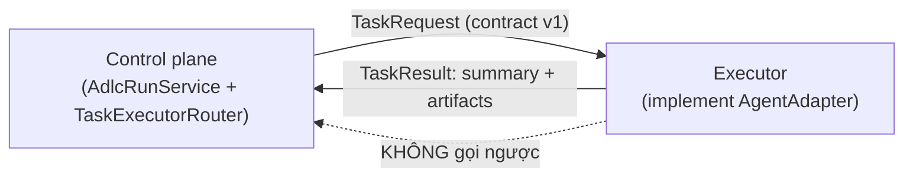

# Hợp đồng kết nối Executor — control plane ↔ tầng thực thi (v1)

> Trạng thái: **v1 — đề xuất chuẩn hóa**. Văn bản này ràng buộc cách một executor
> (OpenCode, DSH, hoặc bất kỳ runtime tương lai nào) cắm vào tầng điều phối của
> ADLC **không phải sửa control plane**. Nền tảng Protocol đã có trong
> `adlc-flow/langflow/adlc/adapter_interfaces.py`; tổng hợp interface gốc xem
> [hop-dong-ky-thuat.md](hop-dong-ky-thuat.md) Chương 1.

## 0. Nguyên tắc một dòng

**Control plane phân rã công việc, chọn agent, lập DAG, dispatch từng task; executor
chỉ thực hiện MỘT task và trả về kết quả theo hợp đồng.** Mọi cơ chế khác (phân rã
thêm, chia việc cho agent khác, đổi trạng thái run) đều thuộc về control plane.



## 1. Cổng ổn định executor phải cắm vào

Control plane chỉ nói chuyện với tầng thực thi qua hai điểm cố định
(`adapter_interfaces.py`):

| Port | Vai trò | Ghi chú |
| --- | --- | --- |
| `TaskExecutor` | Port duy nhất scheduler gọi trực tiếp: `execute(request, on_state_change)` | Router (`TaskExecutorRouter`) dispatch theo `request.executor.service` |
| `AgentAdapter` | Làm việc trong sandbox/memory do plane cấp: `execute(request, *, sandbox, memory)` | Executor hiện thực protocol này, được compose qua `AdapterTaskExecutor` + `AdapterBundle` |

Các adapter đi kèm (do plane cấp, executor **tiêu thụ** chứ không tự cấp):

| Adapter | Executor nhận được | Executor được phép |
| --- | --- | --- |
| `SandboxAdapter` → `SandboxSession` | `session_id`, `workspace_uri` | Làm việc BÊN TRONG workspace đó |
| `MemoryAdapter` → `MemoryContext` | `memory_refs`, `variables` | Đọc context đã được plane lọc theo scope |
| `TestingAdapter` | Được gọi sau agent để chuẩn hóa kết quả | Không bypass |

Định tuyến service là **string-keyed**: `ExecutorTarget.service` phải trùng exact
với `service_name` mà executor khai báo (hoặc rơi vào `default_executor`).
Mẫu cắm tham chiếu: `MockExecutor` (`mock_executor.py`) và
`mock_capability_executors.py` (mock theo capability: `mock:opencode-like`,
`mock:dsh-like`).

## 2. Executor PHẢI (MUST)

1. **Implement `AgentAdapter`** (hoặc `TaskExecutor` trực tiếp) — đúng chữ ký,
   bất đồng bộ, không side-effect ra ngoài sandbox.
2. **Khai báo `service_name` duy nhất** toàn cục và **`capabilities`** là tuple
   giá trị từ enum capability hiện có (`code_generation`, `content_writing`,
   `test_runner`, `security_scan`, `code_review`, `planning`, `reflection`,
   `orchestration`…). Hai executor không được dùng chung một `service_name`;
   router tra theo service, capability là dữ liệu để plane chọn executor.
3. **Nhận `TaskRequest` schema `0.1`** nguyên trạng, kể cả khi có
   `executor_contract` (mục 4). TaskRequest đã đóng gói contract scope;
   executor đọc, không được mở rộng phạm vi ngoài nó.
4. **Trả `TaskResult` chỉ chứa `summary` + `artifacts`**:
   - `output` = đối tượng có trường `summary` (kiểu v1: `{"summary": ...}` —
     hằng `CONTRACT_OUTPUT_KEYS` trong `mock_capability_executors.py` là giới hạn
     duy nhất).
   - `artifacts` = danh sách `Artifact` hợp lệ (có `producer`, `checksum`,
     `created_at`).
   - `metadata` chỉ chứa dữ liệu quan sát vận hành (adapter services, session id,
     contract đã nhận). Không hội thoại, không transcript, không log subagent.
5. **Tôn trọng sandbox/memory do plane cấp**: mọi đường dẫn, biến môi trường,
   ngữ cảnh phải đi qua `SandboxSession`/`MemoryContext` nhận được. Executor
   không tự ý truy cập workspace ngoài `workspace_uri`.
6. **Báo trạng thái đúng chuẩn**: `RUNNING` một lần khi bắt đầu, đúng một trạng
   thái kết thúc (`SUCCEEDED`/`FAILED`/`CANCELLED`) qua `on_state_change` — hoặc
   khi compose qua `AdapterTaskExecutor` thì để runtime lo việc này.
7. **Phân biệt kết quả thành công/thất bại**: thất bại → `status=FAILED` kèm
   `ServiceError` đúng chuẩn mục 5; không được nuốt lỗi rồi trả `SUCCEEDED`.

## 3. Executor KHÔNG ĐƯỢC (MUST NOT)

1. **Gọi ngược vào control plane**: không import/call `run_service`, không tạo run,
   không dispatch task khác, không truy vấn repository của run.
2. **Tự đổi trạng thái task** ngoài chuỗi `RUNNING → (terminal)` đã nêu; không tự
   đánh dấu `SKIPPED`/`CANCELLED` task của task khác.
3. **Trả hội thoại/thông tin ngoài hợp đồng**: không nhét LLM messages, tool-call
   logs, nội dung subagent vào `output`, `metadata` hay `artifacts`. Suy luận,
   debugging chi tiết thuộc về observability plane, không thuộc `TaskResult`.
4. **Vượt scope** của contract: không ghi/sửa/xóa ngoài `allowed_paths`; không dùng
   quyền bị liệt kê trong `denied_permissions`.
5. **Chia nhỏ task thành nhiều agent** bên trong executor (phân rã là việc của
   control plane — xem mục 6).
6. **Tự quản retry/approval/deadline**: các cơ chế đó do scheduler sở hữu; executor
   chỉ phản ánh thực trạng qua status/error.

## 4. Trường hợp đồng mới trên `TaskRequest` (backward-compatible)

`TaskRequest` có thêm trường optional (default `None`, không đổi field bắt buộc
hiện có) — `langflow/adlc/models.py`:

```python
class ExecutorContract(BaseModel):
    schema_version: Literal["0.1"] = CONTRACT_VERSION
    allowed_paths: list[str] = []            # scope paths (đường dẫn tương đối repo, "*" = toàn bộ)
    denied_permissions: list[str] = []       # ví dụ: ["shell", "write", "network"]
    cost_tier: Literal["cheap", "medium", "expensive"] | None = None

class TaskRequest(BaseModel):
    ...
    executor_contract: ExecutorContract | None = None
```

| Trường | Ý nghĩa | Ai dùng |
| --- | --- | --- |
| `allowed_paths` | Contract scope: đường dẫn repo-relative executor (và mọi session/subagent nội bộ của nó) được phép chạm | Plane cấp khi materialize từ contract skilltree (`scope_paths`) |
| `denied_permissions` | Permission hints: quyền bị cấm (`shell`, `write`, `network`…). v1 mang tính khuyến nghị — executor không có privilege plane phải coi như cấm cứng | Plane cấp từ chính sách agent/step |
| `cost_tier` | Mức chi tiêu mong muốn, khớp `CostTier` của resource_manager | Plane cấp từ ngân sách run/step |

Tính tương thích ngược:

- Executor cũ không đọc trường này vẫn chạy bình thường (None = không ràng buộc).
- Executor mới đọc `request.executor_contract` khi có mặt; bỏ qua khi `None`.
- **Shim**: `run_service` hôm nay merge `constraints` từ task definition vào
  request; validator `mode="before"` tự lift `constraints["executor_contract"]`
  (dict) vào trường typed. Nghĩa là control plane hiện có đã gửi được hợp đồng
  chỉ bằng cách đặt `constraints["executor_contract"] = {...}` trong
  `AdlcTaskDefinition` — không cần sửa `run_service`. Khi `executor_contract`
  được set tường minh thì nó thắng.

## 5. Executor ĐƯỢC PHÉP (MAY) dùng session/subagent nội bộ

Executor được tổ chức nội bộ tùy ý (task loop, research, verification riêng cho
candidate, nối agent chuyên gia…) **CHỈ KHI** đồng thời thỏa cả ba điều kiện:

- **(a) Toàn bộ sub-work nằm trong scope** — mọi tệp subagent nội bộ đọc/ghi nằm
  trong `allowed_paths` của contract (và scope do sandbox cấp). Không có "subagent
  ra ngoài scope giúp boss".
- **(b) Tiêu tốn từ budget của task** — token, thời gian, chi phí của mọi
  session/subagent nội bộ nằm trong budget đã cấp cho task đó; executor không được
  "giấu chi phí" ở nơi khác.
- **(c) Đầu ra trả plane vẫn chỉ là `summary` + `artifacts`** — mọi transcript,
  log, hội thoại nội bộ dừng lại bên trong executor; plane chỉ nhận sản phẩm theo
  hợp đồng (mục 2.4).

### 5.1 Ranh giới không được vượt: subagent ≠ cơ chế phân task

Subagent/session nội bộ là **chi tiết triển khai của một task**, KHÔNG PHẢI lớp
phân phối công việc thứ hai:

- Phân rã công việc (một deliverable → các step) và phân bổ agent là việc của
  tầng điều phối, **hoàn tất trước khi dispatch**. Trong một task, executor tự lo
  nội thất; nó không được "nhận task lớn rồi tự chia cho N subagent như N task".
- Bên trong một task, task loop chạy **N iteration TUẦN TỰ** với **session fresh
  mỗi iteration** (đúng thiết kế hiện có). KHÔNG chạy song song qua subagent để
  né concurrency cap của scheduler — nếu công việc đủ lớn để cần song song thì
  đó là tín hiệu control plane phải tách task trong DAG, không phải executor tự
  mở luồng.

Bảng phân định trách nhiệm:

| Hỏi | Trả lời |
| --- | --- |
| Task này nên tách thành mấy step, mỗi step giao agent nào? | Control plane (trước dispatch) |
| Trong task này, tôi có được mở 1 session phụ để research trong scope không? | Được, nếu thỏa (a)+(b)+(c) |
| Tôi có được spawn 5 subagent chạy song song để nhanh hơn không? | Không — task loop tuần tự; muốn song song thì plane phải tạo các task song song trong DAG |
| Subagent của tôi có được sửa file ngoài `allowed_paths` không? | Không, không ngoại lệ |
| Kết quả subagent có được đưa thẳng vào `TaskResult.output` không? | Không — chỉ `summary`; chi tiết nén vào `artifacts` nếu cần |

## 6. Quy ước lỗi — `ServiceError`

Mọi lỗi executor trả về qua `TaskResult.error` theo model `ServiceError`
(`langflow/adlc/models.py`), bám pattern có sẵn trong `executor_router.py`
(`EXECUTOR_SERVICE_NOT_REGISTERED`):

| Trường | Bắt buộc | Quy ước |
| --- | --- | --- |
| `error_id` | ✔ | UUID mới mỗi lần xảy ra lỗi (không tái dùng) |
| `code` | ✔ | `UPPER_SNAKE_CASE`, duy nhất trong phạm vi service, ví dụ `EXECUTOR_SERVICE_NOT_REGISTERED`, `OPENCODE_SESSION_EXPIRED` |
| `category` | ✔ | Một giá trị enum: `VALIDATION`, `DEPENDENCY`, `TIMEOUT`, `EXECUTION`… |
| `message` | ✔ | Tiếng Anh, một câu, mô tả đúng lỗi (không lộ hội thoại) |
| `retryable` | ✔ | `True` chỉ khi lập lại attempt mới có thể thành công (mạng, timeout); lỗi hợp đồng/scope → `False` |
| `service` | ✔ | `service_name` của executor báo lỗi (hoặc router khi không tìm thấy service) |
| `details` | ✔ | Dict dữ liệu cấu trúc (requested_service, path vi phạm…), không chứa hội thoại |
| `correlation_id` | ✔ | Chuỗi truy vết dạng `run-{workflow_run_id}/task-{task_run_id}` như router đang làm |
| `occurred_at` | ✔ | UTC |

Executor **không được** tự retry trong lòng executor rồi trả lỗi chung chung:
thất bại tạm thời → `retryable=True` để scheduler quyết định; scheduler sở hữu
chính sách retry/backoff/deadline.

## 7. Checklist cắm executor mới

1. Tạo module executor, implement `AgentAdapter` (tham khảo
   `CapabilityMockAgentAdapter` trong `mock_capability_executors.py`).
2. Chọn `service_name` duy nhất, khai báo `capabilities` từ enum capability.
3. Compose vào `AdapterBundle` (sandbox/memory/testing — dùng adapter có sẵn hoặc
   tự viết theo Protocol) rồi bọc bằng `AdapterTaskExecutor`.
4. Đăng ký vào `TaskExecutorRouter` tại điểm dựng service (production: factory
   `get_production_host()`; test: fixture).
5. Tự kiểm: nhận `TaskRequest` có/không có `executor_contract`; trả `TaskResult`
   `output={"summary": ...}` + artifacts; lỗi theo `ServiceError` mục 6.
6. Viết test tích hợp kiểu `tests/unit/adlc/test_executor_contract_v1.py`:
   DAG nhiều task, nhiều executor, định tuyến theo service, ràng buộc contract.

## 8. Bằng chứng hiện có (khi viết tài liệu này)

- Router dispatch theo `ExecutorTarget.service`, trả `ServiceError` chuẩn khi
  thiếu service: `executor_router.py`.
- Mock bốn adapter + executor compose: `mock_adapters.py`, `mock_executor.py`,
  `adapter_runtime.py`.
- Mock theo capability cho test mix-executor: `mock_capability_executors.py`
  (`mock:opencode-like` → `code_generation`; `mock:dsh-like` → `security_scan`).
- Test hợp đồng v1 (13 test): `tests/unit/adlc/test_executor_contract_v1.py` —
  run 3 task (CODE_GENERATION → SECURITY_SCAN → integrate phụ thuộc cả hai) chạy
  đúng thứ tự DAG, kết quả về đúng service qua router, `TaskResult` chỉ chứa
  summary + artifacts, contract đi từ definition constraints đến tay executor.
