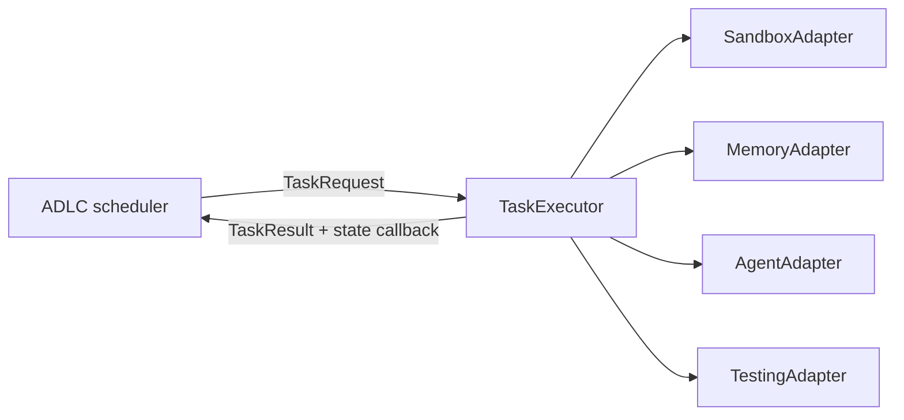
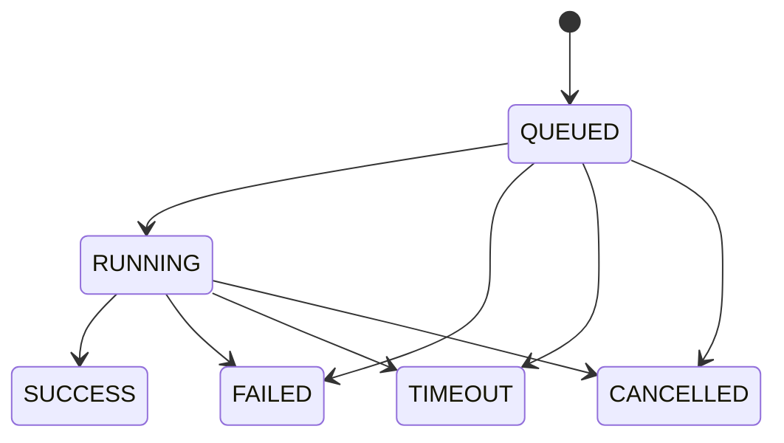

# Hợp đồng kỹ thuật ADLC — adapter interfaces, command execution v0.1, node-package authoring v0.1

> Tài liệu tham chiếu tổng hợp từ ba văn bản hợp đồng/giao diện gốc trên nhánh `agentHarness`. Toàn bộ bảng schema, kiểu dữ liệu, ví dụ JSON, mã lỗi và endpoint được giữ nguyên như bản gốc; phần văn xuôi được viết lại bằng tiếng Việt.

## Chương 1 — ADLC adapter interfaces (giao diện adapter)

Trạng thái bản gốc: **đã triển khai với các mock xác định (deterministic) và runtime worktree OpenCode bật tùy chọn (opt-in)**.

Scheduler chỉ phụ thuộc vào một điểm thực thi ổn định duy nhất: `TaskExecutor`. Executor cụ thể kết hợp các adapter Sandbox, Memory, Agent và Testing phía sau port đó. Việc thay thế một integration chỉ thay đổi cách nối dependency, không thay đổi lên lịch DAG, chuyển trạng thái nhiệm vụ (task-state transitions), retry, phê duyệt hay mã event.



### 1.1 Ranh giới ổn định

Các giao diện nằm trong `adlc-flow/langflow/adlc/adapter_interfaces.py`.

| Giao diện | Phương thức | Trách nhiệm |
|---|---|---|
| `TaskExecutor` | `execute(request, on_state_change)` | Port hướng về scheduler. Báo cáo `RUNNING` sau đó đúng một trạng thái kết thúc (terminal) và trả về `TaskResult` v0.1. |
| `SandboxAdapter` | `open_session(request)` / `close_session(request, session)` | Cấp phát và thu hồi workspace cho một lần thử (attempt) nhiệm vụ. |
| `MemoryAdapter` | `load_context(request)` / `record_result(request, result)` | Giải quyết context nhiệm vụ theo phạm vi và lưu giữ kết quả cuối cùng. |
| `AgentAdapter` | `execute(request, sandbox=..., memory=...)` | Thực hiện nhiệm vụ và trả về `TaskResult` v0.1. |
| `TestingAdapter` | `evaluate(request, result)` | Xác minh hoặc làm giàu kết quả của agent và trả về kết quả đúng hình dạng contract. |

`AdapterTaskExecutor` trong `adapter_runtime.py` triển khai port hướng về scheduler. Thứ tự thực thi của nó là:

1. Báo cáo `TaskRun.RUNNING` qua callback của coordinator.
2. Mở session sandbox.
3. Nạp context từ Memory.
4. Thực thi agent.
5. Xác minh kết quả qua Testing.
6. Ghi kết quả cuối cùng qua Memory.
7. Đóng phiên sandbox.
8. Báo cáo `SUCCEEDED`, `FAILED` hoặc `CANCELLED` qua callback của coordinator.

Nếu một adapter ném exception, runtime chuyển nó thành một `TaskResult` thất bại chứa `ServiceError` v0.1 với mã `ADAPTER_EXECUTION_FAILED`. Điều này ngăn một nhiệm vụ bị kẹt mãi trong trạng thái `RUNNING`.

### 1.2 Các triển khai mock ban đầu

Các triển khai ban đầu nằm trong `adlc-flow/langflow/adlc/mock_adapters.py` và không gọi ra bất kỳ dịch vụ bên ngoài nào.

| Triển khai | Hành vi hiện tại |
|---|---|
| `MockSandboxAdapter` | Trả về một handle workspace `mock://` xác định và giải phóng nó sau lần thử. Không tạo file hay container. |
| `MockMemoryAdapter` | Phản chiếu (echo) `memory_refs` và biến từ `TaskRequest.context`, sau đó lưu bản sao sâu (deep copy) của kết quả cuối vào bộ nhớ tiến trình. |
| `MockAgentAdapter` | Chờ `delayMs`, trả về đầu ra định sẵn, tạo đúng một mock artifact xác định, và tùy chọn trả về `MOCK_EXECUTION_FAILED`. |
| `MockTestingAdapter` | Đánh dấu kết quả agent thành công là `PASSED`; kết quả agent thất bại hoặc bị hủy được giữ nguyên và đánh dấu `NOT_RUN`. |

`MockExecutor` vẫn còn như một facade tương thích, nhưng hiện nó chỉ là tổ hợp mặc định của bốn mock trên. Cả mock workflow cố định lẫn runtime của saved-flow đều dùng chồng adapter này.

### 1.3 Quy tắc sở hữu (ownership rules)

- Scheduler sở hữu độ sẵn sàng DAG, mở khóa dependency, dispatch song song, retry, phê duyệt và trạng thái workflow.
- Coordinator sở hữu `WorkflowRun`, `TaskRun`, `ApprovalRequest` và việc đột biến (mutation) có thứ tự của `RunEvent`.
- Các adapter coi đầu vào request/context là bất biến và trả về dữ liệu; chúng không đột biến trạng thái lần chạy hay tự append event.
- Kết quả của adapter phải bảo toàn `request_id`, `workflow_run_id`, `task_run_id` và `attempt_id` từ request.
- `TestingAdapter.evaluate` trả về kết quả mà Memory ghi lại và coordinator chấp nhận.
- Dọn dẹp sandbox phải an toàn khi gọi một lần cho mỗi phiên đã mở thành công.

### 1.4 Thay thế mock sau này

Tạo các triển khai của cùng bốn protocol và kết hợp chúng phía sau `AdapterTaskExecutor`:

```python
executor = AdapterTaskExecutor(
    AdapterBundle(
        sandbox=SandboxServiceAdapter(...),
        memory=MemoryServiceAdapter(...),
        testing=TestingServiceAdapter(...),
        agent=OpenCodeAgentAdapter(...),
    )
)

run_service = AdlcRunService(executor=executor)
```

Không cần thay đổi phương thức nào của scheduler. Cấu hình production và service client được cố ý hoãn lại; bước này chỉ đóng băng (freeze) các giao diện, thứ tự tổ hợp và ranh giới sở hữu trạng thái.

### 1.5 Ranh giới provider OpenCode

`OpenCodeAgentAdapter` và `OpenCodeHttpClient` triển khai ranh giới provider phía Agent thực đầu tiên. Chúng dùng session API headless server của OpenCode theo tài liệu chính thức, thay vì gọi trực tiếp endpoint model OpenCode Zen:

1. tạo một session giới hạn trong thư mục do `SandboxAdapter` cung cấp;
2. chụp lại (snapshot) các message ID hiện có, gửi prompt nhiệm vụ suy ra từ contract một cách bất đồng bộ, và poll cho đến khi nhận được message trả lời hoàn tất mới trong thời hạn của nhiệm vụ;
3. lấy VCS diff của workspace cô lập trong khi worktree còn tồn tại;
4. trả về `TaskResult` v0.1, các chỉ số token và một tham chiếu artifact `opencode://` cho diff; và
5. hủy session khi ADLC đạt deadline hoặc bị hủy.

Adapter không bao giờ đọc file credential của provider và không bao giờ gửi khóa provider qua `TaskRequest`. OpenCode tự sở hữu việc xác thực provider. Cấu hình kết nối ADLC chỉ chứa URL server OpenCode, thông tin HTTP Basic tùy chọn cho server đó, lựa chọn model và lựa chọn agent.

`TaskExecutorRouter` hiện chọn một adapter bundle từ `ExecutorTarget.service` suy ra chính xác từ package. Service package mock vẫn được map tới `MockExecutor`; `agent-provider:opencode` chỉ được đăng ký khi thực thi trực tiếp (live execution) được bật tường minh. Các service không rõ sẽ fail closed thay vì fallback về hành vi mock.

`LocalWorktreeSandboxAdapter` cung cấp `opencode_directory` bắt buộc. Nó tạo đúng một detached worktree cho mỗi lần thử nhiệm vụ từ một revision đã commit được cấu hình, giữ thư mục cấp phát gốc bên ngoài kho nguồn, và xóa đúng worktree được quản lý đó khi thành công, thất bại hoặc hủy. `OpenCodeAgentAdapter` tiếp tục từ chối các phiên sandbox mock. Xem [Slice 6B](../plans/ke-hoach-slice.md).

### 1.6 Hạn chế hiện tại

- Trạng thái mock chỉ tồn tại trong tiến trình backend và biến mất khi restart.
- URI sandbox mock chỉ mang tính mô tả; adapter worktree cục bộ bật tùy chọn cung cấp cô lập filesystem nhưng không phải ranh giới bảo mật container.
- Memory không được chia sẻ giữa các tiến trình.
- Testing không thực thi lệnh test.
- OpenCode vẫn tắt theo mặc định và dùng Memory, Testing giả lập khi được bật.
- OpenCode sở hữu các session của nó, nhưng các byte VCS diff của workspace đã chụp không được giữ lại bởi bất kỳ service nào sau khi dọn dẹp. Kết quả lần chạy cục bộ trong tiến trình chỉ lưu checksum, URI tương quan mờ (opaque) và metadata các file thay đổi; tải patch xuống đòi hỏi một artifact store trong tương lai.

**Ghi chú về vị trí hiện tại:** ranh giới command request/response đã duyệt và log được tài liệu hóa trong [Command execution contract v0.1](#chương-2--command-execution-contract-v01). Các định nghĩa contract v0.1 (schema thực thi, state machine, ví dụ) hiện được nuôi giữ trong thư mục `adlc-contracts/v0.1/` của repo; các định nghĩa node package hoàn chỉnh nằm trong `adlc_components/packages/` (ví dụ `adlc_components/packages/coding-agent/`, `adlc_components/packages/approval/`) với schema workflow tương ứng tại `adlc-contracts/workflow/v0.1/`.

---

## Chương 2 — Command execution contract v0.1

Trạng thái bản gốc: **MERGED INTO EXECUTION CONTRACT v0.1** (đã gộp vào execution contract v0.1).

### 2.1 Mục đích

Contract này định nghĩa cách một adapter agent/testing yêu cầu một runner thực thi một lệnh cụ thể trong một sandbox đang tồn tại, và cách runner báo cáo trạng thái, log, lỗi và tham chiếu artifact.

Các định nghĩa lệnh là một phần của cùng bundle schema v0.1 thực thi và state machine với các hợp đồng nhiệm vụ. Hình dạng payload nhiệm vụ hiện có không bị thay đổi. Bước này chưa thêm `RunnerAdapter`, chưa thực thi subprocess, và chưa nối thực thi lệnh với scheduler.

### 2.2 Ranh giới


Một lần thử nhiệm vụ có thể thực thi không, một, hoặc nhiều lệnh. Trạng thái lệnh thuộc về ranh giới runner; scheduler tiếp tục sở hữu trạng thái `TaskRun` và `WorkflowRun`.

### 2.3 Các kiểu công khai (public types)

| Kiểu | Mục đích |
|---|---|
| `CommandExecutionRequest` | Yêu cầu lệnh kiểu argv, có tính idempotent, giới hạn trong workflow, nhiệm vụ, attempt và phiên sandbox. |
| `CommandExecutionResponse` | Snapshot lệnh hiện tại hoặc kết thúc (terminal) với exit code, dấu thời gian, log, tham chiếu artifact, và `ServiceError` tùy chọn. |
| `CommandExecutionStatus` | `QUEUED`, `RUNNING`, `SUCCESS`, `FAILED`, `TIMEOUT` hoặc `CANCELLED`. |
| `ExecutionLogEntry` | Bản ghi `SYSTEM`, `STDOUT` hoặc `STDERR` có thứ tự, có dấu thời gian, nhận biết-xóa-dữ-liệu-nhạy-cảm (redaction-aware). |
| `ArtifactReference` | Tham chiếu nhẹ đến các byte artifact ngoài băng tần (out-of-band). |

Các file chuẩn mực (normative):

- [`../adlc-contracts/v0.1/execution-contract.schema.json`](../../adlc-contracts/v0.1/execution-contract.schema.json)
- [`../adlc-contracts/v0.1/state-machines.json`](../../adlc-contracts/v0.1/state-machines.json)
- [`../adlc-contracts/v0.1/examples/`](../../adlc-contracts/v0.1/examples/)
- Model runtime: `adlc-flow/langflow/adlc/command_models.py`

### 2.4 Vòng đời



`SUCCESS`, `FAILED`, `TIMEOUT` và `CANCELLED` là các trạng thái kết thúc. Một lỗi khởi chạy có thể chuyển trực tiếp từ `QUEUED` sang `FAILED`, nên `started_at` có thể là null trong một response thất bại.

### 2.5 Các quyết định đã được phê duyệt

#### 1. Một execution contract duy nhất

Command request/response, trạng thái lệnh, log và tham chiếu artifact được gộp vào `adlc-contracts/v0.1`. Không có namespace command-contract riêng biệt. Bundle kết hợp này bị đóng băng sau lần phê duyệt này.

#### 2. `SUCCESS` so với `SUCCEEDED`

Command contract dùng giá trị `SUCCESS` theo yêu cầu. Các hợp đồng cấp nhiệm vụ tiếp tục dùng `SUCCEEDED`.

Ánh xạ trong tương lai:

| Lệnh | Cách hiểu ở cấp nhiệm vụ |
|---|---|
| `SUCCESS` | Có thể góp phần vào `TaskResult.SUCCEEDED`; nó không tự động hoàn thành nhiệm vụ. |
| `FAILED` | Chính sách agent/testing quyết định nhiệm vụ thất bại hay phục hồi. |
| `TIMEOUT` | Trở thành một `ServiceError` trong nhóm `TIMEOUT`. |
| `CANCELLED` | Trở thành một `ServiceError` trong nhóm `CANCELLED`. |

#### 3. Argv thay vì chuỗi shell

Request dùng `executable` cộng `arguments`. Chúng không chấp nhận một chuỗi lệnh shell được nội suy. Một triển khai shell trong tương lai phải là một capability của runner được khai báo tường minh, nhằm tránh khiến việc quoting và chọn shell trở nên ngầm định.

#### 4. Môi trường và secret

`environment` chứa các giá trị đã resolve, không nhạy cảm. `secret_refs` map tên biến môi trường tới các tham chiếu secret mờ (opaque). Giá trị secret thô không được xuất hiện trong request, log, metadata hay ví dụ.

#### 5. Log

Mỗi mục log mang một số thứ tự đơn điệu (monotonic), dấu thời gian, stream, mức độ (level), thông điệp và cờ `redacted`. Response có thể chứa một cửa sổ log giới hạn; `logs_truncated=true` báo cho client biết cần lấy toàn bộ stream từ kho log trong tương lai.

#### 6. Tham chiếu artifact

Response lệnh chỉ chứa tham chiếu. Byte artifact nằm ngoài response. Các bản ghi `Artifact` cấp nhiệm vụ đầy đủ được tạo sau đó bởi adapter/coordinator khi đầu ra lệnh được chấp nhận làm artifact của nhiệm vụ.

### 2.6 Quy tắc response theo từng trạng thái

| Trạng thái | Hình dạng bắt buộc |
|---|---|
| `QUEUED` | Không có dấu thời gian bắt đầu/kết thúc, exit code, lỗi hay thời lượng. |
| `RUNNING` | Có `started_at`; không có dấu thời gian kết thúc, exit code hay lỗi. |
| `SUCCESS` | Có `started_at` và `completed_at`, `exit_code=0`, `error=null`. |
| `FAILED` | Có `completed_at` và `ServiceError`; `started_at` và exit code có thể null nếu lỗi khởi chạy. |
| `TIMEOUT` | Có `completed_at` và `ServiceError.category=TIMEOUT`. |
| `CANCELLED` | Có `completed_at` và `ServiceError.category=CANCELLED`. |

### 2.7 Ranh giới triển khai tiếp theo

- Protocol `RunnerAdapter`.
- Hành vi `MockRunnerAdapter`.
- Callback trạng thái/log hoặc cơ chế truyền streaming.
- Nối `MockAgentAdapter` vào runner.
- Thực thi subprocess, container hoặc sandbox từ xa.
- API hủy và lưu trữ lệnh bền vững.

Bước triển khai nhỏ tiếp theo là `RunnerAdapter` cộng một `MockRunnerAdapter` xác định bao phủ thành công, thất bại, timeout, hủy, stdout/stderr và các tham chiếu mock artifact.

---

## Chương 3 — ADLC node-package authoring contract v0.1

Trạng thái bản gốc: **DRAFT — SLICE 2 PLANNING CONTRACT IMPLEMENTED**

Cập nhật lần cuối: 2026-09-08

### 3.1 Trạng thái contract

Tài liệu này định nghĩa các trường và bất biến (invariant) cho soạn thảo blueprint ADLC. Các JSON Schema sinh ra tương ứng, ví dụ, runtime model đóng (closed), registry repository, parser blueprint, compiler, validator và API planning hiện đã tồn tại trong `adlc-contracts/workflow/v0.1/` và `adlc-flow/langflow/adlc/`. Toàn bộ contract vẫn ở trạng thái draft cho đến khi phê duyệt kế hoạch và mock materialization hoàn tất checklist đóng băng.

Contract soạn thảo này được đánh phiên bản tách biệt với contract thực thi nhiệm vụ/lệnh đã đóng băng trong `adlc-contracts/v0.1/`.

### 3.2 Các đối tượng công khai

| Đối tượng | Mục đích |
|---|---|
| `PackageReference` | Chọn một phiên bản node-package bất biến chính xác. |
| `NodePackageDefinition` | Khai báo một triển khai giai đoạn tái sử dụng, interface, cấu hình và chính sách. |
| `WorkflowDefinition` | Lưu một blueprint ADLC trừu tượng cùng các giai đoạn (stage) và cạnh (edge) của nó. |
| `WorkflowStage` | Cấu hình một thực thể giai đoạn cấp cao trên canvas. |
| `WorkflowEdge` | Khai báo một dependency không có chu trình và các binding slot có tên tùy chọn. |
| `ResolvedNodeSpec` | Ghi lại cấu hình package hiệu dụng hoàn chỉnh được một nhiệm vụ kế hoạch dùng. |
| `ExecutionPlan` | Lưu một phiên bản kế hoạch sinh/biên dịch bất biến. |
| `PlanTask` | Mô tả một nhiệm vụ kế hoạch cụ thể và khả năng truy vết của nó về giai đoạn nguồn. |

### 3.3 Quy ước truyền dữ liệu (wire conventions)

1. Payload công khai mang `schema_version: "0.1"`.
2. Tên trường dùng `snake_case`; enum dùng giá trị chữ hoa.
3. ID là UUID trừ khi một trường tường minh định danh khóa registry.
4. Dấu thời gian là giá trị UTC RFC 3339.
5. Phiên bản package dùng semantic version chính xác như `0.1.0`; khoảng phiên bản (range) và `latest` bị cấm trong các stage workflow được lưu bền.
6. Các đối tượng đã phát hành (published) từ chối trường lạ. Phần mở rộng sản phẩm thuộc về `metadata`.
7. Mọi giá trị phần mở rộng phải tương thích JSON và không chứa secret.
8. Digest dùng SHA-256 trên canonical JSON với các trường chỉ phục vụ trình bày bị loại trừ.

### 3.4 `PackageReference`

Các trường bắt buộc:

| Trường | Kiểu | Quy tắc |
|---|---|---|
| `package_id` | string | Định danh registry ổn định dùng chữ thường, chữ số, dấu chấm, gạch dưới hoặc gạch ngang. |
| `version` | string | Semantic version chính xác. |
| `content_digest` | string hoặc null | Tùy chọn khi đang draft; bắt buộc trên một `ExecutionPlan` đã được chấp nhận. |

Ví dụ:

```json
{
  "package_id": "coding-agent",
  "version": "0.1.0",
  "content_digest": "sha256:5b7d0f8f74d827d21f2cbe25f64aa21a0e41e52fc720f45d432d16f70155be91"
}
```

### 3.5 `NodePackageDefinition`

#### Các trường bắt buộc

| Trường | Kiểu | Ý nghĩa |
|---|---|---|
| `schema_version` | `"0.1"` | Phiên bản authoring contract. |
| `package_id` | string | Định danh package ổn định. |
| `version` | chuỗi semver | Phiên bản published bất biến. |
| `status` | enum | `DRAFT`, `PUBLISHED` hoặc `DEPRECATED`. |
| `name` | string | Tên hiển thị cho người dùng. |
| `description` | string | Mục đích hiển thị cho người dùng. |
| `kind` | enum | `AGENT`, `TESTING`, `REVIEW`, `APPROVAL`, `ROUTER` hoặc `JOIN`. |
| `interface` | object | Các đầu vào/đầu ra logic có tên. |
| `configuration_schema` | JSON Schema object | Xác minh các override cấu hình của giai đoạn. |
| `defaults` | object | Giá trị mặc định được phép bởi configuration schema. |
| `override_allowlist` | mảng string | Các đường dẫn JSON Pointer mà một giai đoạn hoặc lần chạy được phép override. |
| `implementation` | object | Tham chiếu triển khai đáng tin cậy và dữ liệu tương thích. |
| `execution_profile` | object hoặc null | Tổ hợp agent/runtime; bắt buộc với các loại package có thể thực thi. |
| `default_policies` | object | Mặc định retry, timeout, phê duyệt, permission, resource, Memory và Sandbox. |
| `compatibility` | object | Các phiên bản engine và execution contract được hỗ trợ. |
| `metadata` | object | Phần mở rộng không chứa secret. |

`content_digest` và các dấu thời gian xuất bản là metadata do registry sinh ra. Chúng không được chấp nhận từ một bản tải package không đáng tin cậy nếu không được tính toán lại.

Các đường dẫn trong `override_allowlist` trỏ tới một tài liệu resolution chuẩn hóa có gốc là `/configuration`, `/policies` và `/execution_profile`. Chúng không trỏ trực tiếp vào các trường trong JSON package published.

#### Các slot interface

Mỗi slot đầu vào hoặc đầu ra có:

```json
{
  "name": "source_patch",
  "schema_ref": "adlc://schemas/source-patch/0.1",
  "required": true,
  "multiple": false,
  "description": "Source changes to verify."
}
```

Quy tắc:

- Tên slot là duy nhất trong chiều của nó.
- Một đầu vào bắt buộc ở phía đích phải được cung cấp bởi cấu hình giai đoạn, đầu vào workflow/lần chạy, hoặc đúng một edge binding tương thích.
- Trong v0.1, giá trị `schema_ref` của nguồn và đích phải khớp nhau. Phân type phụ (schema-subtyping) bị hoãn lại.
- Dữ liệu nhị phân không bao giờ được nhúng. Slot mang giá trị hoặc tham chiếu theo schema của nó.

#### Execution profile

Một package có thể thực thi có thể khai báo:

```json
{
  "provider_ref": "agent-provider:opencode",
  "model_ref": "model:opencode/default",
  "system_prompt_ref": "prompt:coding-agent/0.1.0",
  "rule_set_refs": ["rules:secure-coding/0.1.0"],
  "hook_refs": ["hook:task-lifecycle/0.1.0"],
  "capabilities": {
    "tool_refs": ["tool:workspace-read", "tool:workspace-write"],
    "skill_refs": [],
    "plugin_refs": [],
    "mcp_server_refs": []
  },
  "memory_policy_ref": "memory:task-context/0.1.0",
  "sandbox_policy_ref": "sandbox:mock-workspace/0.1.0",
  "secret_refs": {}
}
```

Mọi provider, capability, chính sách, prompt, rule và hook được tham chiếu đều phải phân giải qua các registry đáng tin cậy. Một package không bao giờ nhúng khóa API hay giá trị secret đã phân giải.

#### Ví dụ tối thiểu hoàn chỉnh

```json
{
  "schema_version": "0.1",
  "package_id": "coding-agent",
  "version": "0.1.0",
  "status": "PUBLISHED",
  "name": "Coding Agent",
  "description": "Implements a scoped code change and produces a source patch.",
  "kind": "AGENT",
  "interface": {
    "inputs": [
      {
        "name": "requirement",
        "schema_ref": "adlc://schemas/requirement/0.1",
        "required": true,
        "multiple": false,
        "description": "The scoped implementation requirement."
      }
    ],
    "outputs": [
      {
        "name": "source_patch",
        "schema_ref": "adlc://schemas/source-patch/0.1",
        "required": true,
        "multiple": false,
        "description": "Reference to the produced source changes."
      }
    ]
  },
  "configuration_schema": {
    "type": "object",
    "additionalProperties": false,
    "properties": {
      "temperature": {"type": "number", "minimum": 0, "maximum": 1},
      "max_iterations": {"type": "integer", "minimum": 1, "maximum": 100}
    }
  },
  "defaults": {
    "temperature": 0.2,
    "max_iterations": 20
  },
  "override_allowlist": [
    "/configuration/temperature",
    "/configuration/max_iterations",
    "/policies/timeout_ms"
  ],
  "implementation": {
    "adapter_type": "AGENT_PROVIDER",
    "adapter_ref": "agent-provider:opencode",
    "entrypoint": "coding"
  },
  "execution_profile": {
    "provider_ref": "agent-provider:opencode",
    "model_ref": "model:opencode/default",
    "system_prompt_ref": "prompt:coding-agent/0.1.0",
    "rule_set_refs": ["rules:secure-coding/0.1.0"],
    "hook_refs": ["hook:task-lifecycle/0.1.0"],
    "capabilities": {
      "tool_refs": ["tool:workspace-read", "tool:workspace-write"],
      "skill_refs": [],
      "plugin_refs": [],
      "mcp_server_refs": []
    },
    "memory_policy_ref": "memory:mock-task-context/0.1.0",
    "sandbox_policy_ref": "sandbox:mock-workspace/0.1.0",
    "secret_refs": {}
  },
  "default_policies": {
    "retry": {"max_attempts": 2},
    "timeout_ms": 1200000,
    "approval": {"gate_type": null},
    "permissions": {"mode": "PACKAGE_ALLOWLIST"},
    "resources": {},
    "runtime_overridable": []
  },
  "compatibility": {
    "engine": {"minimum_version": "0.1.0"},
    "execution_contract_versions": ["0.1"]
  },
  "metadata": {}
}
```

### 3.6 `WorkflowDefinition`

Các trường bắt buộc:

- `schema_version`;
- `workflow_definition_id`;
- `project_id`;
- `name` và mô tả tùy chọn;
- `version` số nguyên;
- `status` vòng đời;
- `stages`;
- `edges`;
- `default_policies`;
- người tạo và dấu thời gian; và
- `metadata`.

Biểu diễn `Flow.data` của Langflow mang một marker ở cấp flow:

```json
{
  "nodes": [],
  "edges": [],
  "viewport": {"x": 0, "y": 0, "zoom": 1},
  "adlc": {
    "document_type": "WORKFLOW_DEFINITION",
    "schema_version": "0.1",
    "workflow_definition_id": "11111111-1111-4111-8111-111111111111",
    "version": 1
  }
}
```

Cơ chế thực thi Langflow gốc bỏ qua metadata soạn thảo này vì blueprint ADLC chỉ được xử lý bởi các API planning của ADLC.

### 3.7 `WorkflowStage`

Các trường ngữ nghĩa bắt buộc:

| Trường | Ý nghĩa |
|---|---|
| `stage_id` | ID ổn định trong mọi phiên bản của workflow definition này. |
| `stage_type` | Phân loại vòng đời như `IMPLEMENTATION`, `TESTING` hoặc `APPROVAL`. |
| `name` | Tên giai đoạn hiển thị cho người dùng. |
| `objective` | Kết quả mà giai đoạn phải đạt được. |
| `inputs` | Giá trị literal có tên hoặc tham chiếu mờ cung cấp trực tiếp vào các slot đầu vào của package. |
| `expected_outputs` | Các đầu ra logic có tên kỳ vọng từ giai đoạn. |
| `package_ref` | ID và phiên bản package chính xác. |
| `configuration_overrides` | Giá trị thực thể lệch khỏi package defaults, phải vượt qua cả package schema lẫn override allow-list. |
| `execution_profile_overrides` | Thay đổi tham chiếu provider/model được package phê duyệt; cấm credential provider thô. |
| `policy_overrides` | Các thay đổi retry, timeout, resource hoặc phê duyệt được cho phép. |
| `secret_refs` | Các tham chiếu secret mờ. |
| `position` | Dữ liệu trình bày ReactFlow bị loại khỏi digest ngữ nghĩa. |
| `metadata` | Phần mở rộng không chứa secret. |

Giai đoạn không được chứa mã nguồn component thực thi hay các phần nội bộ của package bị trùng lặp.

### 3.8 `WorkflowEdge`

Hình dạng v0.1:

```json
{
  "edge_id": "44444444-4444-4444-8444-444444444444",
  "source_stage_id": "22222222-2222-4222-8222-222222222222",
  "target_stage_id": "33333333-3333-4333-8333-333333333333",
  "condition": "ON_SUCCESS",
  "bindings": [
    {
      "source_output": "source_patch",
      "target_input": "source_patch"
    }
  ],
  "metadata": {}
}
```

Quy tắc:

- `source_stage_id` và `target_stage_id` phải tồn tại và khác nhau.
- Các cặp nguồn/đích trùng lặp bị từ chối.
- Toàn bộ đồ thị dependency phải không có chu trình (acyclic) và có ít nhất một gốc.
- Trong v0.1, `condition` chính xác là `ON_SUCCESS`.
- Tên binding phải tồn tại trong interface package đã phân giải.
- Schema nguồn và đích của mỗi binding phải khớp nhau.
- Một đầu vào đích bắt buộc, không multiple, không thể nhận nhiều hơn một edge binding.
- Retry, phục hồi thất bại và làm lại (rework) không tạo chu trình trong đồ thị.

### 3.9 `ResolvedNodeSpec`

Trình phân giải (resolver), không phải client, tạo đối tượng này. Nó chứa:

- ID và phiên bản workflow definition nguồn;
- ID giai đoạn nguồn;
- tham chiếu package chính xác, bao gồm digest published;
- kind của package và tham chiếu triển khai;
- interface đã phân giải đầy đủ;
- cấu hình đã phân giải đầy đủ;
- execution profile đã phân giải đầy đủ;
- chính sách đã phân giải đầy đủ;
- `secret_refs` mờ chưa phân giải;
- `resolved_digest` canonical;
- phiên bản resolver và dấu thời gian; và
- bằng chứng xác minh (validation evidence).

Nó loại trừ vị trí canvas, trạng thái UI tạm thời, secret đã phân giải, và các đối tượng registry có thể thay đổi.

### 3.10 `ExecutionPlan` và `PlanTask`

Vòng đời kế hoạch:

```text
DRAFT -> GENERATED -> VALIDATED -> APPROVED -> EXECUTING
                 \-> INVALID
                         \-> REJECTED
                         \-> SUPERSEDED
```

Một execution plan chứa:

- workflow definition nguồn cùng phiên bản chính xác của nó;
- phiên bản kế hoạch và lịch sử trạng thái bất biến;
- các lỗi và cảnh báo xác minh;
- các giả định có thứ tự;
- các bản ghi `PlanTask` cụ thể;
- digest package và resolved node specs; và
- provenance phê duyệt và sinh kế hoạch.

Mỗi `PlanTask` chứa:

- `plan_task_id`;
- `source_workflow_stage_id`;
- `resolved_node_spec_id` và digest;
- objective, đầu vào, dependency và binding cụ thể;
- các artifact kỳ vọng;
- provider/capability được giao và môi trường cần thiết;
- chính sách hiệu dụng; và
- lý do lập kế hoạch (planning rationale).

### 3.11 Thuật toán phân giải (resolution algorithm)

Với mỗi giai đoạn, compiler phải thực hiện các thao tác sau theo thứ tự:

1. Nạp phiên bản package published chính xác.
2. Kiểm tra content digest và khai báo tương thích của nó.
3. Xác minh cấu hình giai đoạn với package schema.
4. Áp dụng package defaults.
5. Áp dụng workflow defaults ở những nơi package cho phép.
6. Áp dụng stage overrides chỉ với các đường dẫn JSON Pointer trong allow-list.
7. Xác minh các tham chiếu provider, capability, chính sách, Memory, Sandbox, prompt, rule và hook.
8. Xác minh các slot đầu vào/đầu ra và edge bindings.
9. Bảo toàn `secret_refs` mà không phân giải giá trị của chúng.
10. Canonical hóa đối tượng đã phân giải về mặt ngữ nghĩa và tính digest SHA-256 của nó.
11. Gắn bằng chứng xác minh và tạo `ResolvedNodeSpec`.

Bất kỳ thất bại nào cũng ngăn kế hoạch đạt trạng thái `VALIDATED`.

### 3.12 Ánh xạ runtime

| Trường soạn thảo/kế hoạch | Đích runtime |
|---|---|
| Định danh giai đoạn và `PlanTask` | `TaskRun.task_definition_id` và các trường truy vết do materializer thêm vào. |
| Objective cụ thể và đầu vào có tên | `TaskRequest.input`. |
| Kết quả thượng nguồn và tham chiếu context | `TaskRequest.context`. |
| Dependencies | `TaskRequest.dependency_task_run_ids`. |
| Lựa chọn provider, môi trường và capability | `TaskRequest.executor`. |
| Chính sách timeout, retry, resource và permission | Chính sách thực thi của coordinator và adapter. |
| Đầu ra có tên | `TaskResult.output`. |
| Tham chiếu artifact đã tạo | Các bản ghi `Artifact` được materialize trong `TaskResult.artifacts`. |
| Thất bại thực thi | `TaskResult.error` dùng `ServiceError`. |

Materializer có thể thêm các trường lưu trữ nội bộ, nhưng không được sửa đổi các payload v0.1 truyền trên mạng đã đóng băng nếu không có phiên bản execution contract mới.

### 3.13 Các mã lỗi xác minh

API planning nên trả về các mã ổn định, bao gồm:

| Mã | Ý nghĩa |
|---|---|
| `PACKAGE_NOT_FOUND` | ID/phiên bản package chính xác không tồn tại hoặc không hiển thị. |
| `PACKAGE_DIGEST_MISMATCH` | Byte published không khớp digest đã đăng ký. |
| `PACKAGE_INCOMPATIBLE` | Phiên bản engine hoặc execution contract không được hỗ trợ. |
| `PACKAGE_OVERRIDE_FORBIDDEN` | Giai đoạn đã cố override một đường dẫn ngoài allow-list. |
| `PACKAGE_CONFIGURATION_INVALID` | Cấu hình hiệu dụng vi phạm JSON Schema của nó. |
| `CAPABILITY_NOT_REGISTERED` | Package tham chiếu một capability chưa đăng ký. |
| `CAPABILITY_NOT_ALLOWED` | Chính sách project hoặc caller cấm capability đó. |
| `STAGE_INPUT_UNBOUND` | Một đầu vào logic bắt buộc không có giá trị hay binding. |
| `STAGE_BINDING_INCOMPATIBLE` | Schema slot nguồn và đích không khớp. |
| `STAGE_DEPENDENCY_MISSING` | Edge tham chiếu một giai đoạn không tồn tại. |
| `STAGE_DEPENDENCY_CYCLE` | Dependency của workflow chứa chu trình. |
| `WORKFLOW_HAS_NO_ROOT` | Workflow không có giai đoạn khởi đầu. |

### 3.14 Checklist đóng băng (freeze checklist)

Contract soạn thảo chỉ có thể được đánh dấu đóng băng sau khi:

- [x] Các file JSON Schema Draft 2020-12 tồn tại cho mọi đối tượng công khai.
- [x] Các ví dụ hợp lệ tồn tại cho một agent package, approval package, blueprint và kế hoạch đã phân giải.
- [x] Runtime model và schema sinh ra dùng cùng quy tắc bắt buộc và enum.
- [x] Các test cân bằng schema/runtime đạt.
- [x] Các test vector canonicalization và digest độc lập nền tảng.
- [x] Các test từ chối secret thô và tham chiếu secret mờ đạt.
- [x] Các test phân giải package chính xác, tương thích, deprecation, digest và override đạt.
- [x] Các test binding edge-slot của blueprint đạt.
- [x] Mock blueprint đầu tiên được đánh dấu biên dịch thành công mà không đột biến runtime.
- [ ] Kế hoạch đã xác minh đầu tiên materialize thành công qua mock scheduler.

### 3.15 Ghi chú về vị trí hiện tại của các hợp đồng

Bản gốc của ba hợp đồng trong chương này trỏ tới các thư mục schema/runtime sau; các thư mục này vẫn tồn tại trong repo và là nơi các hợp đồng được nuôi giữ:

- **`adlc-contracts/v0.1/`** — execution contract đã đóng băng cho nhiệm vụ và lệnh: `execution-contract.schema.json`, `state-machines.json`, `examples/`.
- **`adlc-contracts/workflow/v0.1/`** (và `v0.2` đang đề xuất) — schema soạn thảo blueprint workflow, ví dụ Langflow blueprint.
- **`adlc_components/packages/`** — định nghĩa node package hoàn chỉnh đang được nuôi giữ: `coding-agent`, `approval`, `task-loop`, `coding-agent-opencode`, `coding-agent-contract-harness`, `coding-agent-deepseek-harness`, `harness-workflow-plan`, `harness-workflow-task`, `harness-workflow-publish`, `skilltree-authoring-deepseek-harness`, `task-loop-opencode`, v.v. (kèm `adlc_components/packages/README.md`).
- Các model runtime vẫn nằm trong `adlc-flow/langflow/adlc/` (ví dụ `adapter_interfaces.py`, `mock_adapters.py`, `command_models.py`).

Khi hợp đồng thay đổi, phải cập nhật đồng bộ cả ba vị trí: schema trong `adlc-contracts/`, định nghĩa package trong `adlc_components/packages/`, và model runtime trong `adlc-flow/langflow/adlc/`.

## Nguồn tổng hợp

Tài liệu này được tổng hợp từ các file sau (lưu trữ trên nhánh git `agentHarness`, đọc bằng `git show agentHarness:docs/<file>`):

- `docs/adapter-interfaces.md` — ADLC adapter interfaces (Chương 1)
- `docs/command-execution-contract.md` — Command execution contract v0.1 (Chương 2)
- `docs/node-package-contract-v0.1.md` — ADLC node-package authoring contract v0.1 (Chương 3)
