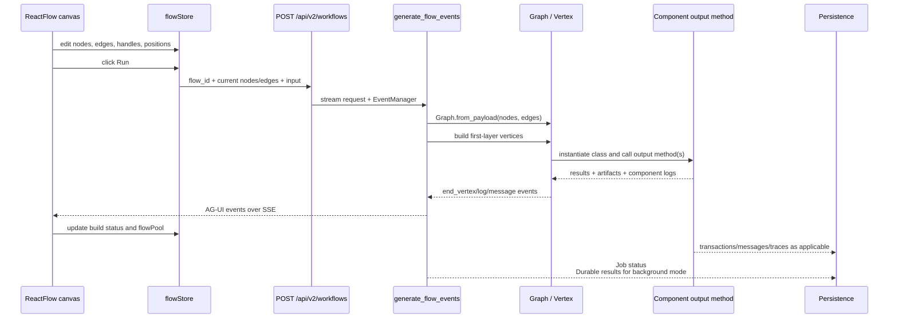

# Bản đồ codebase Langflow: từ chỉnh sửa flow đến thực thi

Phạm vi: dấu vết thực thi Langflow gốc cộng các bổ sung planning/runtime của ADLC, được xác minh ngày 2026-09-11. Các đường dẫn tính từ thư mục gốc kho; các mục sau đôi khi bỏ tiền tố `adlc-flow/` khi dùng đường dẫn module làm cách viết tắt. Bản đồ này đi theo **đường chạy canvas gốc** trước, rồi tách riêng compiler blueprint ADLC để hai mô hình đồ thị không bị nhầm là một.

## Đường thực thi chính (executive path)

Đường thông thường của trình soạn thảo là:

```text
/flow/:id ReactFlow canvas
  -> Zustand flowStore (nodes + edges)
  -> autosave/manual save: PATCH /api/v1/flows/{flow_id}
  -> Run: POST /api/v2/workflows
       body gồm các nodes + edges hiện tại, kể cả khi chưa lưu
  -> LangflowWorkflowHost.stream_response()
  -> _stream_event_frames()
  -> generate_flow_events()
  -> build_graph_from_data()
  -> Graph.from_payload()
  -> Graph.build_vertex() -> Vertex.build() -> component output method
  -> EventManager -> AG-UI SSE -> frontend flowPool/build status
```

Hệ quả chính rất quan trọng: **bấm Run không nạp trước hàng `Flow.data` đã lưu.** Frontend đưa các `nodes` và `edges` hiện tại trong bộ nhớ vào request v2, nên các thay đổi canvas chưa lưu được thực thi như chúng đang hiển thị.

Đường blueprint ADLC cố ý khác biệt và chỉ đi vào runtime từ một kế hoạch đã được chấp nhận:

```text
saved Flow.data với marker WORKFLOW_DEFINITION v0.1 tường minh
  -> POST /api/v1/adlc/workflow-definitions/{workflow_id}/plans
  -> planning/parser.py: WorkflowDefinition
  -> packages/resolver.py: ResolvedNodeSpec cho mỗi giai đoạn
  -> planning/validator.py: DAG + đầu vào logic/bindings
  -> planning/compiler.py: ExecutionPlan + PlanTasks xác định
  -> planning/service.py: dòng dõi phiên bản có phạm vi owner + snapshot đã phân giải
  -> tùy chọn POST /api/v1/adlc/execution-plans/{plan_id}/regenerate
       tạo phiên bản kế nhiệm; phiên bản tiền nhiệm thành SUPERSEDED
  -> phê duyệt kế hoạch khi cần
  -> POST /api/v1/adlc/execution-plans/{plan_id}/runs
  -> planning/materializer.py: định nghĩa nhiệm vụ runtime + khả năng truy vết
  -> run_service.py: scheduler hiện có, mock adapters, phê duyệt, sự kiện, kết quả
```

Việc sinh kế hoạch đọc đồ thị đã lưu thay vì trạng thái trình duyệt chưa lưu, và không tạo bản ghi runtime nào. Chỉ lệnh `/runs` trên kế hoạch đã chấp nhận tạo các bản ghi `WorkflowRun`, `TaskRun`, phê duyệt, artifact, log và `RunEvent`. Đường legacy `POST /api/v1/adlc/runs` đòi hỏi `executionMode=LEGACY_FLOW`, ủy quyền cho `langflow/adlc/legacy_flow_normalizer.py`, và từ chối một blueprint được đánh dấu để không thể vượt qua bước biên dịch. Tên và loại hiển thị component không chọn chế độ hay tạo cổng phê duyệt.

## Trả lời nhanh

| Câu hỏi | Vị trí chính / câu trả lời |
|---|---|
| 1. Flow được tạo và sửa ở đâu? | `adlc-flow/frontend/src/hooks/flows/use-add-flow.ts` tạo nó; `adlc-flow/frontend/src/pages/FlowPage/components/PageComponent/index.tsx` chứa trình soạn thảo ReactFlow; `adlc-flow/frontend/src/stores/flowStore.ts` sở hữu các nodes/edges trực tiếp. |
| 2. JSON nào biểu diễn đồ thị? | Một object ReactFlow: `{ nodes, edges, viewport }`, được type bởi `FlowType.data` và backend `GraphData`. Runtime chỉ cần `nodes` và `edges`. |
| 3. API nào lưu nó? | Tạo: `POST /api/v1/flows/`. Cập nhật/autosave: `PATCH /api/v1/flows/{flow_id}`. Đồ thị được lưu trong `flow.data`. |
| 4. API nào bắt đầu thực thi? | Canvas hiện tại: `POST /api/v2/workflows` với `mode: "stream"` và `stream_protocol: "agui"`. Các lần chạy có thể tạm dừng/HITL gửi cùng endpoint với `mode: "background"`. |
| 5. Đồ thị được dựng ở đâu? | Streaming: `langflow/api/build.py::generate_flow_events` -> `create_graph` -> `langflow/api/utils/flow_utils.py::build_graph_from_data` -> `lfx/graph/graph/base.py::Graph.from_payload`. |
| 6. Các component được nạp ở đâu? | Palette/catalog: `GET /api/v1/all` -> `lfx/interface/components.py`. Dựng class runtime: `lfx/interface/initialize/loading.py::instantiate_class`. |
| 7. Thực thi node diễn ra ở đâu? | `Graph.build_vertex` -> `Vertex.build` -> `Vertex._build` -> `get_instance_results` -> `Component.build_results` -> phương thức output của component được chọn. |
| 8. Log và trace được phát ở đâu? | Log component: `Component.log` -> `EventManager.on_log` và `TracingService.add_log`; trace: `Graph.initialize_run`, `Component._build_with_tracing`, và persistence tracer gốc. |
| 9. Kết quả được lưu ở đâu? | Kết quả trực tiếp vào frontend `flowPool` trước; kết quả bền vững/background dùng `job.result`, `job_events` và `vertex_build`. Messages, transactions và trace gốc có các bảng riêng. Không có một bảng kết quả chạy phổ quát duy nhất. |

## Vị trí các phần của compiler blueprint ADLC

| Mối quan tâm | Triển khai hiện tại |
|---|---|
| JSON blueprint đã lưu | `Flow.data.adlc`, `node.data.adlc`, `position` node ngoài, và `edge.data.adlc` tùy chọn; fixture hoàn chỉnh trong `adlc-contracts/workflow/v0.1/examples/langflow-blueprint-flow-data.json`. |
| Phát hiện chế độ tường minh | `adlc-flow/langflow/adlc/planning/parser.py::has_adlc_blueprint_marker`. |
| Phân tích canvas → miền | `adlc-flow/langflow/adlc/planning/parser.py::parse_blueprint_flow`. |
| Danh mục package | `adlc-flow/langflow/adlc/packages/registry.py::RepositoryNodePackageRegistry`. |
| Phân giải package chính xác | `adlc-flow/langflow/adlc/packages/resolver.py::NodePackageResolver.resolve`. |
| Xác minh đầu vào và edge-slot | `adlc-flow/langflow/adlc/planning/validator.py::BlueprintValidator.validate`. |
| Dựng kế hoạch xác định | `adlc-flow/langflow/adlc/planning/compiler.py::BlueprintCompiler.compile`. |
| Phiên bản kế hoạch và phạm vi owner | `adlc-flow/langflow/adlc/planning/service.py::ExecutionPlanService`. |
| Tái sinh và kế thừa (supersession) | `ExecutionPlanService.regenerate_plan`; HTTP `POST /adlc/execution-plans/{plan_id}/regenerate`. |
| Ánh xạ runtime kế hoạch đã chấp nhận | `adlc-flow/langflow/adlc/planning/materializer.py::ExecutionPlanMaterializer`. |
| Lập lịch và trạng thái runtime | `adlc-flow/langflow/adlc/run_service.py::AdlcRunService`. |
| Routes HTTP package/plan | `adlc-flow/langflow/api/v1/adlc.py`. |

Xem [Blueprint parsing and execution planning](../plans/ke-hoach-slice.md) để biết ánh xạ wire chính xác, các kết quả xác minh, và giới hạn lưu trữ trong tiến trình hiện tại. Xem [Plan regeneration and supersession](../plans/ke-hoach-slice.md) để biết dòng dõi kế hoạch và hành vi lần chạy lịch sử.

## Chuỗi trình tự đầu-cuối



## 1. Tạo và chỉnh sửa flow ở frontend

### Tạo

`adlc-flow/frontend/src/hooks/flows/use-add-flow.ts::addFlow` là đường tạo flow ở frontend.

- Một flow trống bắt đầu là `{ nodes: [], edges: [], viewport: { zoom: 1, x: 0, y: 0 } }`.
- Các flow nhập/sao chép được chuẩn hóa bởi `processDataFromFlow`.
- `createNewFlow(...)` dựng bản ghi flow.
- `usePostAddFlow` gửi nó tới `POST /api/v1/flows/`.

Lời gọi HTTP nằm trong `adlc-flow/frontend/src/controllers/API/queries/flows/use-post-add-flow.ts`.

### Chỉnh sửa

Route trình soạn thảo được khai báo trong `adlc-flow/frontend/src/routes.tsx` là `/flow/:id/`, render `FlowPage`.

Canvas nằm trong `adlc-flow/frontend/src/pages/FlowPage/components/PageComponent/index.tsx`:

- `<ReactFlow nodes={...} edges={...}>` vẽ đồ thị.
- `onNodesChange` và `onEdgesChange` ghi thay đổi vào store.
- `onConnectMod` snapshot trạng thái undo và gọi `flowStore.onConnect`.
- các thao tác kéo/thả/kết nối lại/xóa dùng cùng store và các hook autosave.

Trạng thái trực tiếp của trình soạn thảo nằm trong `adlc-flow/frontend/src/stores/flowStore.ts`. Phương thức `onConnect` của nó chuyển một `Connection` của XYFlow thành một cạnh và phân tích JSON handle nguồn/đích thành `edge.data.sourceHandle` và `edge.data.targetHandle`.

Autosave được phối hợp bởi `adlc-flow/frontend/src/hooks/flows/use-autosave-flow.ts`; tuần tự hóa đồ thị thực tế và lời gọi PATCH nằm trong `adlc-flow/frontend/src/hooks/flows/use-save-flow.ts`.

## 2. JSON đồ thị

Đồ thị đã lưu là `FlowType.data`, được type trong `adlc-flow/frontend/src/types/flow/index.ts` là:

```ts
ReactFlowJsonObject<AllNodeType, EdgeType>
```

Backend phản chiếu nó trong:

- `adlc-flow/langflow/api/v1/schemas/__init__.py::FlowDataRequest`
- `adlc-flow/lfx/src/lfx/graph/graph/schema.py::GraphData`
- `adlc-flow/lfx/src/lfx/graph/vertex/schema.py::NodeData`
- `adlc-flow/lfx/src/lfx/graph/edge/schema.py::EdgeData`

Hình dạng đại diện, với template component lớn được viết tắt:

```json
{
  "nodes": [
    {
      "id": "ChatInput-abc123",
      "type": "genericNode",
      "position": { "x": 100, "y": 200 },
      "data": {
        "id": "ChatInput-abc123",
        "type": "ChatInput",
        "node": {
          "display_name": "Chat Input",
          "base_classes": ["Message"],
          "template": {
            "_type": "Component",
            "code": {
              "type": "code",
              "value": "...Python component source..."
            },
            "input_value": {
              "name": "input_value",
              "type": "str",
              "value": ""
            }
          },
          "outputs": [
            { "name": "message", "method": "message_response", "types": ["Message"] }
          ]
        }
      }
    }
  ],
  "edges": [
    {
      "id": "xy-edge-id",
      "source": "ChatInput-abc123",
      "target": "ChatOutput-def456",
      "data": {
        "sourceHandle": {
          "id": "ChatInput-abc123",
          "name": "message",
          "dataType": "ChatInput",
          "output_types": ["Message"]
        },
        "targetHandle": {
          "id": "ChatOutput-def456",
          "fieldName": "input_value",
          "type": "other",
          "inputTypes": ["Message"]
        }
      }
    }
  ],
  "viewport": { "x": 0, "y": 0, "zoom": 1 }
}
```

Các quan sát chính:

- `position`, kích thước, trạng thái chọn và `viewport` là mối quan tâm của trình soạn thảo.
- `node.data.type` là định danh component.
- `node.data.node.template` chứa giá trị đầu vào và `_type`.
- `node.data.node.template.code.value` chứa mã nguồn component thực thi được trong các flow đã lưu. Xác minh chính sách runtime và thay thế mã đáng tin cậy xảy ra trước khi nó được đánh giá.
- Ngữ nghĩa thực thi cạnh đến từ các bản ghi handle, đặc biệt là `name` đầu ra nguồn và `fieldName` đích.
- Các note node có `type: "noteNode"` và bị bỏ qua khi `Graph` thực thi dựng các vertex.

## 3. API lưu và persistence

### Frontend

`adlc-flow/frontend/src/hooks/flows/use-save-flow.ts::saveFlow` đọc:

- `flowStore.nodes`
- `flowStore.edges`
- `reactFlowInstance.getViewport()`

Nó đặt chúng vào `flow.data`, rồi gọi `usePatchUpdateFlow` trong `adlc-flow/frontend/src/controllers/API/queries/flows/use-patch-update-flow.ts`.

Endpoints:

| Thao tác | Endpoint HTTP | Route backend |
|---|---|---|
| Tạo | `POST /api/v1/flows/` | `adlc-flow/langflow/api/v1/flows.py::create_flow` |
| Cập nhật/autosave | `PATCH /api/v1/flows/{flow_id}` | `adlc-flow/langflow/api/v1/flows.py::update_flow` |

`getURL("FLOWS")` phân giải thành `/api/v1/flows` qua `frontend/src/controllers/API/helpers/constants.ts` và `frontend/src/customization/utils/urls.ts`.

### Backend

- Tạo gọi `adlc-flow/langflow/api/v1/flows_helpers.py::_new_flow`.
- Cập nhật gọi `adlc-flow/langflow/api/v1/flows_helpers.py::_patch_flow`.
- Cả hai xác minh chính sách, cập nhật dòng SQLModel, flush nó, và tùy chọn phản chiếu nó vào kho lưu flow filesystem đã cấu hình.
- Trường cơ sở dữ liệu chuẩn là `adlc-flow/langflow/services/database/models/flow/model.py::Flow.data`, một cột JSON trên bảng `flow`.

## 4. Các API thực thi

### Đường trình soạn thảo hiện tại

`adlc-flow/frontend/src/stores/flowStore.ts::buildFlow` xác minh đồ thị, dựng:

```ts
{
  flowId,
  message: input_value,
  threadId: session,
  startComponentId,
  stopComponentId,
  flowData: { nodes: get().nodes, edges: get().edges },
  files
}
```

và chọn:

- `runFlowAGUI(...)` cho một lần chạy live thông thường.
- `runFlowHITL(...)` khi một node Human Input hay tool-approval khiến việc tạm dừng có thể xảy ra.

Request truyền đi được dựng trong `adlc-flow/frontend/src/controllers/API/agui/run-agent.ts`.

| Trường hợp | Endpoint và chế độ |
|---|---|
| Lần chạy canvas có xác thực thông thường | `POST /api/v2/workflows`, `mode: "stream"`, `stream_protocol: "agui"` |
| Playground chia sẻ/công khai | `POST /api/v2/workflows/public`, chỉ stream; các ghi đè đồ thị request bị cố ý bỏ qua |
| Lần chạy tạm dừng được/HITL | `POST /api/v2/workflows`, `mode: "background"`; sự kiện từ `GET /api/v2/workflows/{job_id}/events` |

Route backend có xác thực được đăng ký bởi `adlc-flow/lfx/src/lfx/workflow/router.py::create_workflow_router`, gắn dưới `/api/v2` trong `adlc-flow/langflow/api/router.py`, và ràng buộc tới `adlc-flow/langflow/api/v2/workflow_host.py::LangflowWorkflowHost`.

### Các bề mặt thực thi khác

Đây là các đường thật nhưng không phải đường nút Run canvas hiện tại:

- `POST /api/v1/run/{flow_id_or_name}` trong `adlc-flow/langflow/api/v1/endpoints.py`: bề mặt thực thi cho lập trình viên/API-key.
- `POST /api/v1/build/{flow_id}/flow` cộng `GET /api/v1/build/{job_id}/events` trong `adlc-flow/langflow/api/v1/chat.py`: đường build legacy/trực tiếp và voice. Nguồn ghi rõ rằng canvas đã chuyển sang v2.

## 5. Dựng đồ thị phía backend

Với request trình soạn thảo live hiện tại:

1. `lfx/workflow/router.py::execute_workflow` xác thực, phân giải flow, ủy quyền thực thi, phân tích request, và điều phối chế độ stream tới host.
2. `langflow/api/v2/workflow_host.py::stream_response` gọi `langflow/api/v2/workflow.py::build_stream_response`.
3. `build_stream_response` tạo adapter AG-UI và đi vào `langflow/api/v2/workflow_execution.py::_execute_streaming_workflow`.
4. `_stream_event_frames` tạo một `EventManager` và gọi `langflow/api/build.py::generate_flow_events`.
5. `generate_flow_events.create_graph` chọn:
   - `build_graph_from_data(...)` khi request có `data` — đây là đường trình soạn thảo vì `flowStore` gửi các nodes/edges hiện tại.
   - `build_graph_from_db(...)` khi request không có `data`.
6. `langflow/api/utils/flow_utils.py::build_graph_from_data` gọi `Graph.from_payload(...)`, đặt metadata session/run, và khởi tạo tracing.
7. `adlc-flow/lfx/src/lfx/graph/graph/base.py::Graph.from_payload` xác minh/di chuyển chính sách, trích `nodes` và `edges`, dựng `Graph`, và gọi `add_nodes_and_edges`.
8. `add_nodes_and_edges` chạy `process_flow`, rồi `initialize()` -> `_build_graph()` để tạo các đối tượng `Vertex` và `CycleEdge`, nối tham số, khởi tạo component, và chuẩn bị các map kề.

Chế độ đồng bộ v2 dùng một đường gần đó nhưng riêng biệt trong `langflow/api/v2/workflow_execution.py::execute_sync_workflow`: áp tweaks lên một bản sao sâu của `flow.data` đã lưu, gọi `Graph.from_payload`, tìm các node kết thúc, rồi chạy đồ thị và trả về `WorkflowExecutionResponse`.

## 6. Nạp component

Có hai nghĩa khác nhau của "nạp một component".

### Nạp palette/catalog

Trình soạn thảo lấy các template component khả dụng từ `GET /api/v1/all` trong `adlc-flow/langflow/api/v1/endpoints.py::get_all`.

Nó gọi `adlc-flow/lfx/src/lfx/interface/components.py::get_and_cache_all_types_dict`, phần khởi tạo của nó hợp nhất:

1. Các built-in từ `import_langflow_components` (index/cache dựng sẵn trong production, import module động làm phương án dự phòng).
2. Các custom component từ `components_path` / `LANGFLOW_COMPONENTS_PATH` đã cấu hình.
3. Các bundle hệ extension từ các nguồn installed, seed, `lfx.bundles`, development và inline.

`lfx/interface/components.py::_initialize_component_cache` phát hành các template hợp nhất và các index identity code/hash một cách nguyên tử (atomically). Chế độ lazy ban đầu chỉ nạp metadata; `ensure_component_loaded` thay một stub bằng template đầy đủ khi cần.

### Nạp class runtime

Tại thời điểm dựng đồ thị/chạy:

1. `Graph._build_graph` tạo các vertex và thường gọi `_instantiate_components_in_vertices`.
2. `Vertex.instantiate_component` hoặc `Vertex._build` gọi `adlc-flow/lfx/src/lfx/interface/initialize/loading.py::instantiate_class`.
3. `instantiate_class` lấy tham số `code`, phân giải bản sao server đáng tin khi chính sách đòi hỏi, gọi `eval_custom_component_code`, và khởi tạo class kết quả.

Như vậy catalog cung cấp template cho trình soạn thảo, trong khi đồ thị thực thi mang mã/cấu hình component cùng mỗi node. Nạp runtime không đơn giản tra một tên class trong palette rồi gọi; nó xác minh và đánh giá mã được biểu diễn bởi đồ thị đã lưu/trong request.

## 7. Thực thi node

Driver streaming trong `adlc-flow/langflow/api/build.py` đi qua đồ thị:

1. `generate_flow_events.build_graph_and_get_order` sắp xếp đồ thị và chọn lớp đầu tiên.
2. `build_vertices` chạy các vertex lớp đầu tiên đồng thời và đệ quy lên lịch các successor được trả về.
3. `_build_vertex` gọi `Graph.build_vertex(...)`.
4. `Graph.build_vertex` xử lý caching kết quả đóng băng, rồi gọi `Vertex.build(...)` khi cần làm việc.
5. `Vertex.build` chạy danh sách bước của nó; bước mặc định là `Vertex._build`.
6. `Vertex._build` phân giải các giá trị vertex thượng nguồn, khởi tạo component nếu cần, rồi gọi `initialize.loading.get_instance_results`.
7. Với các component hiện đại, `get_instance_results` gọi `Component.build_results`.
8. `Component._build_results` lặp qua các output được chọn và gọi phương thức cấu hình của từng output qua `_get_output_result` — đây là điểm mà logic do component viết thực sự chạy.
9. Kết quả được chuyển thành `VertexBuildResponse`; `on_end_vertex` phát nó và driver lên lịch các vertex chạy tiếp theo.

Bộ chạy đồ thị tổng quát (`Graph.async_start` / `Graph.astep`) tới cùng lõi `Graph.build_vertex` và `Vertex.build`. Driver live/background v2 dùng cách đi đệ quy riêng chủ yếu để giữ hợp đồng sự kiện canvas và persistence.

## 8. Log và trace

### Log ứng dụng/hệ thống

`adlc-flow/lfx/src/lfx/log/logger.py` định nghĩa logger cấu trúc dùng chung trong toàn bộ mã API, đồ thị, vertex, nạp component và persistence. Nó hỗ trợ đầu ra console/file, một bộ đệm truy xuất tùy chọn, redaction, và tương quan/xuất OpenTelemetry.

### Log hiển thị với component

`adlc-flow/lfx/src/lfx/custom/custom_component/component.py::Component.log` làm ba việc:

1. Làm sạch và append một `Log` vào `_logs` in-memory của component.
2. Thêm log vào trace component đang hoạt động qua `TracingService.add_log`.
3. Phát `EventManager.on_log` với `component_id` và tên output.

`adlc-flow/lfx/src/lfx/events/event_manager.py::create_default_event_manager` map `on_log` thành một sự kiện `log` thô. `adlc-flow/lfx/src/lfx/workflow/agui_translator.py` chuyển nó thành một AG-UI `CustomEvent(name="langflow.log")`. `frontend/src/controllers/API/agui/run-flow-bridge.ts` nhận nó và append vào mục node/output khớp trong flow pool của frontend.

### Giao dịch thực thi (execution transactions)

`Vertex.build` gọi `_log_transaction_async` khi thành công hay lỗi. Bản ghi đầu vào/đầu ra/trạng thái đã làm sạch cho mỗi vertex được lưu vào `transaction` qua:

- `adlc-flow/langflow/services/transaction/service.py`
- `adlc-flow/langflow/services/database/models/transactions/model.py::TransactionTable`

Chúng được truy xuất qua `/api/v1/monitor/transactions` trong `langflow/api/v1/monitor.py`.

### Trace

- `Graph.initialize_run` gọi `TracingService.start_tracers`.
- `Graph.flow_execution_span` phát một flow span cấp ứng dụng cho APM của người vận hành.
- `Component._build_with_tracing` bọc mỗi component trong `TracingService.trace_component` và ghi các đầu vào, đầu ra, lỗi, log và callback con LangChain.
- `Graph.end_all_traces` gọi `TracingService.end_tracers`.
- `adlc-flow/langflow/services/tracing/native.py::NativeTracer` được bật theo mặc định và flush trace cùng các span component/LangChain vào các bảng `trace` và `span` định nghĩa trong `langflow/services/database/models/traces/model.py`.
- Các tích hợp tùy chọn được khởi tạo từ `langflow/services/tracing/service.py` (LangSmith, LangFuse, LangWatch, Arize Phoenix, Opik, Traceloop, Openlayer).

Trace gốc được đọc qua `/api/v1/monitor/traces` trong `adlc-flow/langflow/api/v1/traces.py`.

## 9. Lưu kết quả lần chạy

Có chủ ý không có một vị trí persistence duy nhất cho toàn bộ đầu ra lần chạy. Việc lưu phụ thuộc vào chế độ thực thi và loại kết quả.

| Dữ liệu | Vị trí | Khi nào |
|---|---|---|
| Đầu ra node live hiển thị trên canvas | Frontend `flowStore.flowPool` qua `run-flow-bridge.ts::applyStateDelta` | Stream live v2 hiện tại; trạng thái tạm thời của trình duyệt. |
| Định danh/trạng thái lần chạy | Bảng `job`, `langflow/services/database/models/jobs/model.py::Job` | Các đường live, sync và background tạo/theo dõi một workflow job khi có thể. |
| Kết quả workflow kết thúc | `job.result` JSON | Các lần chạy background thành công đặt nó trong `background_execution/runner.py::JobRunner._drive`. Sync chỉ ghi khi `sync_result_storage_enabled` được bật. Stream live thông thường không đặt `Job.result` kết thúc. |
| Lỗi workflow kết thúc | `job.error` JSON | Các lần chạy bền vững/background thất bại, timeout hoặc bị hủy; trạng thái cũng được ghi trên dòng `job`. |
| Phát lại sự kiện bền vững | Bảng `job_events` | Chỉ background/HITL; nuôi `GET /api/v2/workflows/{job_id}/events` và resume. |
| Kết quả build/artifact mỗi node | Bảng `vertex_build` (`VertexBuildTable`) khóa bởi `flow_id`, vertex `id`, và `job_id` tùy chọn | Các lần chạy background truyền `run_id=job_id`, nên `_stream_event_frames` bật `log_builds`. Stream live v2 thông thường không truyền run ID và cố ý không persist vertex builds. Build v1 legacy có thể persist khi `log_builds=true`. |
| Kiểm toán thực thi mỗi node | Bảng `transaction` (`TransactionTable`) | Ghi thành công/lỗi của `Vertex.build`; đầu vào/đầu ra/trạng thái đã làm sạch. |
| Chat messages / trạng thái message stream | Bảng `message` (`MessageTable`) | Các component dùng `send_message`/`astore_message`, khi `graph.persist_messages` cho phép persistence. Không phải mọi output component là một message. |
| Trace thực thi gốc | Các bảng `trace` và `span` | Tracing gốc bật theo mặc định trừ khi tắt; flush khi kết thúc lần chạy (và tại các ranh giới tạm dừng HITL). |
| Định nghĩa đồ thị đã lưu | `flow.data` | Chỉ save/autosave. Đây là cấu hình, không phải kết quả lần chạy. |

Với một lần chạy canvas thông thường, đường đầu ra quan sát được vì vậy là:

```text
Vertex result
  -> end_vertex event
  -> AG-UI STATE_DELTA / custom events
  -> run-flow-bridge.ts
  -> flowStore.flowPool và build status
```

Với một lần chạy bền vững/HITL, cùng lần thực thi đó cộng thêm tạo ra:

```text
job.result + job_events + vertex_build(job_id=run_id)
```

Messages, transactions và traces vẫn là các bản ghi cắt ngang (cross-cutting) riêng trong cả hai trường hợp, tùy theo cấu hình persistence và tracing của lần chạy.

## Các điểm vào khi gỡ lỗi

Khi lần dõi một lần chạy thất bại, thứ tự sau cho đường ngắn nhất tới lỗi:

1. `frontend/src/stores/flowStore.ts::buildFlow` — xác minh đồ thị request thực tế và chế độ.
2. `frontend/src/controllers/API/agui/run-flow-bridge.ts` — xác minh cách các sự kiện SSE trở thành trạng thái canvas.
3. `lfx/src/lfx/workflow/router.py::execute_workflow` — xác minh dispatch/auth/chế độ.
4. `langflow/api/v2/workflow_execution.py::_stream_event_frames` — xác minh driver stream và các cờ persistence.
5. `langflow/api/build.py::generate_flow_events` — xác minh nguồn đồ thị, thứ tự sắp xếp và lên lịch vertex.
6. `lfx/src/lfx/graph/graph/base.py::Graph.from_payload` và `Graph.build_vertex` — xác minh vật hóa đồ thị và thực thi cấp đồ thị.
7. `lfx/src/lfx/graph/vertex/base.py::Vertex._build` — xác minh phân giải tham số thượng nguồn và dựng component.
8. `lfx/src/lfx/custom/custom_component/component.py::_build_results` — xác minh phương thức output của component thực sự đã chạy.
9. `langflow/services/tracing/native.py` cộng các bản ghi `transaction`, `vertex_build`, `message` và `job` — xác minh những gì còn sót lại sau khi request kết thúc.

## Nguồn tổng hợp

Tài liệu này được dịch và tổng hợp từ file sau (lưu trữ trên nhánh git `agentHarness`, đọc bằng `git show agentHarness:docs/<file>`):

- `docs/langflow-codebase-map.md` — Langflow codebase map: flow editing through execution
