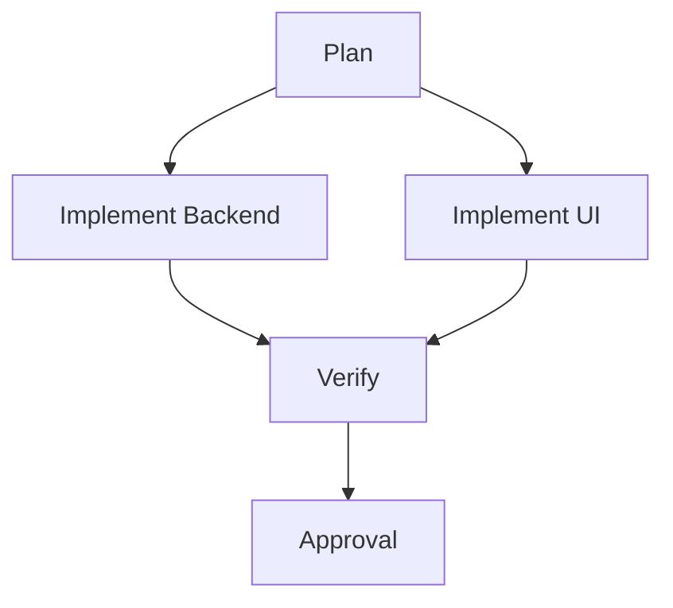

# Lực chạy và phục hồi — Run History bền vững, dự án cục bộ, mock workflow

> Tài liệu tham chiếu tổng hợp từ ba văn bản gốc trên nhánh `agentHarness`: lịch sử lần chạy bền vững và phục hồi sau restart, dự án cục bộ và xác minh flow trực tiếp, và mock workflow. Các bảng cấu hình, route API, lệnh và kết quả xác minh được giữ nguyên như bản gốc.

## Phần I — Durable Run History và phục hồi sau restart

Slice này giữ lịch sử runtime của ADLC sau khi tiến trình backend thoát. Nó không chuyển chính sách orchestration hay các quyết định phê duyệt vòng đời vào các plugin Harness.

### I.1 Những gì được lưu

Một snapshot workflow nguyên tử chứa quyền sở hữu (ownership), run/task IDs, chế độ thực thi và tham chiếu kế hoạch, định nghĩa/cấu hình nhiệm vụ runtime đã đóng băng, các dependency, các request đã dispatch bất biến cùng định danh attempt/idempotency, các kết quả nhiệm vụ đã chấp nhận hoặc đang chờ, các yêu cầu/quyết định phê duyệt vòng đời, các descriptor artifact, và các sự kiện có thứ tự. Việc dựng backend khôi phục các snapshot đó; startup ứng dụng khởi động các observer phục hồi đúng một lần.

Sổ cái (ledger) riêng biệt cho attempt/result/delivery đã ký của Harness vẫn là nguồn sự thật cho các kết quả agent đã chấp nhận. Nhờ đó các **kết quả Agent (Agent results)** hoàn thành có thể được đọc mà không cần kết nối tới một phiên Harness live.

Các byte source-patch do ADLC chụp cũng sống sót qua restart, với các kiểm tra SHA-256/phạm vi hiện có: 2 MiB mỗi artifact, 32 MiB tổng và hết hạn sau 24 giờ. Việc đọc/mở lại cơ sở dữ liệu không gia hạn thời hạn hết hạn. Các descriptor artifact khác không phải là cam kết rằng byte file ngoài của chúng đã được lưu trữ.

### I.2 Cấu hình lưu trữ

Cả hai kho đều bền vững theo mặc định, tính theo dự án đã cài đặt chứ không theo thư mục khởi chạy:

| Cấu hình | Mặc định |
| --- | --- |
| `ADLC_RUN_DB_PATH` | `adlc-flow/data/adlc-runs.sqlite3` |
| `ADLC_HARNESS_ATTEMPT_DB_PATH` | `adlc-flow/data/adlc-harness-attempts.sqlite3` |

Dùng đường dẫn tuyệt đối khi override một trong hai cấu hình. Các đường dẫn attempt được cấu hình tường minh hiện có vẫn được dùng; thay đổi này không di chuyển hay thay thế dữ liệu của chúng. Một giá trị rỗng/chỉ-whitespace tường minh chọn lưu trữ in-memory cho test và không nên dùng cho triển khai bền vững.

Dùng đúng một cặp coordinator/worker ADLC cho mỗi cặp cơ sở dữ liệu. Snapshot SQLite có hàng rào revision tối ưu (optimistic revision fence), nhưng slice này không có worker lease phân tán hay đồng bộ live-cache liên tiến trình. Giữ các cơ sở dữ liệu và sidecar SQLite trên một volume cục bộ bền vững. Chúng chứa đầu vào/đầu ra lần chạy và các patch; bảo vệ chúng bằng kiểm soát truy cập của hệ điều hành. Sao lưu chúng nhất quán bằng công cụ hỗ trợ SQLite. Không xóa các kho này như một thủ tục restart/phục hồi.

### I.3 Hành vi phục hồi

| Trạng thái đã lưu | Hành vi khi khởi động |
| --- | --- |
| Lần chạy kết thúc (terminal) | Khôi phục nó mà không thực thi hay đọc từ xa. |
| Phê duyệt vòng đời đang chờ | Khôi phục cùng approval/result; chờ Approve hoặc Reject. |
| Kết quả Harness được chấp nhận khi coordinator đang chết | Áp dụng kết quả đã chấp nhận về phía mình đúng một lần, giữ nguyên các ID gốc. |
| Nhiệm vụ Harness đang chạy, FORM/APPROVAL đang chờ, hoặc kết quả MANUAL sẵn sàng | Quan sát phiên ràng buộc hiện có, giữ submission mode và tương quan. |
| Không thể thiết lập attempt/session hiện có | Tạm dừng với lỗi phục hồi có thể retry có cấu trúc; không tạo/hủy phiên từ xa. |
| Kết quả đã chấp nhận đến sau một chẩn đoán phục hồi | Chấp nhận nó ở lần restart tiếp theo hoặc qua Retry tường minh, không tăng số lần thử hay gọi lại model. |
| Executor bị gián đoạn, không có khả năng tiếp tục | Tạm dừng chờ Retry tường minh; không phát lại request đã dispatch của nó. |
| Nhiệm vụ chưa bao giờ được dispatch, mọi dependency đã thành công | Lập lịch bình thường dùng định nghĩa runtime đã đóng băng và một hàng rào dispatch bền vững. |

Shutdown hủy các observer ADLC, không hủy các phiên Harness. Phục hồi có thể thực hiện AUTO submission đã cấu hình bình thường trên một phiên đã chuẩn bị hiện có; MANUAL vẫn là thủ công. Không có đường phục hồi nào tạo một phiên thay thế hay gửi prompt model mới. Khi một kết quả hiện có hoàn thành một dependency, các nhiệm vụ hạ nguồn chưa được dispatch có thể tiến hành bình thường.

Xác thực callback đã ký, bảo vệ phát lại delivery, tương quan attempt và chấp nhận kết quả bất biến vẫn không đổi. Polling không thể ghi đè một kết quả callback kết thúc. Một lần ghi snapshot phải thành công trước mọi dispatch ngoài mới; một writer cũ dừng lại thay vì ghi đè snapshot mới hơn.

Chẩn đoán thiếu-session gồm `HARNESS_RECOVERY_SESSION_UNAVAILABLE` kèm `cause_code`, hoặc `ADLC_RECOVERY_ATTEMPT_MISSING`. Xem lại attempt/session Harness hiện có trước khi yêu cầu một Retry mới, đặc biệt khi độ sẵn sàng vận chuyển không chắc chắn. Một kết quả đã lưu trữ có thể có mặt ngay cả khi một cảnh báo điều khiển live đang hiển thị.

### I.4 UI và API

Mở **Run History** từ header ứng dụng, hoặc điều hướng tới `/runs`. Trang hiển thị tên/chế độ workflow, run ID, trạng thái, số nhiệm vụ hoàn thành và thời gian bắt đầu/cập nhật. Lọc trạng thái, làm mới, phân trang, và dùng **Open run** để quay về Run Detail gốc.

`GET /api/v1/adlc/runs` đòi hỏi xác thực ADLC bình thường:

```text
GET /api/v1/adlc/runs?status=WAITING_APPROVAL&limit=25&offset=0
GET /api/v1/adlc/runs?flow_id=<workflow UUID>&limit=25&offset=0
```

`limit` trong khoảng 1–100, `offset` không âm, `status` là enum trạng thái workflow và `flow_id` là một UUID. Response chứa `runs`, `total`, `limit` và `offset`. Mỗi bản tóm tắt gồm các ID, chế độ thực thi, trạng thái, số nhiệm vụ và dấu thời gian, không chứa đầu vào/kết quả nhiệm vụ hay credential của owner. Frontend cũng chấp nhận bộ lọc workflow tại `/runs?flowId=<workflow UUID>`.

Các endpoint detail/task/event/artifact/approval/agent-result giữ các kiểm tra owner hiện có. Lần chạy của người dùng khác trả về 404 thay vì lộ sự tồn tại hay dữ liệu của nó.

### I.5 Các bước kiểm tra restart thủ công

Trước tiên restart backend và frontend một lần để nạp phiên bản này. Sau đó:

1. Bắt đầu một lần chạy Blueprint với provider ghim `my-codex`, model `cx/gpt-5.6-luna`, một requirement chỉ đọc và `submission_mode: MANUAL`.
2. Khi FORM/APPROVAL xuất hiện, ghi lại các ID lần chạy, nhiệm vụ, attempt, session và interaction. Restart **chỉ ADLC**, để Harness chạy tiếp.
3. Mở Run History và lần chạy đó. Trả lời tương tác hiện có trong ADLC, chờ `READY_FOR_SUBMISSION`, rồi Submit. Các ID và số lần thử không nên đổi vì restart.
4. Kiểm tra `SUCCEEDED` và **Agent results**. Restart ADLC lần nữa; cùng detail/events/result vẫn còn khả dụng. Kết quả hoàn thành không cần Harness phải online.
5. Riêng biệt, restart ADLC tại một cổng phê duyệt vòng đời workflow. Cùng yêu cầu vẫn phải hỗ trợ Approve hoặc Reject; một source patch đã chụp chưa hết hạn vẫn có thể được review.

Tránh restart Harness trong một lượt model đang hoạt động cho test này: điều đó kiểm tra chính sách lượt bị gián đoạn của Harness thay vì gắn lại coordinator. Bộ test tự động của slice dùng một Harness client tổng hợp và không bao giờ gọi model trả phí.

### I.6 Các kiểm tra kín (hermetic, PowerShell)

Từ `adlc-flow`, cô lập test khỏi bất kỳ cơ sở dữ liệu lập trình viên hay cấu hình executor live nào:

```powershell
$env:ADLC_RUN_DB_PATH=' '
$env:ADLC_HARNESS_ATTEMPT_DB_PATH=' '
$env:ADLC_HARNESS_ENABLED='false'
$env:ADLC_OPENCODE_ENABLED='false'
.venv\Scripts\python.exe -m pytest tests/unit/adlc tests/unit/api/v1/test_adlc_runs.py tests/unit/api/v1/test_adlc_harness_results.py tests/unit/api/v1/test_adlc_artifacts.py tests/unit/api/v1/test_adlc_plans.py -q -o log_cli=false
```

Các test khởi tạo các kho SQLite tạm thời tường minh ở nơi durability đang được kiểm tra. Các trường hợp restart bao phủ lịch sử kết thúc, quyết định vòng đời, patch đã chụp và hết hạn, FORM/APPROVAL + MANUAL Submit qua các route HTTP được gắn, nhận kết quả chấp nhận offline, phát lại callback muộn, khả năng truy vết Blueprint bất biến, các phiên không khả dụng/đã tương quan, retry tường minh, ghi-trước-dispatch và từ chối ghi stale.

Từ `adlc-flow/frontend`:

```powershell
npm test -- --runInBand --watch=false src/pages/RunHistoryPage/index.test.tsx src/pages/RunDetailPage/index.test.tsx src/pages/RunDetailPage/HarnessResults.test.tsx src/controllers/API/__tests__/adlc.test.ts src/components/core/appHeaderComponent/__tests__/appHeader.a11y.test.tsx
npm run build
```

### I.7 Ranh giới

H4A hiện chụp cả Git patch Harness thực lẫn các patch OpenCode hiện có; xem milestone H4 trong bản gốc `harness-milestone-h4.md`. Điều này bổ sung các byte source-patch có giới hạn, không phải một kho lưu workspace tùy ý hay bản ghi hội thoại đầy đủ, và bảo tồn các quy tắc phục hồi ở trên.

- Các lần chạy bị mất trước khi lưu trữ bền vững được bật không thể được dựng lại an toàn từ một sổ attempt/result mồ côi; quyền sở hữu và định nghĩa runtime đóng băng không thể suy ra được.
- Slice này bao phủ các lần chạy `LEGACY_FLOW` và `EXECUTION_PLAN` đã materialize. Dịch vụ demo `MOCK_WORKFLOW` cố định riêng không đổi.
- Định nghĩa runtime đóng băng/khả năng truy vết kế hoạch được lưu cùng lần chạy; các bản nháp planning chưa materialize và cache lệnh materialization không được làm bền vững ở đây.
- Kết quả có cấu trúc và source patch được giữ lại không phải là bản ghi hội thoại model đầy đủ hay bản sao workspace tùy ý.
- Chính sách lưu giữ/xóa trong tương lai, worker lease cơ sở dữ liệu dùng chung và một kho artifact tổng quát vẫn là công việc riêng.

### I.8 Bản ghi xác minh — 2026-10-04

- 226 test backend ADLC và 34 test frontend liên quan ĐẠT; kiểm tra Ruff/Biome có phạm vi và build production frontend ĐẠT.
- Một restart tiến trình backend thật bảo tồn trọn vẹn snapshot JSON của một lần chạy mock đang chờ phê duyệt: cùng run/task/attempt/approval IDs và 9 sự kiện. Approve trong UI thật tạo ra `SUCCEEDED` với attempt gốc và 14 sự kiện. Một lần restart backend nữa bảo tồn snapshot JSON hoàn thành không đổi; Run History và bộ lọc SUCCEEDED của nó mở lại cùng lần chạy.
- Test smoke tiến trình/UI này dùng một flow mock-only kiểu legacy tên `Run History restart smoke (mock only)`. Các trường hợp restart/tương tác Harness dùng các client tổng hợp. Không có lần gọi model trả phí nào và không đổi cấu hình model/provider.
- Kiểm tra TypeScript toàn kho vẫn báo các lỗi hiện có ngoài slice đã thay đổi; không có chẩn đoán nào trỏ tới các file Run History/Run Detail/API/type/header/route đã thay đổi.

---

## Phần II — Local project và xác minh flow trực tiếp

Đã triển khai và kiểm tra ngày 2026-10-11. Chọn thư mục, review kế hoạch và kết nối Agent Harness đều hoạt động. Một lần chạy live model thành công vẫn bị chặn bởi lỗi Cloudflare HTTP 530 / lỗi DNS origin 1016 của provider đã cấu hình. Đây là một thất bại live được quan sát, không phải kết quả test offline.

### II.1 Sử dụng một project

1. Mở **Projects → Open local folder**. Duyệt các ổ đĩa hoặc dán một đường dẫn thư mục tuyệt đối.
2. Chọn **Use This Folder**. Project nhóm các workflow của nó và lưu vị trí nguồn cho tài khoản của bạn.
3. Tạo một workflow, hoặc chọn project từ header của một workflow hiện có. Dùng Coding Agent starter cho Requirement → Coding Agent → Human Approval.
4. Review kế hoạch. Tên project và revision đã commit của nó định danh nguồn mà nó sẽ dùng. Chấp nhận và chạy kế hoạch đó.
5. Review kết quả Harness và source patch, gửi ngược nó về workflow, rồi xử lý phê duyệt của con người riêng biệt của workflow.

Một thư mục không có Git commit có thể được mở làm project, nhưng coding live đòi hỏi một gốc kho Git đã commit. Các lần chạy dùng các file đã commit trong một bản sao làm việc riêng; các file chưa commit và file gốc của project giữ nguyên vị trí. Tính năng này không tự động áp các patch trả về vào thư mục bạn đã chọn.

Bộ chọn thư mục truy cập các thư mục trên máy đang chạy backend. Các request cục bộ có xác thực và quyền tạo project hiện có là bắt buộc. Bản ghi nguồn project có phạm vi owner. Duyệt trên Windows mặc định tới các ổ khả dụng; `ADLC_LOCAL_PROJECT_ROOTS` có thể giới hạn vị trí bằng các gốc tuyệt đối phân cách bằng dấu chấm phẩy. Đường dẫn project hiện có có thể trở nên không khả dụng nếu ổ đĩa bị gỡ bỏ hoặc các gốc thay đổi.

### II.2 Gắn kết nguồn và runtime

Server phân giải bản ghi project thực tế của workflow và phát hành một bản clone đã commit độc lập trong `adlc-flow/data/project-sources/<project-id>/<commit>`. Metadata thực thi project do trình duyệt cung cấp bị loại bỏ. Một kế hoạch đã review chỉ ghim project ID, tên hiển thị, commit và tham chiếu nguồn đã xác minh. Các thay đổi sau đó đối với thư mục gốc không thể chuyển hướng kế hoạch đó.

`coding-agent@0.2.1` bảo tồn cả bốn tổ hợp: coding đơn giản, hợp đồng đã duyệt, task loop, và hợp đồng với task loop. Thực thi đơn giản và hợp đồng bổ sung `vai-adlc-local-projects@0.1.0` vào plugin lock chính xác. Extension tái dùng các runtime coding và hợp đồng hiện có, collectors, kiểm tra công cụ được bảo vệ, xác minh và xử lý callback qua các endpoint project riêng biệt. Các file plugin và lock đã phát hành gốc được bảo tồn. Các giai đoạn Harness cũ cần cập nhật tường minh **Use unified Coding Agent** của trình soạn thảo trước khi dùng một project được chọn.

Docker gắn kho nguồn chỉ-đọc tại `/app/project-sources`, kể cả trong sandbox hiện có. `ADLC_LOCAL_PROJECT_SOURCE_ROOT`, khi bị override, phải định danh cùng kho tuyệt đối trong môi trường backend và môi trường Compose. Task loop dùng snapshot ghim của project đó và workspace xác minh được bảo vệ hiện có. Commit của đặc tả của nó phải khớp commit project đã review. Các tùy chọn hợp đồng và task-loop vẫn đòi hỏi các cờ kích hoạt và runtime tương ứng.

Quan hệ project có một Alembic migration với ràng buộc duy nhất owner/nguồn và một quan hệ cascade tới project của workflow. Mở lại cùng thư mục canonical tái dùng project hiện có của owner.

### II.3 Kiểm tra live thực tế

Trình duyệt dùng ứng dụng và API thật mà không có response workflow mô phỏng:

- Chọn một kho test nhỏ đã commit qua trình duyệt thư mục.
- Tạo coding starter ba giai đoạn, cung cấp một requirement chỉ-README có giới hạn, lưu nó, review kế hoạch gắn project, chấp nhận nó, và bắt đầu lần chạy.
- Harness live xác minh cả năm plugin pin, chuẩn bị bản sao làm việc cô lập tại commit `3575da8fa52fddbec72c378660849188874a1f8c`, và dispatch model đã cấu hình.
- Model thượng nguồn trả về HTTP 530 với lỗi DNS origin 1016 của Cloudflare trước bất kỳ phản hồi nào của trợ lý. Không có source patch hay thành công ngữ nghĩa nào được tuyên bố.
- Gửi kết quả thất bại qua ứng dụng. Callback lưu nó trong ADLC, đánh dấu nhiệm vụ coding thất bại, và tạm dừng workflow theo chính sách thất bại đã cấu hình. Commit project gốc và trạng thái working-tree giữ nguyên không đổi.

Lần chạy test: `907cb17b-184d-45fc-913a-56f946181cab`, xem tại [ứng dụng cục bộ](http://localhost:3000/runs/907cb17b-184d-45fc-913a-56f946181cab). Endpoint model đã cấu hình hiện dùng `ruf2hqt.abc-tunnel.us`; nó cần một origin tiếp cận được hoặc một base URL provider thay thế trước khi coding live thành công có thể được xác minh.

Sau khi người dùng cung cấp `https://ruf2hqt.abc-tunnel.us/v1`, cấu hình được kiểm tra lại: base URL đầy đủ, bao gồm `/v1`, đã được cấu hình. Request tới endpoint `/models` của nó từ cả Windows và container Agent Harness vẫn trả về HTTP 530 với lỗi DNS origin 1016. Không thay đổi cấu hình hay lần chạy model bổ sung nào được thực hiện khi origin chưa khả dụng.

Các sửa nhỏ phát hiện trong quá trình kiểm tra gồm khởi tạo danh sách workflow sau thiết kế lại header, các URL request thư mục phân biệt để tránh guard trùng request cũ hủy điều hướng, đăng ký contract-tool dùng chung và routing agent chính xác, cấu hình Git long-path cho Windows, và loại bỏ request startup Store-tags lỗi thời. Nạp font không còn chặn khởi tạo ứng dụng. Ứng dụng được khởi động lại với cấu hình cục bộ gốc; project đã chọn và kết quả lần chạy đã gửi vẫn khả dụng.

### II.4 Xác minh và khả năng lặp lại

Các test local project bao gồm bảo tồn file bẩn (dirty-file preservation), snapshot độc lập, trôi revision (revision drift), tham chiếu lỗi dạng (malformed), cô lập nguồn, rollback/cascade migration, routing sau restart, và cả xác minh hợp đồng lẫn vòng lặp trên project đã chọn. Các test Harness collector hiện có xác minh giới hạn chụp, cô lập kho, khóa plugin, và dispatch hợp đồng được bảo vệ. Cả hai phiên bản Coding Agent đã phát hành được kiểm tra trên bốn tổ hợp tùy chọn.

Xác minh ĐẠT: 127 test backend, 64 test frontend qua năm suites, 52 test Harness, và build production frontend. Các test backend dùng thư mục tạm ngắn vì Git for Windows vẫn từ chối các đường dẫn metadata worktree bất thường dài dù đã bật long-path. Ruff và các kiểm tra format frontend được chọn ĐẠT. Kiểm tra TypeScript toàn kho giữ 283 chẩn đoán hiện có; UI project mới không có chẩn đoán bổ sung. Độ sẵn sàng dịch vụ runtime và một phản hồi model thành công thực tế là tách biệt với các kiểm tra offline này.

Trình trợ giúp trình duyệt bật tùy chọn là `adlc-flow/frontend/tests/utils/check-adlc-local-project-live.cjs`. Nó đọc file đăng nhập demo cục bộ, tạo kho test và trạng thái trình duyệt của nó trong `adlc-flow/data/local-project-live-check` bị ignore, và giữ credential ngoài đầu ra. Các giai đoạn là `open`, `flow`, `run --live`, `review` và `finish`. `run --live` thực hiện một lần gọi provider thật; dùng nó có chủ đích sau khi sửa endpoint provider. Screenshot và bằng chứng cục bộ nằm trong thư mục bị ignore đó.

---

## Phần III — ADLC mock workflow

Trạng thái bản gốc: **đã triển khai cho vertical slice runtime đầu tiên**.

Mock workflow rèn luyện state machine v0.1 và các hợp đồng payload mà không kết nối OpenCode, Sandbox, Memory, Testing hay bất kỳ dịch vụ ngoài nào khác.



`Implement Backend` và `Implement UI` được dispatch đồng thời sau khi `Plan` thành công. `Approval` chạy qua chồng mock adapter, tạo một kết quả và artifact, rồi dừng tại một cổng phê duyệt `AFTER_TASK`. Approve sẽ chấp nhận kết quả đang chờ; reject chuyển nó thành một `TaskResult` thất bại với `APPROVAL_REJECTED`.

### III.1 Hành vi mock adapter

Mỗi nhiệm vụ dùng chồng mock adapter. Nó:

- mở và đóng một phiên sandbox mock;
- nạp và ghi context mock in-memory;
- chờ `delayMs` trong `MockAgentAdapter`;
- trả về một `TaskResult` v0.1 định sẵn và một artifact `mock://` xác định;
- thất bại với `MOCK_EXECUTION_FAILED` khi `simulateFailure` là true cho nhiệm vụ đó; và
- đưa kết quả qua `MockTestingAdapter` trước khi báo trạng thái kết thúc.

Coordinator, thay vì một adapter, vẫn là chủ sở hữu trạng thái nhiệm vụ và workflow. Xem [ADLC adapter interfaces](hop-dong-ky-thuat.md#chương-1--adlc-adapter-interfaces-giao-diện-adapter) cho ranh giới thay thế ổn định.

### III.2 API

Tất cả route đều có xác thực và nằm dưới `/api/v1/adlc`.

| Phương thức | Route | Mục đích |
|---|---|---|
| `GET` | `/mock/workflow` | Đọc đồ thị năm nhiệm vụ cố định. |
| `POST` | `/mock/runs` | Chạy cho đến khi thất bại hoặc cổng phê duyệt. |
| `GET` | `/mock/runs/{run_id}` | Đọc snapshot hiện có phạm vi owner. |
| `GET` | `/mock/runs/{run_id}/events` | Đọc các sự kiện v0.1 có thứ tự. |
| `POST` | `/mock/runs/{run_id}/approval` | Approve hoặc reject cổng đang chờ. |

Bắt đầu đường thành công:

```json
{
  "delayMs": 50
}
```

Response bắt đầu có trạng thái workflow `WAITING_APPROVAL`. Giải quyết nó bằng:

```json
{
  "action": "APPROVE",
  "comment": "Mock output accepted."
}
```

Rèn luyện một đường thất bại:

```json
{
  "simulateFailure": true,
  "failureTask": "implement_backend",
  "delayMs": 50
}
```

Các giá trị `failureTask` hợp lệ là `plan`, `implement_backend`, `implement_ui`, `verify` và `approval`. Một dependency thất bại khiến các nhiệm vụ hạ nguồn của nó thành `SKIPPED`; một nhánh song song độc lập được phép chạy hết.

### III.3 Vertical slice saved-flow

Trình soạn thảo giờ có hành động **Run as ADLC**. Nó lưu flow hiện tại, rồi gửi ID của nó và `executionMode=LEGACY_FLOW` tới `POST /api/v1/adlc/runs`. Với v0, mọi node canvas không phải note được chuẩn hóa thành một nhiệm vụ ADLC và mọi cạnh canvas trở thành một dependency nhiệm vụ. Một node có thể từ chối với `data.adlc.enabled=false`. Phê duyệt phải được khai báo tường minh bằng metadata ADLC như `data.adlc.approvalGate=AFTER_TASK`; tên và loại component không có ngữ nghĩa runtime. Tất cả node vẫn dùng bốn mock adapter.

Các route saved-flow là:

| Phương thức | Route | Mục đích |
|---|---|---|
| `POST` | `/runs` | Xác minh đồ thị đã lưu và thực thi các nhiệm vụ mock sẵn sàng. |
| `GET` | `/runs/{run_id}` | Đọc trạng thái workflow và các projection phê duyệt. |
| `GET` | `/runs/{run_id}/tasks` | Đọc trạng thái các nhiệm vụ. |
| `GET` | `/runs/{run_id}/events` | Đọc dòng thời gian sự kiện có thứ tự. |
| `POST` | `/tasks/{task_id}/retry` | Chạy lại một nhiệm vụ mock thất bại và mở khóa các nhiệm vụ phụ thuộc. |
| `POST` | `/approvals/{approval_id}/approve` | Chấp nhận kết quả đang chờ và tiếp tục DAG. |
| `POST` | `/approvals/{approval_id}/reject` | Từ chối kết quả đang chờ và làm thất bại lần chạy. |

Task ID không hợp lệ, dependency thiếu, chu trình, đồ thị không có nhiệm vụ khởi đầu, và các nhiệm vụ không khởi đầu thiếu dependency hợp lệ đều bị từ chối trước khi một lần chạy được tạo. Một thất bại nhiệm vụ mô phỏng tạm dừng workflow để nhiệm vụ có thể đi theo chuyển tiếp retry đóng băng `FAILED -> READY`.

### III.4 Ranh giới hiện tại

Các snapshot lần chạy có phạm vi owner nhưng chỉ được lưu trong bộ nhớ tiến trình. Chúng bị mất khi backend restart và không được chia sẻ giữa nhiều backend worker. Các model cơ sở dữ liệu bền vững, phân phối SSE, và một Run Board đầy đủ là các bước tiếp theo có chủ đích; slice này chỉ gồm một trang Run Detail cơ bản.

Các mock không gọi OpenCode hay bất kỳ dịch vụ Sandbox, Memory hoặc Testing ngoài nào.

## Nguồn tổng hợp

Tài liệu này được tổng hợp từ các file sau (lưu trữ trên nhánh git `agentHarness`, đọc bằng `git show agentHarness:docs/<file>`):

- `docs/durable-run-history-recovery.md` — Durable Run History and restart recovery (Phần I)
- `docs/adlc-local-projects.md` — Local projects and live flow verification (Phần II)
- `docs/mock-workflow.md` — ADLC mock workflow (Phần III)
