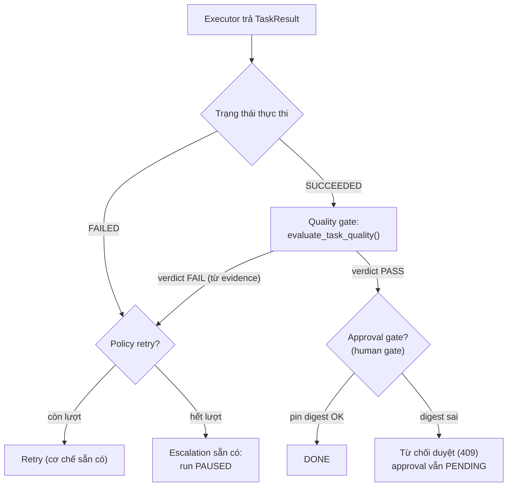

# Quality gate — verdict độc lập, human gate pin phiên bản, reflection (G6)

> Trạng thái: **G6 — đã hiện thực trên `orchestrator`**. Văn bản chuẩn hóa ba chiều
> của bài thuyết trình trên state machine của run coordinator: **trạng thái thực
> thi / verdict theo tiêu chí / quyết định chấp nhận**. Xem thêm
> [hop-dong-executor.md](hop-dong-executor.md) cho hợp đồng kết nối executor và
> [hop-dong-ky-thuat.md](hop-dong-ky-thuat.md) cho giao diện adapter gốc.

## 0. Luận điểm cốt lõi

**Succeeded chưa đủ để DONE.** Executor trả kết quả thành công chỉ là
*trạng thái thực thi*; run chỉ kết thúc khi verdict độc lập (chấm theo tiêu chí
nghiệm thu từ EVIDENCE) đạt và — nếu hợp đồng yêu cầu — con người chấp nhận
phiên bản đã được pin bằng digest.



Ba chiều tách bạch:

| Chiều | Ai quyết định | Không ai được quyền gì |
| --- | --- | --- |
| Trạng thái thực thi | Executor (qua hợp đồng TaskResult) | Không tự ghép verdict, không đổi trạng thái run |
| Verdict theo tiêu chí | `quality_gate.evaluate_task_quality` — chỉ từ EVIDENCE | KHÔNG từ lời tự báo cáo của executor hay Monarch |
| Quyết định chấp nhận | Con người, áp lên **phiên bản đã pin digest** | Không duyệt được phiên bản đã thay đổi |

## 1. Gate trong scheduler (G6-M1)

Điểm nối: `run_service.AdlcRunService._on_executor_state` — sau khi executor trả
`TaskResult SUCCEEDED`, kết quả **bắt buộc** qua gate trước khi task được
DONE (`langflow/adlc/run_service.py`):

1. Không khai báo `acceptance_criteria` → hành vi cũ nguyên vẹn (legacy path).
2. Có tiêu chí + policy cho phép → `evaluate_task_quality()` chấm từng
   criterion (HUMAN/TEST/ARTIFACT):
   - **verdict PASS** → verdict lưu vào `result.metadata["quality_gate"]`, tiếp
     tục sang approval gate nếu có.
   - **verdict FAIL, còn lượt retry** → đi qua `_begin_auto_retry` (cơ chế
     backoff sẵn có), `error.retryable=True`.
   - **verdict FAIL, hết lượt** → result chuyển FAILED với
     `ServiceError(code="QUALITY_GATE_FAILED", retryable=False)` → run vào
     **PAUSED** (escalation sẵn có, không trạng thái mới).

Ràng buộc giữ nguyên: **KHÔNG tạo trạng thái mới** — mọi chuyển tiếp dùng
`TaskRunStatus`/`WorkflowRunStatus` hiện có.

## 2. Verdict độc lập theo tiêu chí (G6-M2)

Hàm chấm: `quality_gate.evaluate_task_quality(run, task, *, criteria, result,
evidence, human_gate_required)` (`langflow/adlc/quality_gate.py`).

Nguyên tắc **chỉ chấm từ EVIDENCE**:

| Loại tiêu chí | Bằng chứng được công nhận | Bằng chứng bị từ chối |
| --- | --- | --- |
| `TEST` | Outcome `PASSED` của testing adapter trong result metadata; evidence `TEST_RESULT` từ Evidence Plane | Summary/text của executor ("trust me"); outcome `FAILED`/`NOT_RUN` |
| `ARTIFACT` | Artifact thực của result; evidence không phải METRIC | Evidence METRIC bookkeeping (`task_completed`) |
| `HUMAN` | Chỉ khi task khai approval gate (AFTER_TASK/ACTION) → chờ duyệt | Khai HUMAN nhưng không có approval gate → FAIL ngay |

Cấu trúc verdict — `TaskQualityVerdict` lưu vào `result.metadata["quality_gate"]`:

```json
{
  "task_run_id": "...", "attempt_id": "...",
  "decision": "PASS | FAIL",
  "criteria": [{"description": "...", "verification": "TEST",
                "status": "PASS | FAIL | HUMAN_REQUIRED",
                "evidence_refs": ["result:metadata:testing", "evidence:...", "artifact:..."]}],
  "reasons": ["Criterion '...' lacks passing test evidence."],
  "evidence_sources": ["evidence_plane", "task_result_artifacts"],
  "evaluator": "adlc-quality-gate",
  "evaluated_at": "..."
}
```

Verdict PASS cũng luôn lưu — DONE phải kèm bằng chứng đã được chấm.

## 3. Human gate pin phiên bản (G6-M3)

Khi approval gate chặn task (`pending_result`, `WAITING_APPROVAL`):

- `_create_approval` ghi `context.payload["artifact_digests"]` = digest
  (sha256 checksum) của **mọi artifact reviewer được nhìn thấy** tại thời điểm
  mở duyệt.
- `approve()` gọi `_verify_approval_artifact_digests` trước khi chuyển trạng
  thái: artifact thay đổi sau khi reviewer mở → raise `AdlcRunStateError`
  (`APPROVAL_ARTIFACT_DIGEST_MISMATCH`), API trả **409**, approval **PENDING**,
  reviewer phải duyệt lại phiên bản mới — không bao giờ duyệt trượt một
  phiên bản không từng xem.
- Lỗi kèm sự kiện runtime `approval_request.artifact_digest_mismatch` cho truy
  vết.

## 4. Reflection sau run (G6-M4)

`langflow/adlc/run_reflection.py` — khi run đến trạng thái terminal
(SUCCEEDED/FAILED), `AdlcRunService` gọi dispatcher mặc định:

1. Projection run → `ExecutionResult` (`StepResult` trên từng task).
2. `get_production_host().dispatch_reflect(...)` — chọn plugin có capability
   `REFLECTION` (Monarch hiện tại).
3. `ReflectionReport` (successes/failures/suggestions) lưu
   `run.metadata["reflection"]`.

Best-effort trên cả 3 đường terminal: `_schedule`, `reject()`,
`expire_due_approvals()`. Reflection là quan sát — **không bao giờ** làm rơi run
(err → log warning, giữ run nguyên vẹn).

## 5. Policy bật/tắt theo cấu hình (G6-M5)

Toàn bộ qua biến môi trường, không hardcode
(`langflow/adlc/quality_gate_policy.py`):

| Biến môi trường | Mặc định | Ý nghĩa |
| --- | --- | ---|
| `ADLC_QUALITY_GATE` | `on` | Master switch của gate |
| `ADLC_QUALITY_GATE_TASK_TYPES` | rỗng (= mọi task type) | Allowlist task type được chấm |
| `ADLC_QUALITY_GATE_EXEMPT_TASK_TYPES` | rỗng | Task type không chấm |
| `ADLC_QUALITY_GATE_EXEMPT_SERVICES` | rỗng | Executor service không chấm |
| `ADLC_QUALITY_GATE_EXEMPT_MOCK` | `on` | Mock execution (metadata `mock=true`) bỏ qua gate |
| `ADLC_RUN_REFLECTION` | `on` | Bật/tắt reflection sau run |

Inject policy bất biến qua constructor: `AdlcRunService(quality_gate_policy=...)`
— env chỉ là nguồn mặc định, test không phụ thuộc môi trường.

## 6. Bằng chứng test (khi viết tài liệu này)

- `tests/unit/adlc/test_run_quality_gate.py` (21 test): verdict fail → PAUSED
  escalation sau retry; verdict pass + human gate + digest đúng → DONE; artifact
  đổi → 409/ex-refuse; reflection cho run thành công lẫn thất bại; tắt gate
  theo policy/env → hành vi cũ nguyên vẹn.
- `tests/unit/api/v1/test_adlc_runs.py`: refusal 409 `APPROVAL_ARTIFACT_
  DIGEST_MISMATCH` qua HTTP API; `metadata.reflection` trên run hoàn tất.
- Hồi quy full `tests/unit/adlc`: bộ failure/error **giống hệt baseline G4**
  (17 failed + 23 errors = cùng 30 test, không regression mới).
