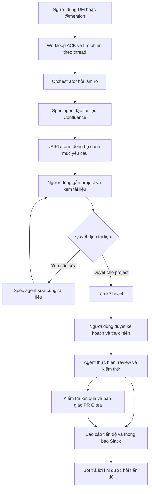

# Xây dựng Slack bot cho quy trình phát triển phần mềm ADLC

Ngày đối chiếu: **11/11/2026**. Tài liệu dựa trên mã vAIPlatform trong project, bản nguồn Workloop đã lưu và hồ sơ kiểm chứng từ 27/10 đến 02/11/2026. Các kết quả chạy được ghi theo thời điểm của hồ sơ; đây không phải lần kiểm tra bot trực tiếp trên Slack ngày 11/11.

Ảnh kiểm tra lại giao diện ngày **16/11/2026** được bổ sung tại [phần 8](#8-ảnh-minh-chứng-ngày-16112026).

Slack bot là điểm tiếp nhận yêu cầu và trao đổi với agent trong ADLC. Workloop quản lý hội thoại và gọi agent; Confluence lưu tài liệu; vAIPlatform tiếp nhận tài liệu, gắn project, phê duyệt, lập kế hoạch và theo dõi thực hiện; Gitea phục vụ quản lý source và bàn giao PR.

## 1. Phạm vi đã triển khai

| Năng lực | Trạng thái trong project |
| --- | --- |
| Nhận DM hoặc được @mention trong channel | Đã có ở bot Workloop `vai-orchestrator-agent` |
| Duy trì phiên hội thoại theo channel/thread | Đã có, liên kết với Harness session và lifecycle |
| Hỏi làm rõ, gọi Spec agent, trả tài liệu Confluence | Đã có đường xử lý bất đồng bộ |
| Đưa tài liệu Slack vào vAIPlatform | Đã có qua danh mục Workloop và polling khi ứng dụng được mở |
| Duyệt tài liệu, yêu cầu sửa, duyệt kế hoạch và thực hiện | Đã có trên giao diện web, kiểm tra quyền và phiên bản |
| Gửi thông báo tiến độ vào thread nguồn | Đã có, cần quản trị viên cấu hình token và bật cho yêu cầu |
| Hỏi tiến độ từ Slack | Đã nối qua báo cáo Confluence riêng của vAIPlatform |
| Block Kit, nút duyệt hoặc chạy lại CI ngay trong Slack | Phần mở rộng; chưa có handler tương ứng trong bản bot đã đối chiếu |

Nguồn: [hành trình Slack → vAIPlatform](slack-document-journey.md), [góp ý và thông báo Slack](slack-revisions-and-notifications.md), [rà soát Workloop](gitea-integration-review-2026-10-28.md).

## 2. Hướng dẫn cài đặt

### 2.1. Chọn Slack App

Project đang dùng app **`vai-orchestrator-agent`**, App ID **`A0CA54Q7FV3`**, workspace **`adlcfactory`**. Với môi trường này, dùng lại app và tiến trình bot hiện có.

Nếu triển khai một Factory mới:

1. Mở [Slack App Management](https://api.slack.com/apps).
2. Chọn **Create New App → From scratch**.
3. Nhập tên đại diện cho Factory, ví dụ `payments-agent`, và chọn workspace.
4. Tạo app, cấu hình quyền và sự kiện như bên dưới.

### 2.2. Cấp quyền

Trong **OAuth & Permissions → Bot Token Scopes**, cấu hình:

| Scope | Mục đích | Khi cần |
| --- | --- | --- |
| `app_mentions:read` | Nhận sự kiện được @mention | Luồng channel hiện tại |
| `chat:write` | Gửi câu trả lời và thông báo | Luồng hiện tại |
| `im:history` | Nhận tin nhắn trực tiếp qua `message.im` | Luồng DM hiện tại |
| `reactions:write` | Thả reaction xác nhận đã tiếp nhận | Bot hiện có sử dụng reaction sau khi kiểm tra Harness |
| `channels:history` | Nhận `message.channels` hoặc đọc lịch sử public channel qua API phù hợp | Khi bổ sung chức năng tương ứng |
| `groups:history` | Nhận `message.groups` hoặc đọc lịch sử private channel qua API phù hợp | Khi bổ sung chức năng tương ứng |

`message.im` yêu cầu `im:history`; cấp quyền lịch sử channel không tự đưa lịch sử đó vào ngữ cảnh agent. Cần có xử lý đọc dữ liệu tương ứng. Xem tài liệu Slack về [DM](https://docs.slack.dev/reference/events/message.im/), [public channel](https://docs.slack.dev/reference/events/message.channels/) và [private channel](https://docs.slack.dev/reference/events/message.groups/).

Tại **Basic Information → App-Level Tokens**, tạo token có scope **`connections:write`**. Đây là quyền của app-level token, không phải Bot Token Scope. Token `xapp-` dùng mở Socket Mode; token `xoxb-` dùng gọi Web API. Xem [hướng dẫn Socket Mode của Slack](https://docs.slack.dev/tools/java-slack-sdk/guides/socket-mode).

### 2.3. Cấu hình Socket Mode và event

1. Bật **Socket Mode**.
2. Bật **Event Subscriptions** và thêm Bot Events:
   - `app_mention`: tiếp nhận yêu cầu được tag trong channel có bot.
   - `message.im`: tiếp nhận DM, không cần tag.
3. Cài app vào workspace và lấy **Bot User OAuth Token**. Khi thay đổi scope, cài lại app để cấp quyền mới.
4. Cho phép người dùng gửi tin trong tab **Messages** của App Home nếu dùng DM.
5. Mời bot vào các channel cần sử dụng; private channel cần được mời rõ ràng.

Socket Mode chuyển sự kiện qua WebSocket nên không cần public HTTP Request URL cho đường nhận sự kiện này. Xem [Slack Socket Mode](https://docs.slack.dev/apis/events-api/using-socket-mode/).

**Hành vi cần hướng dẫn người dùng:** trong channel, bản bot đã đọc chỉ xử lý `app_mention`; reply thông thường không có @mention bị bỏ qua. Để tiếp tục cùng ngữ cảnh, reply trong thread và tag bot. Với DM, tiếp tục trả lời trong thread. Nếu muốn nhận mọi reply trong thread đã mở, cần bổ sung subscription `message.channels`/`message.groups` và bộ lọc thread đang được theo dõi.

**Interactivity & Shortcuts** chỉ cần bật khi triển khai nút tương tác. Việc bật cấu hình này chưa tạo ra chức năng duyệt: bot còn cần handler, liên kết tài khoản, kiểm tra quyền và chống thực hiện lặp. Slack mô tả riêng [luồng xử lý tương tác](https://docs.slack.dev/interactivity/handling-user-interaction/).

### 2.4. Cấu hình trong ADLC

| Thành phần | Cấu hình | Vai trò |
| --- | --- | --- |
| Bot Workloop | `SLACK_APP_TOKEN`, `SLACK_BOT_TOKEN` | Nhận event qua Socket Mode, gửi tin và reaction |
| Bot Workloop | `SLACK_SESSION_REGISTRY` | Đường dẫn lưu liên kết thread/session; mặc định `/workspace/data/slack-sessions.json` trong bản nguồn đã đọc |
| Bot Workloop | `DSH_URL`, `DSH_TOKEN_FILE`, `DSH_PRESET` | Kết nối Harness và chọn preset agent |
| Bot Workloop | `FACTORY_PATH` | Đọc persona orchestrator và cấu hình Factory/project |
| vAIPlatform | `VAI_WORKLOOP_URL`, `VAI_WORKLOOP_MCP_URL` | Kết nối Workloop và các công cụ MCP |
| vAIPlatform | `VAI_SLACK_APP_ID`, tùy chọn `VAI_SLACK_TEAM_ID` | Mở đúng app/workspace Slack |
| vAIPlatform | `VAI_SLACK_WORKSPACE_URL` | Tạo link hội thoại và kiểm tra workspace khi lưu token gửi tin |
| vAIPlatform | `VAI_WORKSPACE_PUBLIC_URL` | Tạo link quay về ứng dụng từ Slack/báo cáo |

Trong vAIPlatform, quản trị viên mở **Cài đặt → Slack & Workloop**, kiểm tra kết nối rồi cấu hình **Thông báo Slack chủ động** bằng token `xoxb-` của chính bot. Server gọi `auth.test`, kiểm tra workspace, mã hóa token và không trả token qua API.

Bot Workloop và bộ gửi thông báo vAIPlatform có thể dùng cùng bot identity; vAIPlatform gửi qua Web API nên không mở thêm Socket Mode listener. Bản tích hợp hiện tại giữ một đường nhận hội thoại, tránh hai tiến trình cùng xử lý. Địa chỉ `127.0.0.1` chỉ phù hợp với máy đang chạy ứng dụng; muốn người khác mở link từ Slack cần đặt địa chỉ web dùng chung. Xem [cấu hình và quyền](vaiplatform-brand-and-slack.md).

## 3. Các điểm mấu chốt trong thiết kế

### 3.1. Một thread gắn với một phiên hội thoại

Khóa hội thoại được xác định theo:

```text
root_ts = event.thread_ts nếu có, ngược lại dùng event.ts
conversation_key = (channel_id, root_ts)
```

Giữ timestamp dưới dạng chuỗi để không làm sai định danh. Tin nhắn đầu tiên chưa có `thread_ts`, vì vậy dùng chính `ts` của nó làm gốc.

- Chưa có liên kết: tạo workspace/session qua Harness, gồm `session/create`, rồi lưu `session_id` và `lifecycle_id`.
- Đã có liên kết và session còn tồn tại: gửi lượt trao đổi tiếp vào cùng session để giữ ngữ cảnh.
- Session không còn tồn tại sau khi Harness khởi động lại: bot mở session mới. Registry không thay thế lịch sử trong Harness và không bảo đảm khôi phục toàn bộ memory.
- Tin nhắn mới ở ô nhập chính tạo thread mới; không tự hiểu đó là phần tiếp theo của yêu cầu cũ.

`session_id` là phiên làm việc của agent. `lifecycle_id` là mã liên kết yêu cầu, tài liệu và tiến độ. `run_id` là một lượt thực thi. Các mã này phục vụ những mục đích khác nhau; một phiên đã trả lời hoặc tài liệu đã được tạo chưa chứng minh có lượt triển khai thành công.

Nguồn: bản bot Workloop đã lưu tại `adlc-flow/data/slack-actions-check/slack_bot.py`, các hàm `_handle_event`, `_process`, `_open_session`, `_ensure_lifecycle`.

### 3.2. ACK nhanh và xử lý ngoài callback

Cần tách hai loại phản hồi:

1. **ACK giao thức:** xác nhận với Slack đã nhận envelope, thực hiện ngay trước tác vụ lâu.
2. **Phản hồi cho người dùng:** reaction hoặc tin “đang xử lý”, sau đó là kết quả trong thread.

Socket Mode vẫn cần ACK nhanh; hướng dẫn SDK của Slack yêu cầu xác nhận trong khoảng 3 giây. Gửi `chat.postMessage` không thay thế ACK envelope. Xem [ví dụ ACK Socket Mode](https://docs.slack.dev/tools/java-slack-sdk/guides/socket-mode).

Bản bot hiện có gửi `SocketModeResponse(envelope_id=...)` trước khi xử lý. Công việc agent chạy ở luồng nền. Bot kiểm tra kết nối Harness rồi mới thả reaction; khi Spec agent chạy bất đồng bộ, bot có tin thông báo đang xử lý. Vì vậy, chưa nên mô tả rằng mọi yêu cầu đều nhận ngay một tin “đang xử lý” trong 3 giây.

### 3.3. Tách hội thoại khỏi tác vụ agent

Orchestrator đọc persona `agents/orchestrator.md` và thông tin Factory/project để xử lý yêu cầu:

- Hỏi đáp: trả lời trực tiếp.
- Yêu cầu chưa rõ: hỏi phạm vi, hành vi, dữ liệu và ràng buộc còn thiếu.
- Đủ thông tin: gọi MCP `call_agent(name="spec", ...)`, truyền ngữ cảnh đã thống nhất cùng lifecycle, channel, thread và user.
- Nhận `invocation_id`: theo dõi bằng `call_agent_status`, rồi gửi kết quả hoặc lỗi vào thread.

Bản nguồn đã lưu dùng tín hiệu nội bộ `PENDING:<invocation_id>` để đánh thức orchestrator kiểm tra tiếp. Mặc định kiểm tra mỗi 60 giây, tối đa 15 lượt; hết lượt kiểm tra không có nghĩa agent đã thất bại hoặc bị dừng. Không đưa tín hiệu nội bộ này thành kết quả nghiệp vụ cho người dùng.

Bot có chế độ Slack yêu cầu dừng ở hỏi đáp/soạn tài liệu; bước triển khai đi qua quyết định của người dùng. Các giá trị model/preset lấy từ cấu hình, không nên ghi cố định một tên model vào hợp đồng chức năng của bot.

### 3.4. Trạng thái có nguồn kiểm chứng

Workloop lưu lifecycle, tài liệu và biên nhận gọi agent. vAIPlatform lưu quyết định, phiên bản tài liệu, project/repo, lệnh lập kế hoạch và lượt chạy. Bot trình bày các dữ liệu đó.

Thông báo chủ động có hàng chờ lưu trong database, gửi về channel/thread nguồn đã kiểm tra. Chỉ ghi **SENT** khi Slack trả biên nhận hợp lệ, đúng channel, thread và timestamp tin nhắn. Khi mất phản hồi sau lúc có thể đã gửi, giữ **UNCONFIRMED**, không tự gửi lại mù. Mã nguồn: [`slack_notifications.py`](../adlc-flow/langflow/adlc/slack_notifications.py).

## 4. Tiêu chí trải nghiệm trong vòng đời phát triển phần mềm

### 4.1. Phản hồi rõ ràng, có bước tiếp theo

Người dùng cần biết yêu cầu đã được nhận, agent đang làm gì và đang chờ ai. Khi cần làm rõ, bot hỏi ngắn; khi có tài liệu, gửi link và hướng dẫn duyệt; khi cần người xử lý, gửi link về đúng yêu cầu trên web.

Bot phải phân biệt “đã tạo tài liệu”, “chờ duyệt kế hoạch”, “đang thực hiện”, “cần phản hồi”, “lỗi” và “chưa xác nhận”. Hỏi tiến độ không tự khởi chạy, duyệt hoặc tiếp tục workflow.

### 4.2. Thông tin dễ quét và chi tiết mở khi cần

**Đã có:** câu trả lời và thông báo dạng văn bản, gồm trạng thái, lifecycle/run khi có, số task, số yêu cầu cần người phản hồi, kết quả kiểm tra, thời điểm cập nhật và link báo cáo/web/PR. Thông báo chủ động không xuất source, log hoặc nội dung câu hỏi.

**Thiết kế mở rộng bằng Block Kit:**

- Dùng section cho trạng thái và kết quả chính.
- Dùng [context block](https://docs.slack.dev/reference/block-kit/blocks/context-block/) cho metadata. Chỉ hiển thị commit, model, token hoặc thời gian thực thi khi có số liệu từ đúng lượt chạy.
- Dùng [divider block](https://docs.slack.dev/reference/block-kit/blocks/divider-block/) để ngăn các phần.
- Dùng code block cho đoạn mã ngắn theo [định dạng tin nhắn Slack](https://docs.slack.dev/messaging/formatting-message-text/); kiểm tra loại payload trước khi cam kết syntax highlighting.
- Dùng link về log/diff trên web hoặc bổ sung modal **Xem chi tiết** cho thông tin dài. Không coi thread lồng nhau hay block thu gọn là chức năng đã có của tích hợp.

Mẫu nội dung thông báo đề xuất; các giá trị bên dưới là minh họa:

```text
vAIPlatform · Thống kê đoàn viên
Trạng thái: Cần bạn phản hồi
Task: 3/5 · Chờ phản hồi: 1
Yêu cầu: <lifecycle_id>
Mở yêu cầu: <đường dẫn vAIPlatform>
Cập nhật: <thời điểm của dữ liệu>
```

### 4.3. Tương tác một lần bấm và Human-in-the-Loop

**Đã có:** người dùng duyệt tài liệu, yêu cầu sửa, duyệt kế hoạch, trả lời câu hỏi/cổng duyệt và xử lý bàn giao trên web. API kiểm tra tài khoản, quyền project và quyền thực thi khi thao tác yêu cầu. Giao diện Slack hiện gửi link về web.

**Mở rộng dự kiến:**

| Thời điểm | Nút dự kiến | Điều kiện thực hiện |
| --- | --- | --- |
| Spec sẵn sàng | Approve Spec / Request Changes | Đúng tài liệu, phiên bản và người có quyền |
| Có PR | View PR on Gitea | Link PR đã được ràng buộc với yêu cầu/run |
| CI lỗi | Run CI again | Quyền phù hợp, đúng PR/head commit, có lệnh chống chạy lặp |
| Agent cần phản hồi | Trả lời / Mở yêu cầu | Đúng request còn chờ, chưa được xử lý ở web |

Project đang bàn giao qua **Gitea**, vì vậy nhãn mặc định là **View PR on Gitea**. Chỉ dùng GitHub khi project thực sự kết nối GitHub.

Để nút duyệt hoạt động đúng cần liên kết Slack user với tài khoản vAIPlatform; kiểm tra chính sách project ở server; ràng buộc action với document/run, phiên bản và digest; lưu người thao tác và thời điểm; xử lý an toàn khi hai người bấm hoặc Slack gửi lại sự kiện. Người tạo yêu cầu chỉ được duyệt nếu chính sách project cho phép, không mặc định có quyền vì đã gửi tin.

Nếu không có quyền, phản hồi riêng cho người bấm, ví dụ: “Bạn chưa có quyền phê duyệt tài liệu này. Hãy mở yêu cầu để xem người có thể duyệt.” Chỉ dùng câu “Chỉ Tech Lead…” khi đó là quy tắc đã được cấu hình. Các kiểm tra quyền ngay trong Slack này còn thuộc phạm vi mở rộng.

## 5. Luồng triển khai trong ADLC



### Bước 1. Tiếp nhận và làm rõ yêu cầu

Người dùng gửi mô tả trong DM hoặc @mention bot. Bot lấy channel/thread, tạo hoặc tìm lifecycle/session và hỏi các thông tin còn thiếu. Các lượt trả lời tiếp tục trong cùng thread; trong channel cần @mention theo hành vi hiện tại.

### Bước 2. Soạn và lưu tài liệu

Orchestrator gọi Spec agent qua Workloop MCP với nội dung đã thống nhất. Agent có thể soạn phân tích yêu cầu, thiết kế chi tiết hoặc thiết kế cơ sở dữ liệu. Bot theo dõi invocation và trả link tài liệu Confluence khi có kết quả. Biên nhận gọi agent thiếu tài liệu hoặc tài liệu không đọc được chưa đủ để chuyển sang duyệt.

### Bước 3. Đồng bộ vào vAIPlatform và gắn project

Hộp **Yêu cầu & tài liệu** lấy danh mục từ Workloop; truy vấn danh sách được làm mới khoảng 10 giây khi giao diện hoạt động. Đây là polling, không phải Slack webhook đẩy trực tiếp vào vAIPlatform. Việc nhập danh mục chung yêu cầu quyền quản trị hiện có.

Người dùng mở tài liệu, kiểm tra nội dung/phiên bản, chọn project Gitea và chỉ dẫn bổ sung. Quản trị viên có thể lưu quy tắc channel → project cho tài liệu mới. Tự gắn project không đồng nghĩa tự duyệt hoặc tự chạy.

### Bước 4. Yêu cầu sửa hoặc duyệt tài liệu

Nếu cần sửa, dùng **Yêu cầu bot sửa tài liệu** trên web. Server kiểm tra nguồn, phiên bản, lifecycle/channel/thread và quyền; lưu mã thao tác rồi gọi Spec agent qua MCP. Chỉ báo có bản mới khi invocation thành công và đúng trang Confluence thực sự thay đổi. Mất phản hồi giữ trạng thái chưa xác nhận để đối soát, tránh gọi model thêm lần nữa.

Nếu tài liệu phù hợp, chọn **Duyệt cho project**. Quyết định được ràng buộc với người duyệt, project/repo, nội dung, phiên bản và phạm vi. Tài liệu hoặc phạm vi thay đổi thì cần duyệt lại; lượt chạy đã tạo giữ bản yêu cầu đóng băng.

**Hai quyết định cần phân biệt:** API duyệt `approved` của Workloop có thể dispatch workflow. vAIPlatform lưu quyết định triển khai riêng và không gọi API đó chỉ để ghi nhận đồng ý, tránh sinh thêm lượt chạy. Xem [`document_intake.py`](../adlc-flow/langflow/adlc/document_intake.py) và [luồng góp ý](slack-revisions-and-notifications.md).

### Bước 5. Lập kế hoạch và duyệt thực hiện

Chọn workflow đã lưu hoặc để agent đề xuất, rồi bấm **Lập kế hoạch**. Hệ thống tạo flow/delivery/run thuộc project, giữ nguồn tài liệu đã duyệt. Người dùng xem sơ đồ task, phạm vi sửa và điều kiện kiểm tra trước khi chọn **Duyệt & thực hiện**. Gửi lại cùng mã lệnh sau lỗi mạng dùng lại kết quả/lượt chạy đã có.

### Bước 6. Thực hiện, review và kiểm thử

Agent thực hiện theo kế hoạch. Trạng thái task, kết quả review, vòng sửa, câu hỏi, xin quyền và cổng duyệt được theo dõi trên web. Khi cần người quyết định, người dùng xử lý ở đúng yêu cầu đang chờ. Kết quả kiểm thử phải gắn với source/lượt chạy tương ứng; agent nói “xong” chưa thay thế bằng chứng test hoặc kiểm tra.

### Bước 7. Bàn giao

Người dùng kiểm tra source diff, kết quả kiểm thử và preview nếu môi trường hỗ trợ. Luồng bàn giao tạo hoặc đối soát PR Gitea, giữ liên kết với lượt chạy và tài liệu nguồn. Merge là quyết định riêng, chịu điều kiện quyền, head/base và kiểm tra của luồng bàn giao; tin nhắn Slack không tự thực hiện quyết định đó. Xem [`project_handover.py`](../adlc-flow/langflow/adlc/project_handover.py).

### Bước 8. Thông báo và hỏi tiến độ trong Slack

Có hai cơ chế bổ sung cho nhau:

- **Thông báo trong hội thoại Slack:** bật theo yêu cầu để bot chủ động báo các mốc như bắt đầu, chờ duyệt, cần phản hồi, lỗi, có bản tài liệu mới hoặc thay đổi bàn giao. Tăng số task hoàn tất đơn thuần không tạo tin liên tục.
- **Tiến độ cho bot Slack:** xuất báo cáo Confluence riêng; bot tìm và đọc báo cáo khi người dùng hỏi. Bộ đồng bộ kiểm tra khoảng 15 giây; lượt đang hoạt động có cơ chế cập nhật thời gian sau 120 giây khi trạng thái không đổi. Đây là nhịp xử lý dự kiến, không phải cam kết độ trễ đầu cuối.

Báo cáo tách khỏi tài liệu nghiệp vụ đã duyệt. Persona orchestrator kiểm tra lifecycle/channel/thread; nếu người dùng hỏi từ thread khác trong cùng channel, cần mã hoặc link yêu cầu để chọn đúng nguồn. Không tìm thấy báo cáo có nghĩa chưa xác minh được tiến độ. Câu trả lời luôn kèm thời điểm dữ liệu và link nguồn. Xem [`document_progress.py`](../adlc-flow/langflow/adlc/document_progress.py) và [persona đã lưu](../integration-sources/factory-wilson/agents/orchestrator.md).

## 6. Xử lý lỗi và vận hành

| Tình huống | Cách xử lý hiện có hoặc yêu cầu vận hành |
| --- | --- |
| Tin do bot gửi, sự kiện hệ thống, nội dung rỗng | Bot bỏ qua để tránh tự hội thoại |
| Harness không truy cập được | Bot báo chưa xử lý được; reaction không được coi là bằng chứng hoàn tất |
| Gửi thông báo bị rate limit | Chờ theo `Retry-After` trước khi thử lại |
| Gửi thông báo mất phản hồi sau lúc có thể đã gửi | Giữ `UNCONFIRMED`, không tự phát lại |
| Token sai, sai workspace, thiếu quyền gửi | Báo lỗi kết nối; kiểm tra cấu hình thay vì báo gửi thành công |
| Tài liệu đổi sau khi duyệt | Hủy hiệu lực quyết định cũ, yêu cầu xem lại |
| Thay đổi channel/thread nguồn | Tắt thông báo để kiểm tra lại đích gửi |
| Workloop/Confluence mất kết nối | Giữ dữ liệu đã lưu để đọc; thao tác cần nguồn mới phải kiểm tra lại |

Sao lưu `intake.sqlite3`, database project/workflow/run và khóa mã hóa server. Với bot Workloop, giữ registry phiên Slack, database lifecycle và dữ liệu Harness liên quan. Chỉ giữ file registry không đủ khôi phục memory của session đã mất.

Trạng thái **đã cấu hình Slack** chưa chứng minh bot đang trả lời. Cờ health của webhook connector phụ có thể tắt khi bot hội thoại riêng nhận Socket Mode; cần đối chiếu đúng tiến trình và hội thoại thực tế. Nếu dịch vụ nội bộ còn truy cập được nhưng Slack/Confluence timeout, kiểm tra kết nối và VPN theo hướng dẫn repository trước khi kết luận token hỏng; giữ nguyên cấu hình VPN.

## 7. Kiểm chứng và phần cần hoàn thiện tiếp

### 7.1. Bằng chứng đã có

- Hồ sơ [kiểm chứng 29/10](slack-demo-readiness-2026-10-29.md) và [30/10](demo-verification-2026-10-30.md) ghi nhận tiếp nhận tài liệu, duyệt theo phiên bản, thông báo Slack thật và báo cáo Confluence. Các lỗi Spec/planning cũng được ghi riêng.
- Hồ sơ [số liệu ngày 02/11](report/runtime-metrics-20261102/README.md) ghi nhận job BE và PR Gitea #13 đã merge ngày 30/10. Hồ sơ đồng thời ghi node merge còn `BLOCKED` trong kết quả engine; không đồng nhất trạng thái engine với kết quả bàn giao được đối soát bên ngoài.
- Project có kiểm thử cho [tiếp nhận và duyệt tài liệu](../adlc-flow/tests/unit/adlc/test_document_intake.py), [sửa tài liệu](../adlc-flow/tests/unit/adlc/test_document_revision.py), [thông báo Slack](../adlc-flow/tests/unit/adlc/test_slack_notifications.py), [báo cáo tiến độ](../adlc-flow/tests/unit/adlc/test_document_progress.py) và [kiểm tra tích hợp](../adlc-flow/tests/unit/adlc/test_workloop_integration.py).

Những bằng chứng này không thay thế nghiệm thu đầy đủ trên mọi project hoặc xác nhận runtime hiện tại đã nhận mọi thay đổi mã nguồn.

### 7.2. Tiêu chí nghiệm thu cho một lần triển khai bot

1. DM và @mention được nhận; bot trả đúng thread, bỏ tin của chính bot.
2. ACK hoàn tất trước tác vụ lâu; người dùng thấy xác nhận tiếp nhận và lỗi nếu không xử lý được.
3. Hai lượt trong cùng thread dùng lại session còn tồn tại; thread khác có ngữ cảnh riêng.
4. Agent nhận đủ thông tin đã làm rõ, tạo tài liệu đọc được và trả đúng link.
5. vAIPlatform tiếp nhận đúng tài liệu/lifecycle, gắn project và chỉ duyệt đúng phiên bản/phạm vi.
6. Sửa tài liệu có biên nhận thật; phiên bản mới được xem lại trước khi triển khai.
7. Gửi lại lệnh lập kế hoạch hoặc kiểm tra biên nhận không tạo thêm run/model call ngoài ý muốn.
8. Thông báo dùng đúng thread, có biên nhận; xử lý đúng rate limit, mất phản hồi và khởi động lại khi gửi.
9. Hỏi tiến độ trả đúng yêu cầu và thời điểm dữ liệu, không tự chạy workflow hoặc suy ra thành công.
10. Bằng chứng test, diff, PR và quyết định merge đối chiếu được với đúng lượt chạy.

### 7.3. Hạng mục mở rộng

- Chuyển thông báo sang Block Kit, thêm link/nút **Mở yêu cầu**, **Xem PR**.
- Bổ sung xác nhận đang xử lý sớm, thống nhất cho mọi loại yêu cầu.
- Nhận reply không cần @mention trong thread đã theo dõi, với phạm vi channel được cấu hình rõ.
- Bổ sung nút duyệt/yêu cầu sửa/trả lời câu hỏi sau khi có liên kết danh tính và kiểm tra quyền đầy đủ.
- Củng cố xử lý event trước khi gọi agent: bản đã đọc có khử trùng `event_id` khi lưu bản sao vào webhook store, nhưng đường xử lý hội thoại vẫn gọi handler sau bước lưu; chưa đủ cơ sở khẳng định mỗi event chỉ chạy agent một lần.
- Bổ sung hàng đợi tuần tự theo thread và lưu registry có kiểm soát đồng thời trước khi mở rộng tải; bản đã đọc tạo một luồng nền cho mỗi event và dùng registry JSON.

Thứ tự hợp lý là hoàn thiện phản hồi/trình bày trước, sau đó mở rộng tương tác có tác dụng thay đổi trạng thái. Mỗi phần dùng lại API và lịch sử quyết định của vAIPlatform để giữ thống nhất giữa Slack và web.

## 8. Ảnh minh chứng ngày 16/11/2026

[Xem bộ ảnh](report/slack-bot-evidence-20261116/index.html) · [Chú thích và nguồn đối chiếu](report/slack-bot-evidence-20261116/README.md) · [Tải gói ZIP](report/slack-bot-evidence-20261116/slack-bot-adlc-evidence-20261116.zip).

Bộ ảnh gồm 18 ảnh minh chứng giao diện và 1 ảnh giới hạn quyền truy cập: yêu cầu và phản hồi Spec trong Slack; tài liệu và báo cáo Confluence; hộp yêu cầu, quyết định duyệt, cấu hình thông báo và sơ đồ task vAIPlatform; lịch sử duyệt Workloop; PR, kết quả test đã lưu và source diff trên Gitea; câu trả lời tra cứu tiến độ của bot trong lịch sử Slack.

Giữ đúng nguồn khi sử dụng ảnh: lượt native của yêu cầu 32 còn **Cần đối soát**, trong khi PR #13 là ví dụ Workloop được đối chiếu riêng và tham chiếu tài liệu 4980813. Workloop ghi node merge `BLOCKED`; mô tả PR ghi 17 test tính năng đạt nhưng toàn bộ bộ test còn 5 failure baseline. Các tin Slack từ 28–30/10 là bằng chứng lịch sử được chụp lại, chưa phải phép thử phản hồi bot mới ngày 16/11.

Chưa có ảnh scopes, Event Subscriptions và Socket Mode trong Slack App Management vì tài khoản hiện tại chưa là Collaborator của app. Giới hạn này được giữ trong ảnh 16. Mỗi ảnh có link nguồn, thời điểm chụp và SHA-256 trong manifest của bộ ảnh.
