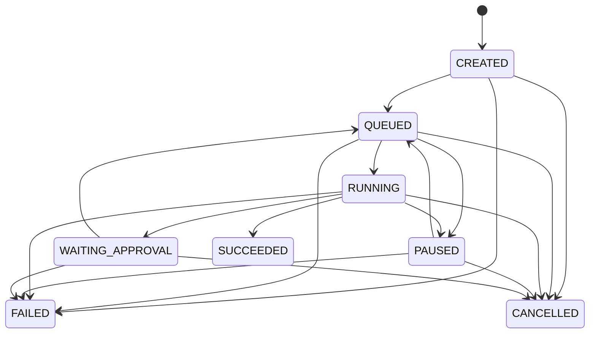
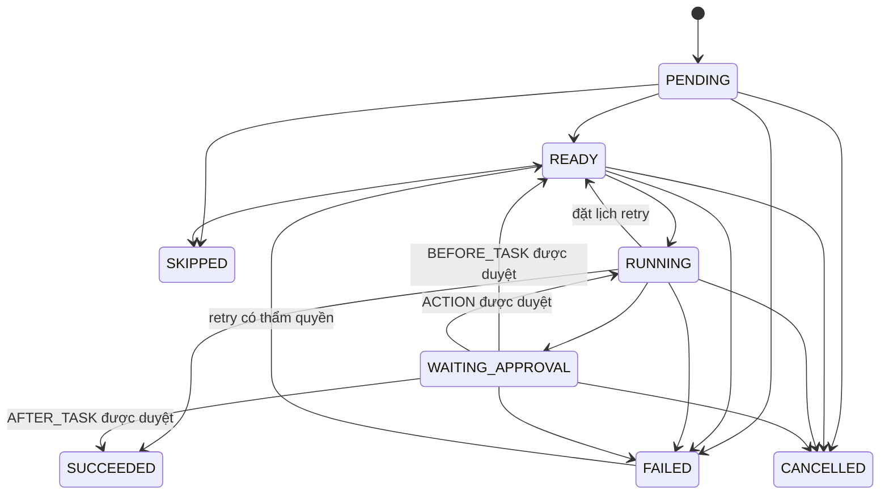
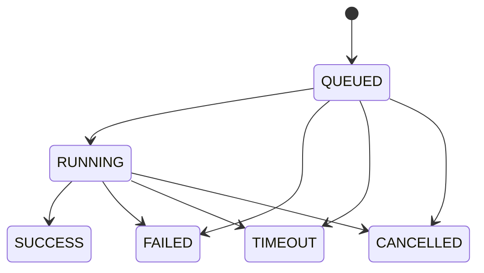

# State machine thực thi ADLC v0.1

Trạng thái: **ĐÓNG BĂNG cho contract v0.1**
Bundle hợp đồng: `adlc-contracts/v0.1/`
Phạm vi: chỉ vòng đời `WorkflowRun` và `TaskRun`. Projection lần thử của Harness bên ngoài được đặc tả riêng trong `adlc-contracts/harness/v0.1/`; không làm thay đổi state machine đóng băng này.

Các từ khóa **MUST**, **MUST NOT**, **SHOULD** và **MAY** mang tính bắt buộc (RFC 2119).

## Quy tắc chung

1. Giá trị trạng thái được tuần tự hóa đúng như chuỗi IN HOA trong tài liệu này.
2. Mỗi thay đổi trạng thái MUST được lưu bền vững nguyên tố (atomically) cùng một `RunEvent`.
3. Mọi chuyển trạng thái MUST khớp với `adlc-contracts/v0.1/state-machines.json`.
4. Giao lại cùng một lệnh MUST NOT áp dụng chuyển trạng thái hai lần. Trình xử lý lệnh MUST đảm bảo tính idempotent.
5. Chuyển trạng thái cũ (stale) MUST bị từ chối bằng `ServiceError` với mã `STATE_CONFLICT`.
6. Dấu thời gian là giá trị UTC theo RFC 3339.
7. Hủy mang tính hợp tác khi công việc đang chạy, nhưng khi đã lưu thành `CANCELLED` thì là trạng thái cuối.
8. Chờ phê duyệt không phải là thất bại và MUST NOT tiêu tốn ngân sách retry.
9. `PAUSED` dành cho việc tạm ngưng cấp run vì lý do không phải phê duyệt. Cổng phê duyệt dùng `WAITING_APPROVAL`.

## WorkflowRun

### Các trạng thái

| Trạng thái | Ý nghĩa |
|---|---|
| `CREATED` | Bản ghi run đã tồn tại nhưng admission và scheduling chưa hoàn tất. Trạng thái khởi tạo. |
| `QUEUED` | Run được chấp nhận, đủ điều kiện để scheduler đối chiếu; chưa có nhiệm vụ nào đang chạy. |
| `RUNNING` | Scheduler hoặc ít nhất một nhiệm vụ đang thực sự tiến triển. |
| `PAUSED` | Việc điều phối bị tạm ngưng có chủ đích vì lý do không phải phê duyệt. Công việc đang chạy phải đạt tới ranh giới pause/cancel an toàn. |
| `WAITING_APPROVAL` | Tiến trình bị chặn duy nhất bởi một hoặc nhiều `ApprovalRequest` đang mở và mang tính chặn. |
| `SUCCEEDED` | Mọi nhiệm vụ bắt buộc đều thành công; nhiệm vụ điều kiện có thể ở `SKIPPED`. Trạng thái cuối. |
| `FAILED` | Workflow không thể tiến triển tiếp vì xác thực, điều phối hoặc một nhiệm vụ bắt buộc thất bại mà không còn đường phục hồi. Trạng thái cuối. |
| `CANCELLED` | Một tác nhân hoặc chính sách có thẩm quyền đã dừng workflow. Trạng thái cuối. |

### Các chuyển trạng thái hợp lệ

| Từ | Đến | Nguyên nhân bắt buộc |
|---|---|---|
| `CREATED` | `QUEUED` | Admission và xác thực graph thành công. |
| `CREATED` | `FAILED` | Admission hoặc xác thực graph thất bại. |
| `CREATED` | `CANCELLED` | Hủy thắng trước khi admission hoàn tất. |
| `QUEUED` | `RUNNING` | Scheduler bắt đầu đối chiếu hoặc điều phối nhiệm vụ sẵn sàng đầu tiên. |
| `QUEUED` | `PAUSED` | Một lệnh tạm dừng có thẩm quyền được chấp nhận trước khi điều phối. |
| `QUEUED` | `FAILED` | Scheduler không thể khởi động run và phân loại thất bại là cuối cùng. |
| `QUEUED` | `CANCELLED` | Yêu cầu hủy được chấp nhận. |
| `RUNNING` | `PAUSED` | Lệnh tạm dừng cấp run có thẩm quyền đạt tới ranh giới an toàn. |
| `RUNNING` | `WAITING_APPROVAL` | Không còn công việc độc lập nào có thể tiến triển và ít nhất một phê duyệt đang chờ. |
| `RUNNING` | `SUCCEEDED` | Mọi nhiệm vụ bắt buộc đều `SUCCEEDED` hoặc `SKIPPED` hợp lệ. |
| `RUNNING` | `FAILED` | Xảy ra thất bại cuối cùng ở cấp workflow hoặc nhiệm vụ bắt buộc. |
| `RUNNING` | `CANCELLED` | Hủy đạt tới ranh giới an toàn. |
| `PAUSED` | `QUEUED` | Lệnh tiếp tục được chấp nhận; scheduler phải đối chiếu lại trước khi điều phối tiếp. |
| `PAUSED` | `FAILED` | Xác thực checkpoint/resume thất bại cuối cùng. |
| `PAUSED` | `CANCELLED` | Hủy được chấp nhận khi đang tạm dừng. |
| `WAITING_APPROVAL` | `QUEUED` | Mọi phê duyệt chặn đã được giải quyết thuận; scheduler phải đối chiếu trạng thái nhiệm vụ. |
| `WAITING_APPROVAL` | `FAILED` | Một phê duyệt bị từ chối/hết hạn theo chính sách fail, hoặc xác thực resume thất bại. |
| `WAITING_APPROVAL` | `CANCELLED` | Run hoặc phê duyệt chặn của nó bị hủy. |

`SUCCEEDED`, `FAILED` và `CANCELLED` không có chuyển trạng thái đi ra. Chạy lại một workflow đã kết thúc tạo ra một `WorkflowRun` mới.

### Projection trạng thái workflow

Coordinator sở hữu `WorkflowRun.status` và MUST chiếu trạng thái theo thứ tự:

1. Giữ trạng thái cuối đã lưu.
2. Dùng `PAUSED` khi lệnh tạm dừng cấp run còn hiệu lực.
3. Dùng `RUNNING` khi có nhiệm vụ đang chạy hoặc vẫn còn công việc độc lập có thể điều phối.
4. Chỉ dùng `WAITING_APPROVAL` khi phê duyệt là rào cản duy nhất của tiến trình.
5. Dùng `SUCCEEDED` khi mọi nhiệm vụ bắt buộc đều `SUCCEEDED` hoặc `SKIPPED` hợp lệ.
6. Dùng `FAILED` khi một nhiệm vụ bắt buộc `FAILED` không thể phục hồi, hoặc scheduler phát hiện lỗi điều phối cuối cùng.
7. Còn lại dùng `QUEUED` sau admission hoặc resume.

Quy tắc này ngăn một workflow song song bị coi là nhàn rỗi chỉ vì một nhánh đang chờ phê duyệt trong khi nhánh khác vẫn đang chạy.

## TaskRun

### Các trạng thái

| Trạng thái | Ý nghĩa |
|---|---|
| `PENDING` | Nhiệm vụ tồn tại nhưng phụ thuộc hoặc điều kiện chưa phân giải xong. Trạng thái khởi tạo. |
| `READY` | Phụ thuộc và điều kiện đã thỏa; nhiệm vụ đủ điều kiện được điều phối. |
| `RUNNING` | Một `TaskAttempt` đang thực thi hoặc đang resume từ checkpoint. |
| `WAITING_APPROVAL` | Đầu vào của con người là rào cản duy nhất: một yêu cầu phê duyệt ADLC đang mở, một tương tác executor bên ngoài đang chờ, hoặc submission có chủ đích của một kết quả đã xác minh. |
| `SUCCEEDED` | Kết quả nhiệm vụ bắt buộc đã được chấp nhận. Trạng thái cuối. |
| `FAILED` | Chính sách retry hiện tại đã cạn hoặc nhiệm vụ thất bại cuối cùng. Chỉ mở lại được bằng retry có thẩm quyền tường minh. |
| `CANCELLED` | Nhiệm vụ đã bị hủy. Trạng thái cuối. |
| `SKIPPED` | Nhiệm vụ không cần thiết vì điều kiện sai hoặc chính sách phụ thuộc chọn nhánh khác. Trạng thái cuối. |

### Các chuyển trạng thái hợp lệ

| Từ | Đến | Nguyên nhân bắt buộc |
|---|---|---|
| `PENDING` | `READY` | Mọi phụ thuộc thành công hoặc được skip hợp lệ, và điều kiện của nhiệm vụ đúng. |
| `PENDING` | `FAILED` | Đánh giá phụ thuộc/định nghĩa sinh ra lỗi cuối cùng. |
| `PENDING` | `CANCELLED` | Hủy nhiệm vụ hoặc workflow được chấp nhận. |
| `PENDING` | `SKIPPED` | Điều kiện sai hoặc chính sách phụ thuộc tường minh bỏ qua nhiệm vụ. |
| `READY` | `RUNNING` | Một worker nhận một lần thử mới và giỏ được quyền thực thi (execution lease). |
| `READY` | `FAILED` | Điều phối hoặc xác thực yêu cầu thất bại cuối cùng. |
| `READY` | `CANCELLED` | Hủy nhiệm vụ hoặc workflow được chấp nhận trước khi điều phối. |
| `READY` | `SKIPPED` | Đối chiếu chứng minh nhiệm vụ không còn cần thiết trước khi điều phối. |
| `RUNNING` | `READY` | Lần thử thất bại, chính sách retry cho phép thử tiếp, và thời gian backoff đã trôi. Lần điều phối kế tiếp MUST tạo `TaskAttempt` mới. |
| `RUNNING` | `WAITING_APPROVAL` | Thực thi tới cổng phê duyệt ADLC, hoặc executor bên ngoài báo một ranh giới tương tác con người/manual-submit có kiểu. |
| `RUNNING` | `SUCCEEDED` | Một `TaskResult` thành công hợp lệ được chấp nhận. |
| `RUNNING` | `FAILED` | Xảyra thất bại cuối cùng hoặc ngân sách retry cạn kiệt. |
| `RUNNING` | `CANCELLED` | Hủy đạt tới ranh giới an toàn. |
| `WAITING_APPROVAL` | `READY` | Một phê duyệt `BEFORE_TASK` được duyệt. |
| `WAITING_APPROVAL` | `RUNNING` | Một phê duyệt `ACTION` được duyệt, hoặc tương tác bên ngoài được giải quyết và cùng lần thử/phiên được resume. |
| `WAITING_APPROVAL` | `SUCCEEDED` | Một phê duyệt `AFTER_TASK` chấp nhận kết quả đã tạo. |
| `WAITING_APPROVAL` | `FAILED` | Phê duyệt bị từ chối/hết hạn theo chính sách fail, hoặc resume checkpoint thất bại. |
| `WAITING_APPROVAL` | `CANCELLED` | Nhiệm vụ, workflow hoặc phê duyệt bị hủy. |
| `FAILED` | `READY` | Một retry thủ công có thẩm quyền tường minh mở lại cùng `TaskRun`; bắt buộc tạo `TaskAttempt` mới. |

`SUCCEEDED`, `CANCELLED` và `SKIPPED` không có chuyển trạng thái đi ra. `FAILED -> READY` là chuyển "hồi sinh" duy nhất và MUST NOT được thực hiện bởi callback của executor; nó đòi hỏi lệnh từ coordinator, có thẩm quyền, và sự kiện `task_run.retry_requested`.

Với executor Harness bên ngoài, `WAITING_APPROVAL` là một projection lên state machine task v0.1 hiện có. Một tương tác Harness đang chờ không phải là `ApprovalRequest`, không mang thẩm quyền phê duyệt, và được giải quyết qua endpoint phản hồi có kiểu theo phiên. Chính sách phê duyệt của workflow tiếp tục dùng `ApprovalRequest` riêng biệt.

## State machine CommandExecution

`CommandExecution` theo dõi một tiến trình cụ thể do agent hoặc adapter kiểm thử khởi tạo bên trong sandbox hiện có. Nó phụ thuộc vào `TaskRun`: một lần thử nhiệm vụ có thể chạy không, một hoặc nhiều lệnh, và một lệnh kết thúc không trực tiếp chuyển trạng thái nhiệm vụ.

| Từ | Đến | Điều kiện / ý nghĩa |
|---|---|---|
| `QUEUED` | `RUNNING` | Runner chấp nhận yêu cầu và khởi động tiến trình. |
| `QUEUED` | `FAILED` | Xác thực, tra cứu sandbox hoặc khởi chạy tiến trình thất bại trước khi start. |
| `QUEUED` | `TIMEOUT` | Hạn chờ hàng đợi/deadline hết trước khi tiến trình start. |
| `QUEUED` | `CANCELLED` | Hủy được chấp nhận trước khi tiến trình start. |
| `RUNNING` | `SUCCESS` | Tiến trình hoàn tất với exit code `0`. |
| `RUNNING` | `FAILED` | Tiến trình hoặc runner thất bại. Exit code khác 0 thường rơi vào trạng thái này. |
| `RUNNING` | `TIMEOUT` | Lệnh vượt quá `timeout_ms`. |
| `RUNNING` | `CANCELLED` | Hủy chạm tới tiến trình đang chạy. |

`SUCCESS`, `FAILED`, `TIMEOUT` và `CANCELLED` là trạng thái cuối. `SUCCESS` cấp lệnh chỉ ánh xạ tới `SUCCEEDED` cấp nhiệm vụ sau khi adapter sở hữu chấp nhận mọi kết quả lệnh bắt buộc và trả về một `TaskResult` thành công.

## Quy tắc phê duyệt

`ApprovalRequest.gate_type` cố định chuyển trạng thái thành công của nhiệm vụ:

| Loại cổng | Ý nghĩa | Chuyển khi được duyệt |
|---|---|---|
| `BEFORE_TASK` | Cần con người phê duyệt trước khi điều phối. | `WAITING_APPROVAL -> READY` |
| `ACTION` | Lần thử đang chạy được checkpoint trước một hành động nhạy cảm. | `WAITING_APPROVAL -> RUNNING`, dùng cùng lần thử và checkpoint. |
| `AFTER_TASK` | Công việc hoàn tất nhưng cần xác nhận trước khi chấp nhận. | `WAITING_APPROVAL -> SUCCEEDED` mà không thực thi lại nhiệm vụ. |

Các bất biến bổ sung:

- Một nhiệm vụ CÓ THỂ có nhiều yêu cầu phê duyệt lịch sử nhưng MUST có tối đa một yêu cầu chặn đang mở.
- Quyết định phê duyệt là bất biến.
- `APPROVED` MUST tham chiếu một hành động có hiệu lực `APPROVE`; `REJECTED` MUST dùng `REJECT`.
- Từ chối hoặc hết hạn MUST tạo `ServiceError` (`APPROVAL_REJECTED` hoặc `APPROVAL_EXPIRED`) trước khi nhiệm vụ chuyển `FAILED`.
- Hủy nhiệm vụ hoặc workflow MUST hủy yêu cầu phê duyệt đang chờ của nó.
- Duyệt cổng `ACTION` MUST tái dùng cùng `attempt_id`; duyệt `BEFORE_TASK` chỉ dẫn tới lần thử mới khi điều phối diễn ra.

## Các sự kiện trạng thái bắt buộc

Mỗi thay đổi trạng thái phát ra một sự kiện với tên riêng cho trạng thái đích như bảng dưới. `previous_status` và `status` trong sự kiện MUST khớp với chuyển trạng thái đã lưu.

| Aggregate | Đích / hành động | `RunEvent.event_type` |
|---|---|---|
| WorkflowRun | `CREATED` | `workflow_run.created` |
| WorkflowRun | `QUEUED` | `workflow_run.queued` |
| WorkflowRun | `RUNNING` | `workflow_run.started` |
| WorkflowRun | `PAUSED` | `workflow_run.paused` |
| WorkflowRun | `WAITING_APPROVAL` | `workflow_run.waiting_approval` |
| WorkflowRun | `SUCCEEDED` | `workflow_run.succeeded` |
| WorkflowRun | `FAILED` | `workflow_run.failed` |
| WorkflowRun | `CANCELLED` | `workflow_run.cancelled` |
| TaskRun | `PENDING` | `task_run.created` |
| TaskRun | `READY` từ trạng thái khác `FAILED` | `task_run.ready` |
| TaskRun | `RUNNING` | `task_run.started` hoặc `task_run.resumed` |
| TaskRun | `WAITING_APPROVAL` | `task_run.waiting_approval` |
| TaskRun | `SUCCEEDED` | `task_run.succeeded` |
| TaskRun | `FAILED` | `task_run.failed` |
| TaskRun | `CANCELLED` | `task_run.cancelled` |
| TaskRun | `SKIPPED` | `task_run.skipped` |
| TaskRun | Tự động `RUNNING -> READY` | `task_run.retry_scheduled` |
| TaskRun | Thủ công `FAILED -> READY` | `task_run.retry_requested` |

Sự kiện tạo dùng `previous_status: null`. Mọi sự kiện trạng thái khác đều bao gồm cả hai trạng thái. Phát sự kiện là at-least-once; phía tiêu dùng khử trùng lặp theo `event_id` và áp dụng sự kiện theo thứ tự `sequence` trong phạm vi workflow.

## Ngoài phạm vi v0.1

- API `TaskAttempt` bền vững đa dụng. Bản nháp ranh giới Harness chỉ định nghĩa projection lần thử bên ngoài.
- Các trạng thái compensation/rollback.
- Thành công cục bộ của workflow.
- Di chuyển nhiệm vụ giữa các worker khi lần thử đang chạy.
- Tự động retry workflow run đã kết thúc.

Bổ sung bất kỳ trạng thái hoặc chuyển trạng thái nào đòi hỏi một phiên bản contract mới. Bản triển khai MUST NOT tự chế chuỗi trạng thái cục bộ.
